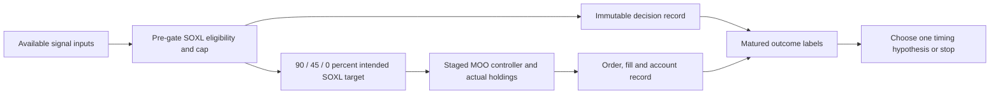

# SOXL-only entry, reentry and exit review

Scope: bounded read-only review of saved evidence and one proposed research
direction. **Zero financial runs, downloads, network access or broker operations.**
The eight-case allowance remains exhausted. This note does not reopen it.
The [research standard](../research-standard.md) owns experiment approval and
evidence; [decision logs and outcome labels](../research-development.md#decision-logs-and-outcome-labels)
owns the general logging contract. This is a SOXL-specific application, not another
policy owner or readiness claim.

## Finding and preferred next action

**Recover auditable daily decisions and execution evidence before selecting a
timing modification.** The saved native summaries establish a descriptive gate
benefit, but cannot identify whether remaining losses came from late exits,
failed entries, missed rebounds, exposure drift or staged execution.

The implementation already changes its target intent when either SOXL eligibility
or the risk cap changes. Consequently, “reenter when the light improves” alone is
not a new mechanism. The controller's waiting, affordability and fill behavior
must be distinguished from the signal's intent.

## Saved evidence inventory

Reviewed [eight-case report](2026-10-30-t11-soxl-cloud-results.md), private
`.local/t11-soxl-cloud-v1/analysis.json`, its eight `main.py` files and the
gated25bp source's audit, intent and rebalance methods. Source text was read only;
no private implementation was copied into this public note.

| Evidence | Saved state | Supported conclusion / missing prerequisite |
| --- | --- | --- |
| Case identities and source hashes | Eight completed unique cases; all eight source hashes match analysis records | Case/source binding passes this local comparison; not proof of accounting truth |
| Native performance summaries | Eight cases, two cost contexts | Compare native summary conventions only; not an account reconciliation |
| Annual custom summaries |43 of48 rows | Identify years worth investigating; cannot locate trades or decision errors |
| Official downloaded results | All eight marked unverified | Daily equity and additional order detail need actual exports; do not assume exports contain a decision trace |
| Daily equity | Built in source memory; saved daily path unverified | Summary fragments are not recoverable daily paths |
| Decisions / gate transitions | Source computes inputs and aggregate counts/hash | No saved day-by-day causal decision record for these eight cases |
| Orders / fills | Source counts statuses and order types | No saved order-event ledger linked to decisions or reconciled account path |
| Holdings / cash / financing | Aggregate maxima/minima and financing logic | Missing daily position/cash/debit ledger; target weights are not realized weights |
| Temporal metrics | Some legacy longest-underwater summaries | No complete recovery-inclusive temporal-v1.2 comparison |

At25bp the gated SOXL-only native Calmar is1.271 versus1.137 ungated, with
48.9% versus52.8% native drawdown. In2022 the custom annual return is approximately
−28.99% gated versus−47.27% ungated. These observations do **not** identify the
particular exits that helped or rebounds missed. Full gated T11 is a separate
external benchmark, with native Calmar2.492 and drawdown36.9% in the matched fresh
25bp case; its alternative assets prevent treating the gap as timing attribution.

## SOXL-specific decision and outcome requirements

Keep decision inputs, execution and future labels in separate append-only records,
linked by `run_id`, source/config/data hashes, stable `decision_id` and session.
These fields are **proposed for prospective capture**, not present in the saved
eight-case evidence. Historical reconstruction must explicitly mark its origin.

| Record | SOXL-specific minimum fields |
| --- | --- |
| Decision | UTC decision time; exchange session/time zone; source bar session and actual availability time; intended eligible execution session; warmup/missing/stale state; original T11 branch reason and pre-gate SOXL eligibility; prior/current gate state and cap; proposed base and capped SOXL target; prior holdings, cash and NAV; transition reason; unchanged-intent versus new-intent flag |
| Controller / execution | Decision-to-intent mapping; pending intent version; sell-first/wait/buy state; prior open orders; submission and acknowledgement times; order IDs, signed quantities, status changes and fill times/prices; rejected/unknown orders; target-share rounding; affordability clipping; realized post-fill SOXL weight; fees/slippage and separate financing debit |
| Account | Opening and closing cash/shares/prices/NAV; raw marks and corporate actions; debit accrual dates; gap return; cash/position/NAV reconciliation residuals; market-calendar identity |
| Outcome | Fixed5/21/63 observed-session horizons, maturity timestamp, right-censoring and unavailable reasons; actual account return; separate SOXL reference return and maximum favorable/adverse excursion; prior observed21-session decline as rebound context; future-path label; cost and exposure context |

One warning is not one trade. Separate events into:

- Eligibility exit while holding; cap reduction while holding; and warning while
  already in cash. Already-cash means both base target and prior actual shares are
  zero; an exit day must not receive that label.
- Eligible entry/reentry intent, actual filled entry, and unfilled/deferred entry.
  A signal missed because of a pending order is an execution question.
- Signal-change time, submission time, fill time and first observable performance
  interval. Future opens cannot enter a preceding-close decision.

“Premature exit” is an ex-post candidate label: an actual exit followed by a
positive SOXL reference path at the frozen horizon. “Failed entry” requires a
filled entry and negative subsequent reference outcome. “Missed rebound” requires
the predefined prior decline, no/less actual exposure, and a subsequent positive
reference outcome. Also retain avoided losses, adverse excursions, near ties,
censored windows and unfilled entries. None is proof that the decision was wrong
using information available then. Overlapping labels are not independent samples;
their returns cannot be summed into attributed dollars.

The reference continuation path does not establish matched-capital avoided loss.
Precise incremental net P&L requires matched causal paths with identical
accounting, costs, financing and initial wealth, plus reconciled actual exposure.
Store outcome labels after maturity; never feed future outcomes into a decision.

## One conditional hypothesis, not selected for execution

**Eligibility-exit confirmation:** an isolated one-session loss of original SOXL
eligibility may generate exit/reentry costs and miss a continuing positive move.
This is worth testing only if recovered logs show that these events are frequent
and economically material after adverse moves and costs. It is not evidence that
confirmation is generally safer; delayed exits may worsen losses.

The proposed single change is inside position proposal: while actually holding
SOXL, retain the last eligible proposal through the first consecutive completed
close that loses original SOXL eligibility. Exit on the second consecutive loss;
reset the counter on recovered eligibility. Preserve original entry/reentry rules.
The unchanged risk stage applies its current cap on every proposal; red still
requests zero immediately. Missing/stale/unready inputs do not receive retention.
Sizing, controller, fills, instruments, data and accounting stay unchanged. This
is a position-proposal memory rule, not a new risk override or extra stop.

Before freezing any financial test, source review must prove the retained proposal
does not leak other T11 branches into SOXL. Synthetic checks must cover first and
second ineligible close, recovered eligibility, red during retention, yellow cap,
cash without prior holdings, missing inputs and restart restoration of the counter.

Falsification: reject if logs do not show a material isolated-exit/cost mechanism,
or a matched challenger fails the frozen Calmar/growth/drawdown/recovery screen.
Do not threshold-search after seeing outcomes. This viewed history cannot supply
untouched validation, and improvement may simply be higher participation.

## Proposed future bounds and controls

**Not authorized or executable here.** First recover the daily evidence, accounting
and free-input identities; then choose numerical materiality and exposure controls
under the canonical standard. A possible ceiling is one worker, two hours and six
financial cases total, zero retries: unchanged gated SOXL/cash, confirmation variant,
and a frozen participation control, each at25/50bp. Failed cases count; exhausted
budgets stop the cycle. No borrowing from the closed eight-case allowance.

The participation-control rule is intentionally **unresolved**, rather than calling
a fixed half-size control exposure-matched. Freeze it from a declared earlier
development window or a predeclared causal rule before challenger evaluation;
report actual time invested, realized gross exposure and turnover. If it cannot
match exposure credibly, restrict conclusions to the combined timing/exposure
tradeoff rather than timing skill. Existing buy-and-hold and full T11 are contextual
references until fresh same-engine/accounting evidence is available.

Preserve2020-01-02–2025-12-31, USD10000, original native adjusted instruments and
gate seed,90% base target, staged signal-change MOO controller, IB fees, matched
25/50bp affordability reservations,6% ACT/360 debit on prior cash and zero credit
interest. No daily target maintenance is introduced. Qualified calendar, actions,
input availability and native accounting remain gates, not assumptions silently
certified by this proposal. All dates were viewed; chronological subdivisions are
development diagnostics and may not be renamed an untouched holdout.

Report same-convention full-path Calmar with CAGR, drawdown, temporal-v1.2 time
underwater and evidence status; annual metrics and worst1/5/21/63-session returns
are secondary. Include initial capital in peak tracking and retain undefined
ratios. Freeze growth/recovery/materiality thresholds before any new outcomes.
No acceptance claim, promotion or paper-order readiness follows from this note.

## Verification and disposition

Read-only local check confirmed8 completed cases, zero retries,8 matching source
hashes,43 annual rows, and all eight official-export/daily-equity/order-ledger
verification flags false. No saved records were changed. Documentation validation
is reported by the coordinator after integration. Preferred next task remains
decision evidence recovery and attribution; the timing modification stays a
conditional hypothesis, not a selected financial experiment.
