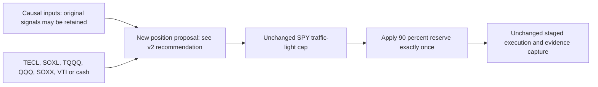

# T11 long-equity universe extension

Design ID: **T11-LONG-UNIVERSE-20261030-01**. The requested permitted choices are
TECL, SOXL, TQQQ, QQQ, SOXX, VTI and cash. This record scopes a new variant;
original T11, SOXL-only variants and saved evidence remain unchanged. Selection
semantics were initially pending; the user then delegated the choice with further
research. The [source review and v2proposal](2026-10-30-t11-universe-research.md)
now recommend a group-aware momentum selector. No selector implementation or
financial comparison is claimed; the original v1design stays unchanged.
The [stage procedure](../research-development.md#individual-stage-development)
and [GRS](../research-standard.md) own implementation and evaluation requirements.

## What the extension changes

Treat the list as the complete tradable universe unless the user specifies a
bullish-branch-only extension. The list removes original inverse/volatility and
defensive positions and adds unleveraged alternatives. It is therefore a new
long-equity/cash variant, not faithful full T11 reproduction. Cash means actual
unallocated USD; do not replace it silently with BIL or another security.
Observing a symbol for original T11 signals does not permit trading it.

The original basket already contains TECL, SOXL and TQQQ. Merely subscribing to
QQQ, SOXX and VTI does not define when to select them. The initial alternatives,
retained for design history, were:

- A fixed trend/relative-strength selector among the permitted ETFs, retaining
  the existing risk gate. This replaces position proposal and needs exact ranking,
  eligibility, selection count, timing and tie rules.
- Original T11 branches with explicitly specified leveraged/unleveraged mappings.
  The original policy does not supply those new mappings; excluded branches
  cannot be assigned discretionary substitutes after viewing results.
- Preserve the original bullish basket and send excluded branches to cash. This
  is a narrow projection but does not make the newly listed ETFs active choices.

Keep gate, reserve, accounting and execution unchanged in the first comparison.
A raw-return ranking of leveraged and unleveraged funds can mostly choose higher
embedded leverage. It needs simpler/exposure-aware controls before claiming
target-selection skill. Additional ranking or state-dependent aggressiveness
must not be stacked into the same claimed single-stage improvement.

## Local coverage inspection and bounds

The saved private preview plan lists TECL, SOXL, TQQQ and QQQ, but not SOXX or
VTI. This is a plan-token inventory, not a bar/action/calendar quality audit.
The existing preview is unqualified for orders and does not provide the original
full historical T11/bootstrap reference. No relevant symbol token was found in
the inspected public pilot/sector manifests; this does not prove no other local
file or free source exists. No acquisition was attempted.

[Machine-readable design](../../research/plans/t11-long-equity-universe-v1.design.json)
records permitted instruments, unresolved selection, unchanged downstream
contracts and **zero allowed/used financial cases**. Proposed portfolio weights
must be finite long-only NAV fractions summing at most one, with cash residual;
the execution reserve and gate are applied once. Missing causal input behavior
must be resolved before the selector is implemented or financially tested.

## Checklist and handoff

- [x] Record requested universe and distinguish positions from signal symbols.
- [x] Inspect original allocation and gate/controller boundaries read-only.
- [x] Inventory explicit coverage in saved preview and inspected manifests.
- [x] Preserve old sources, experiments and financial budgets.
- [x] Resolve selection direction: user delegated research/design; v2recommends
  group-aware risk-adjusted momentum, with numerical rules still proposed.
- [ ] Implement that selector and meaningful synthetic interface/failure checks.
- [ ] Qualify complete inputs, daily capture and accounting before any new study.
- [ ] Separately freeze comparable controls, costs, metrics and finite financial
  bounds if a backtest is requested. No performance improvement or leaderboard
  promotion is inferred from this design.

This is an open design handoff, not closure of a financial research cycle.
Actual validation: parse/read-back of design JSON and documentation checks; no
selector implementation, tests, downloads, uploads or financial runs.
