# Three isolated T11 research sessions

User approved gated T11 as primary, ungated T11 control, three isolated worktrees
including current uncommitted research, and four hours/twelve financial cases per
lane (36 aggregate maximum). This is a finite initial research wave, not a promise
of beating T11 or permission to renew exhausted budgets automatically.
The [machine contract](../../research/plans/t11-parallel-research-20261030.json)
owns benchmark identities, comparison criteria, scope and pending-session records.

```mermaid
flowchart TD
    P[Coordinator: shared benchmark, bounds and integration] --> M[Market conditions and recovery]
    P --> S[Target and strategy selection]
    P --> R[Portfolio risk and sizing]
    M --> B[Qualified baseline handoff]
    B -. read only .-> S
    B -. read only .-> R
    M & S & R --> E[Own sealed evidence, failures and lesson]
    E --> C[Coordinator checks matched context and updates one leaderboard]
```

## Benchmark and evidence limits

Official18215 references: gated T11 Calmar2.494123529, CAGR92.0276%, DD36.8978%;
ungated Calmar2.334664398, CAGR119.6664%, DD51.2564%, over2020-01-02–2025-12-31.
Use the same USD10000,25bp friction, original fee/financing/intent-controller model,
and matched input/accounting conventions. The current sector result near1.03 is a
different context and is not a substitute benchmark. Full raw/corporate-action and
feature/execution qualification remains incomplete; existing exports prove aggregate
compatibility only. Do not request the same result downloads again.

The new local research route needs transparent validated daily decisions and
accounts. If original trace recreation is impossible, a qualified restatement must
be explicitly labeled and compare against fresh matched T11 controls; it never
proves original daily parity. No right to export raw vendor prices or publish
private third-party code is inferred. The contract freezes a10%Calmar screen at
25/50bp with growth/depth/recovery guards; observed development is not untouched OOS.

## Ownership and finite iteration

Each lane owns its worktree, journal and task evidence. Primary source/private
artifacts are read-only; credentials, broker state and accounts are excluded.
The market lane owns benchmark qualification to avoid three duplicate acquisitions.
The other lanes can research/implement/test contracts while it works. Parent/coordinator
alone integrates verified handoffs into the canonical primary leaderboard.

Use GRS-1.1, research-management and stage-development skills. Freeze one stage,
controls, timing, evaluator and remaining bounds before each cycle; count failed
financial starts. No automatic reset or silent retry. A readiness task does not
win the goal, and another period/cost/exposure cannot be called a T11 win.
No paid resources, broker actions, services/deployment, commits or publication.

## Dispatch checklist

- [x] Read current benchmark evidence and preserve prior exhausted budgets.
- [x] Obtain benchmark, bounds and current-worktree preferences from user.
- [x] Queue three actual worktree forks; verify latest research/skills were copied.
- [x] Verify `.env.alpaca`, ignored private evidence and virtualenv were not copied.
- [x] Freeze lane ownership and the shared benchmark/comparison contract.
- [ ] Resolve actual child thread IDs after asynchronous fork setup.
- [ ] Set distinct titles, dispatch lane-specific bounded goals and inspect startup.
- [ ] Verify actual lane goals, source isolation and financial usage before claims.
- [ ] Supervise qualified handoffs and integrate evidence/lessons, preserving failures.

At this checkpoint, the three worktrees exist, but child thread registration and
research dispatch are still pending. Zero financial cases launched by this wave.
The source checkout is not listed in the app's saved projects; the supported
worktree-fork route preserves its actual current uncommitted research.

## Dispatch recovery evidence

A fresh app registry check still returns no child thread IDs for the three existing
worktrees. The source repository is absent from saved projects, and no project
registration API is available. The computer-control tool denied access to the
Codex app, so UI registration cannot be completed by this executor. This is a
dispatch blocker, not a running research process or a financial readiness verdict.
No duplicate forks, substitute simulations or budget resets were launched.

The [three ready-to-send lane assignments](../../research/plans/t11-parallel-research-20261030.launch.json)
are saved with `sent: false` and `goal_verified: false`. No lane deadline has
started; zero of 36 financial cases have been used. Resume only after actual
child IDs are returned, or after the user adds this repository as a saved project
and the supported launch route can be used. Preserve the existing worktrees.

## Blocked audit

At 2026-10-30T07:53:53.355814+00:00, the app registry again returned only the source Quant trading
chat for this checkout and no matching saved project. The same dispatch blocker
has persisted for at least three consecutive goal turns. The coordinator goal is
blocked, not complete; all three lane goals remain unstarted and all 36 cases
remain unspent. Existing worktrees and prepared assignments are preserved.
Resume on the registration change described above; do not relaunch duplicate forks.
