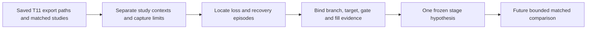

# Why the headline remains 2.494

Classification: descriptive diagnosis of saved development evidence. No new
financial runs, parameter changes, downloads, broker operations or promotion.
The [leaderboard](../leaderboard.md) remains the single ranking owner; this report
explains its unchanged incumbent, rather than creating another ranking.

## Main finding

2.494 is the best saved T11 development Calmar, not a demonstrated performance
ceiling or an expected future score. Repeating the unchanged control reproduces
its number. Most historical local SPY/sector work challenged different parents,
periods, exposures and cost assumptions; it did not incrementally improve T11.
The latest two directions removed or replaced major T11 behavior, and lost much
more return than drawdown. A longer checklist or more agents is not evidence of
more information about the incumbent's marginal weaknesses.

## What the experiments actually distinguish

| Evidence | Observed finding | Interpretation limit |
| --- | --- | --- |
| [Original gate transfer](2026-10-26-qc504-t11-gate.md) | Calmar2.3347→2.4941; CAGR119.67%→92.03%; DD51.26%→36.90% | Improved ratio with less wealth and slower recovery; no exposure-matched timing-skill proof |
| [SOXL/cash](2026-10-30-t11-soxl-cloud-results.md) | Full gated T11 dominates SOXL-only variants at both costs; 2022full gated return+60.62% vs gated SOXL/cash−28.99% | Removing defensive, inverse and other tactical branches is a large policy change; annual results alone cannot identify asset/branch PnL |
| [Six-ETF selector](2026-10-30-t11-universe-comparison.md) | 25bp selector Calmar0.3497 vs full T11 2.4941; selector DD38.50% exceeds full36.90% | Monthly252-session ranking replaced tactical proposal; not merely an expanded bullish basket |
| Same selector vs simpler equal-family control | Selector lowers DD51.28%→38.50% and underwater795→774days, but CAGR16.00%→13.46% | A local benefit exists without beating T11; missing exposure/restricted controls remain missing |
| [Sector epoch3](2026-10-30-calmar-epoch3-experience-report.md) | Correlation selection and breadth gate both lose to their sector incumbent | Negative evidence for those fixed rules on that portfolio, not proof every breadth or correlation model fails |

The last wave consumed ten slots for four unique completed policy/cost cases:
three input-qualification failures, one rejected save, one unknown submission,
and five completed runs including a reporting rerun. Repeated controls and
report repairs are necessary evidence costs, but they are not independent new
strategy discoveries. Capture reliability must improve before allocating another
financial comparison. All original failures remain in that study's receipt.

## Saved-path diagnosis

Recomputed using the previously validated official-export candidate closing paths
under `.local/t11-reference-v2/export-review-v2/`. These paths have1508matched
sessions plus an explicit2019-12-31USD10000anchor. No simulation or data fetch.
[Reproduction script](../../scripts/diagnose_t11_saved_paths.py) writes private
JSON under `.local/t11-diagnosis-v1/saved-path-diagnosis.json`, with source hashes.
The canonical temporal implementation includes recovery; old legacy durations
remain preserved in older studies.

1. **The gate moved the dominant loss episode rather than eliminating it.**
   Ungated worst drawdown was51.26% in February–March2020. Gated worst drawdown
   was36.90% from2024-09-06to2025-03-13, recovered2025-06-26. Ungated recovered
   its corresponding2024–2025episode on2025-04-09. Gated underwater duration is
   200sessions/293days versus147/215:53sessions and78calendar days longer.
2. **The drawdown problem includes a sharp loss as well as slow recovery.**
   On2025-01-27the gated closing-path return was−14.7825%; ungated was−14.7829%.
   The gate did not materially cushion this observed account loss. Daily decisions
   are missing, so this does not identify its colour, exact holdings or gap PnL.
3. **The gate also displaced upside.** On2025-04-09the gated path gained14.67%
   versus28.61% ungated; on2020-03-24gated wasflat versus+9.66% ungated.
   These are retrospectively selected examples, not prospective entry signals.
   Different holdings, turnover, fees and compounding prevent attributing the
   daily gap exclusively to the gate state without the decision/account trace.
4. **Strong and weak periods differ sharply.** Gated2024return was228.44%, but
   2025return was−0.64%.2024contributed30.37% of its total six-year log growth.
   Its ten largest positive daily log returns contributed28.44% of total log
   growth (denominator includes losing days). This is concentration of observed
   growth, not an arithmetic profit share or a remove-best-days backtest.
5. **Execution costs are material.** In the prior same-engine SOXL wave, full
   gated T11's native rounded Calmar fell2.492→1.713 at25→50bp, and native CAGR
   91.961%→68.515%. That is a separate native-metric context, not a custom-score
   subtraction. Costs also change quantities/orders; it is not a fixed-trade fee
   decomposition. Current gate/full paths accrued no debit financing, so financing
   improvement is not supported as the main explanation for this plateau.

## Where to investigate next, before another financial test

Preserve the full T11 policy. The next analysis should join, for each session:
observed inputs and branch ID → proposed instruments/weights → gate colour/cap
→ submitted orders/fills → realized holdings/cash → next-period account change.
Use the2024–2025drawdown,2025-01-27loss, recovery through2025-06-26, and earlier
counterexamples. These slices are exploratory because we selected them after
inspection; any later test needs separate generalization evidence.

Priority questions:

- Did the SPY-based market gate miss concentrated leveraged-target risk?
- Did a blanket cap suppress defensive/inverse branches or delay a useful rebound?
- Were next-open staging, turnover or market gaps responsible for a material loss?

These are hypotheses, not diagnosed causes. The source applies a common cap to
all T11 branches, including defensive/inverse positions, so branch-conditioned
risk treatment is a plausible one-stage candidate. Preserve the branch selection
first; do not replace it with a slower unrelated selector while calling it a small
extension. A future experiment must choose one mechanism after the trace review.

## Metric objective and stopping discipline

Calmar=CAGR/absolute full-period maximum drawdown. With92.03%CAGR unchanged,
reducing DD to30% would imply Calmar≈3.07; this is arithmetic, not a forecast.
A target2.75 would require DD≈33.46% at unchanged CAGR, or CAGR≈101.47% at
unchanged DD. Neither is an achieved result. Smoother sizing alone need not
improve the ratio, especially if it sacrifices rebound days.

Keep CAGR, drawdown, recovery and cost stress beside Calmar. Do not optimize
only the date defining historical max drawdown, declare annual reset DD a30%
full-path limit, or treat repeatedly viewed2020–2025history as independent OOS.
The immediate outcome is a prioritized evidence gap, not a new winning algorithm.

## Verification and remaining evidence

- [x] Read original gate, SOXL, selector and sector negative-result studies.
- [x] Recompute canonical temporal measures and annual log-growth concentration
  from preserved reference paths; check matching calendars,1508rows and ending NAV.
- [x] Bind diagnostic source/output hashes in the companion evidence note.
- [ ] Original daily branch/gate/feature trace and independent full account replay.
- [ ] Exposure-matched and complete matched-cost marginal-stage comparisons.
- [ ] Untouched prospective/generalization evidence and operational readiness.

No leaderboard score changed because diagnosis did not create a financial case.
