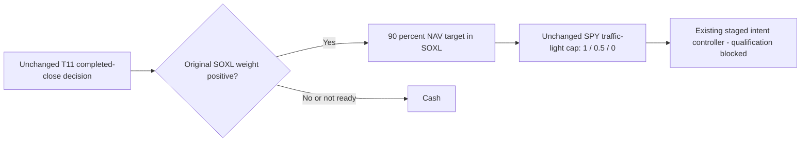

# T11 signals with SOXL or cash

User selected SOXL or cash using unchanged T11 signals and risk gate.
The [scoped design](../../research/plans/t11-soxl-cash-v1.json) owns this variant;
[GRS](../research-standard.md) continues to own research acceptance.

## Implemented and verified

A pure allocation projection is implemented in
[selection.py](../../research/studies/t11_soxl_cash/selection.py). It does not copy
private T11 indicator/rule code or implement orders. Green/yellow/red imply
90/45/0 percent SOXL target, with the remainder cash. Other T11 branches,
including oversold TQQQ/SPXL and inverse/defensive choices, map to cash.
The gate and 90 percent reserve must each be applied once; the existing controller
must consume this final NAV target without applying either again. Target weights
are not actual continuously maintained holdings or guaranteed loss limits.

Three synthetic tests passed for concentration, cap/reserve application, no input
mutation, alternative branches, not-ready state and invalid inputs. The saved
2026-10-29 unqualified preview projects to90 percent SOXL /10 percent cash. This
is a snapshot transform, not a historical test, present signal or order proposal.
The [engineering evidence](evidence/2026-10-30-t11-soxl-cash-preflight.json)
preserves that distinction. Original snapshots and experiments remain unchanged.

## Proposed bounded comparison and blockers

Four cases at25/50bp (eight proposed cases): original gated T11, ungated SOXL/cash,
gated SOXL/cash and90 percent initial SOXL buy-and-hold. Match2020–2025 dates,
USD10000 capital, fees, staged execution and financing. Compare annual/full-period
returns, drawdowns, Sharpe/Calmar, recovery/censoring and costs. No parameter sweep.
Use actual SOXL history and corporate actions; no synthetic three-times index.

Financial execution is disabled: full causal T11 inputs/gate seed, qualified staged
accounting/execution and source-use rights remain unresolved. The recent preview
has414 sessions and cannot fill those gaps. A transparent restatement must be
qualified and labeled against freshly matched controls; it cannot prove original
historical daily parity. The eight-case design does not consume or reset the
separate pending36-case session allowance. Zero financial runs, downloads, broker
connections or orders were performed. No measured leaderboard row is warranted.

Lesson: reducing traded instruments to one does not reduce the upstream information
needed to reproduce the original multi-instrument T11 decision policy.

Validation: `make check` passed (583 tests plus documentation/catalog and dependency checks). These are offline engineering checks, not financial runs.

## Explicit test request: cloud route

The user subsequently requested testing. A separate own QuantConnect project
38676621 (Virtual Orange Wolf) was created; original38484741 source remains
unchanged. The free coding slot was switched to the new project. Eight private
case sources are compiled and frozen under `.local/t11-soxl-cloud-v1/`; AST
normalization verifies no undeclared method change outside selection, case/study
labels and the two matched cost settings. The current cloud engine is18217,
so fresh gated T11 controls are required; old18215 scores are not new controls.

Automatic approval review rejected the first upload because private local strategy
source would be sent to QuantConnect without explicit payload/destination approval.
No upload completed; no case build or financial run started. The user has been
asked to approve these eight private files to their own project solely for bounded
backtesting. No alternate upload path was attempted.

[Blocked experiment receipt](evidence/2026-10-30-t11-soxl-cloud.json). The local
source and existing negative evidence remain preserved. This cloud preflight
does not remove the original local reproduction blockers or demonstrate performance.

## Eight requested cloud tests executed

After explicit upload approval, all8 bounded cases completed once on LEAN18217.
[Provisional results and lessons](2026-10-30-t11-soxl-cloud-results.md) distinguish
native observations from custom partial summaries and missing daily/export audits.
No strategy promotion; no financial slots remain. Original preflight evidence and
failed upload receipt are preserved.
