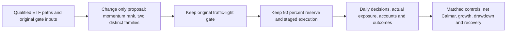

# T11 universe: research-led selector proposal

**Completed source review; proposed selector, zero financial cases.** The user
delegated the selection decision and requested further research. This replaces
the pending choice in the [initial universe handoff](2026-10-30-t11-long-equity-universe.md),
while preserving its original design bytes. [GRS](../research-standard.md),
[feature conventions](../feature-engineering.md) and
[stage development](../research-development.md#individual-stage-development)
retain policy ownership. No published result below has been reproduced here.

## Recommendation

Test **group-aware, risk-adjusted momentum position selection** before changing
the existing risk gate or adding ML. Six ticker choices are not six independent
economic exposures. The selector should not simultaneously count QQQ and TQQQ,
or SOXX and SOXL, as separate diversification opportunities. The declared groups
still have overlapping holdings; they do not create broad asset-class diversity.

Call this candidate **GATE-RS1**, a T11-gate-derived strategy. Replacing original
T11's position proposal removes its branch logic; this is not a faithful T11
upgrade whose old metrics can carry over. Full gated T11 remains an unchanged
comparison. A selector may lose the oversold-rebound opportunities or alternative
branches that made T11 strong. This risk must remain in the final lesson.

## What published research supports, and what it does not

Sources accessed October30,2026; official publisher, author, issuer and regulator
sources only. Public reading does not grant source-code or data redistribution.

- Moskowitz, Ooi and Pedersen's **Time Series Momentum** finds a12-month trend
  effect across futures markets. It motivates positive-trend eligibility, but
  does not test our six long-only ETFs, traffic-light gate or Calmar objective.
  Our cross-sectional ranking, volatility window and family constraints are
  project hypotheses, not a reproduced version of that paper.
  [AQR article](https://www.aqr.com/Insights/Research/Journal-Article/Time-Series-Momentum).
- **A Century of Evidence on Trend-Following Investing** expands historical
  trend evidence across markets. Its diversified multi-asset construction is
  materially different from a US equity/technology-heavy universe; do not
  transfer its diversification or crisis results to this list.
  [AQR article](https://www.aqr.com/insights/research/journal-article/a-century-of-evidence-on-trend-following-investing).
- **Volatility-Managed Portfolios** provides a research precedent for using risk
  information. This proposal uses volatility only in the ranking score, not a
  new dynamic allocation model. The NBER landing-page search was accessible but
  direct opening returned403; no unseen methodological detail is asserted.
  [Moreira and Muir](https://www.nber.org/papers/w22208).
- Counterevidence matters: Cederburg and coauthors evaluate103 equity strategies
  and do not find systematic outperformance from volatility management in direct
  comparisons; implementable out-of-sample combinations disappoint. This is not
  a direct test of our selector, but it argues against treating risk scaling as
  an automatic improvement. The publisher page returned403; the author-hosted
  paper was readable. [Author copy](https://www.lehigh.edu/~xuy219/research/COWY.pdf).
- SEC/FINRA explains daily-reset compounding: multi-day leveraged ETF returns can
  differ substantially from a fixed multiple of the underlying. Dividing a
  momentum score by observed volatility does **not** fully remove leverage,
  compounding, cost or concentration effects.
  [SEC alert](https://www.sec.gov/files/investor/pubs/leveragedetfs-alert.htm).

Issuer checks support the family interpretation, with historical qualification:
TQQQ targets3x daily Nasdaq100; current SOXL and SOXX materials reference the
NYSE Semiconductor Index. Direxion announced SOXL's switch from PHLX to ICE on
or about August25,2021. Do not assume today's benchmark identity over all history
or reconstruct SOXL by multiplying SOXX returns. Use actual fund paths, record
benchmark changes and audit actions.
[TQQQ](https://www.proshares.com/our-etfs/leveraged-and-inverse/tqqq),
[SOXL](https://www.direxion.com/product/daily-semiconductor-bull-bear-3x-etfs),
[SOXX factsheet](https://www.ishares.com/us/literature/fact-sheet/soxx-ishares-semiconductor-etf-fund-fact-sheet-en-us.pdf),
[SOXL benchmark-change announcement](https://www.direxion.com/uploads/Direxion-Changes-Index-for-Semiconductor-ETFs.pdf).

## Exact first candidate, not an optimized result

[Design v2](../../research/plans/t11-long-equity-universe-v2.design.json) owns the
proposed numerical rule. It is explicitly non-executable and does not supersede
an incumbent research version.

1. Use actual, qualified total-return ETF histories. For each fund, calculate
   trailing252-session return and trailing63-session annualized sample volatility.
   The score is return divided by volatility; this is not a Sharpe ratio.
2. At the completed month-end decision, retain positive-return candidates,
   sort by score and ticker tie-break, and choose at most two distinct families:
   technology TECL; semiconductors SOXL/SOXX; Nasdaq100 TQQQ/QQQ; broad US VTI.
3. Give each winner half the normalized proposal. With only one eligible family,
   keep the unused half in cash rather than double concentration. With none,
   propose cash. All six remain permitted choices; cash is a balance, not BIL.
4. Persist that monthly proposal. Apply the unchanged daily SPY traffic light and
   downstream90% reserve exactly once, then the unchanged staged next-open controller.
   No new daily momentum exit, reentry delay, exposure maintenance or financing
   model is bundled into this test. Red remains a zero target; gate recovery can
   restore the persisted eligible monthly proposal.

The252/63windows, two choices and monthly cadence are declared research choices,
not numbers selected by a backtest. They count as one proposed rule configuration.
No parameter neighborhood is authorized. Require253 complete causal closes for
all six before ranking; missing/stale/future data invalidates the affected case
rather than silently improving its history by cash substitution. Zero volatility
is undefined, never an infinite winning score.

This first selector does **not** cleanly separate economic-family forecasting
from leverage choice: ranking actual ETFs can choose a leveraged wrapper. A
passing result therefore establishes only an allocation tradeoff until exposure
analysis is credible. A later distinct study could rank unleveraged economic
signals first and test wrapper choice separately; it is not silently included now.

## Comparison that can falsify it

Propose five fixed policies at25/50bp, at most10future cases, one worker,
three-hour launch limit and zero retries. These are proposed bounds, not an
activated allowance. All previous exhausted budgets remain closed.

- Fresh full gated T11: external research benchmark, unchanged.
- Restricted original T11: keep only permitted weights; excluded weights become
  cash without renormalization. This isolates removal of original branches.
- Fixed equal-family allowed-universe proposal plus gate: quarter each in
  technology, semiconductor, Nasdaq and broad-US families; split the two paired
  families equally between their wrappers. Existing controller semantics apply,
  so this is not daily equal-weight maintenance.
- GATE-RS1: the single proposed selector change.
- Half-sized fixed equal-family control: a simple risk-reduction reference,
  explicitly **not** an exactly exposure-matched timing control.

Match dates2020-01-02–2025-12-31, USD10000, original gate seed, actual actions,
fees, fill/affordability assumptions and6% ACT/360 prior debit financing. Already
viewed history is development evidence, even if subdivided chronologically.
No untouched result or statistical significance is inferred from six correlated
ETFs. Different wrapper choices require reported realized and approximate
underlying exposures; fewer tickers does not prove lower economic concentration.

Proposed screen before any outcomes: at both costs, Calmar at least10% above the
restricted-T11 and fixed equal-family controls, CAGR at least90% of each, no
deeper drawdown and no longer recovery-inclusive underwater sessions/calendar
days. Report full T11 head-to-head separately and say plainly if we fail to beat
it. These are prospective study guards, not a change to the mandate. No growth
retention percentage guarantees an acceptable live outcome. Preserve annual
returns/DD/Sharpe/Calmar, worst1/5/21/63-session returns, turnover, fees, exposure
and censored recovery, with complete reconciled daily paths.

Stop on failed input/capture/accounting integrity before launching remaining
cases. Reject a failed joint screen rather than add features until the same
history passes. A better Calmar due only to reduced participation is not proof
of better target-selection skill.

## Prior evidence and what to build first

The [SOXL-only review](2026-10-30-soxl-parallel-review.md) found no daily decisions
or independently reconciled ledger for the eight cloud cases. Full T11's stronger
summary cannot identify which discarded branch caused the gap. Existing
[epoch3 failures](2026-10-30-calmar-epoch3-experience-report.md) also reject the
assumption that more breadth gates or correlation-aware selection necessarily
help. This proposal uses a different fixed equity ETF universe, but momentum and
volatility-adjusted ranking are not new mechanisms to the project; do not label
this as an untouched research family or reset its trial history.

Next bounded engineering task, before finance:

- Qualify missing SOXX/VTI and full six-fund history/actions/warmup, plus the
  original gate seed and as-of availability. Free data and permitted local use
  remain prerequisites. The existing preview's symbol plan is not qualification.
- Implement a pure selector with deterministic family/tie rules, invalid-input
  handling, causal-prefix/future-mutation checks and monthly-state restoration.
- Add decision, rank, rejected-candidate, actual-position, intent/fill and account
  capture before another financial comparison. Distinguish signal inputs from
  labels and simulated account values. Verify no double cap/reserve and preserve
  actual next-open execution alignment.
- Only after readiness passes, freeze the executable study and obtain the new
  scoped financial allowance/route. No upload, replay or financial launch occurred
  in this research review. ML or dynamic aggressiveness is deferred until a
  simple selector's failure mode justifies another stage.

## Validation and disposition

Source and saved-document review only; original strategy/source/results and the
v1design are preserved. v2JSON parse and contract checks plus documentation
validation were performed. No selector code, fitting, synthetic portfolio tests,
market-data acquisition, backtests, orders or deployments. The proposal selects
a research direction; performance improvement is unassessed. No metric-row change
or leaderboard promotion is appropriate for this open design handoff.

[Review evidence](evidence/2026-10-30-t11-universe-research.json) binds source
references, design/report identities, checks and explicit blockers. This is a
source/design review receipt, not an experiment result receipt.
