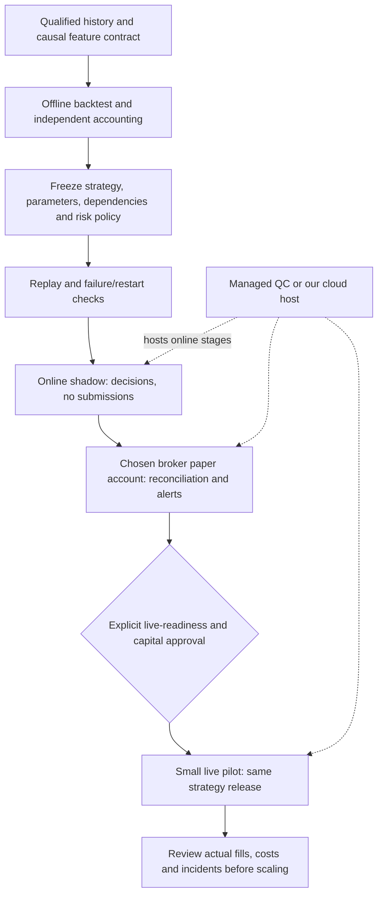

# Research to paper to live: deployment options and monthly cost review

**Dated source review, accessed October30,2026.** USD prices, before tax. This is
a planning report, not an approved architecture change, subscription or deployment.
The [architecture](../architecture.md), [golden research standard](../research-standard.md),
[IBKR observation SOP](../operations/paper-connection.md) and
[Alpaca paper SOP](../operations/alpaca-paper.md) retain policy ownership.

## Findings and corrections

**Neither Alpaca's paid data plan nor QuantConnect is compulsory.** We have three
credible architectures: self-host NautilusTrader with Alpaca; self-host it with
IBKR; or use managed LEAN hosting on QuantConnect with a simulator/broker adapter.
The appropriate comparison is total cost plus qualification and operating work,
not a broker data price alone. These are documented platform capabilities, not
evidence of adoption by a particular proprietary trading firm.

Earlier estimates omitted inexpensive IBKR data and a verified managed quote.
They also blurred the optional Alpaca data upgrade with free paper access.
Free app quotes do not establish API entitlements. A short paper observation
establishes operational evidence, not profitability or realistic live fills.

## Monthly comparison

Self-host totals use a DigitalOcean2–4GiB VM at$12–$24 and weekly backups at20%,
giving$14.40–$28.80 infrastructure. Included disk is50–80GiB. These sizes are
**budget assumptions, not measured capacity**; concurrent research/MLflow/Gateway
may need more. [VM pricing](https://www.digitalocean.com/pricing/droplets),
[backup pricing](https://www.digitalocean.com/pricing/backups).

| Route, one active algorithm | Platform / host monthly | Data monthly | Fixed monthly planning subtotal | What it buys / important qualification |
| --- | ---: | ---: | ---: | --- |
| NautilusTrader + Alpaca Basic | $14.40–$28.80 including weekly VM backup | $0 | **$14.40–$28.80** | Free broker paper environment and limited real-time IEX feed; our adapter still needs substantial work |
| NautilusTrader + Alpaca Algo Trader Plus | $14.40–$28.80 | $99 | **$113.40–$127.80** | Broader real-time feed; optional, not a paper-trading entry fee |
| NautilusTrader + IBKR, US equity A/B/C reference coverage | $14.40–$28.80 | $4.50 eligible nonprofessional reference | **$18.90–$33.30** | Conditional account/data entitlement; additional Gateway operating work; no paid Alpaca required |
| QuantConnect + QuantConnect paper brokerage | $34 observed monthly configuration | $0 QC US equity provider | **$34** | Managed LEAN live node with simulated fills; does not validate IBKR/Alpaca execution integration |
| QuantConnect + IBKR paper or live | $34 observed monthly configuration | Broker entitlement dependent; illustrative $4.50 if choosing A/B/C | **$34 plus applicable data; $38.50 illustration** | Managed LEAN and broker route; broker/account/authentication requirements remain |
| QuantConnect + Alpaca paper or live | $34 observed monthly configuration | $0 QC provider if selected; Alpaca feed entitlements separate | **$34 plus any selected extras** | Managed LEAN with actual Alpaca paper/live connection; not our Nautilus implementation |

All totals exclude transaction/financing costs, engineering/operator time,
independent alerting, extra archive storage, redundant servers, overages, AI
subscriptions, paid datasets and account capital. No plan is purchased. Do not
add self-host VM costs to a fully managed QC route unless running an additional
service. No permanent free cloud-hosting offer is assumed.

AWS Lightsail independently lists Linux public-IPv4 bundles at$12 for2GB and$24
for4GB; backup charges need a separate estimate. Thus changing between these two
providers alone does not remove our basic compute expense. Promotional credits
and IPv6-only prices are excluded from comparisons.
[Lightsail pricing](https://aws.amazon.com/lightsail/pricing/).

## Broker and data findings

**IBKR.** Its published nonprofessional A/B/C Level1 rates are$1.50 each/month.
The ordinary individual data-subscription equity minimum is$500 **plus the
subscription charge**, not a monthly fee or a universal paper-activation deposit.
Market-data professional classification differs from IBKR Pro brokerage pricing.
The pricing page advertises free non-consolidated app quotes but says delayed
US equity quotes are unavailable to Interactive Brokers LLC clients. Do not
promise free delayed API data across jurisdictions.
[Data pricing and eligibility](https://www.interactivebrokers.com/en/pricing/market-data-pricing.php).

The API documentation generally requires paid subscriptions for market data,
with a delayed-watchlist exception where available. It also documents unavailable
historical instruments, exchange-move gaps, pacing restrictions and filtered bars.
IBKR therefore is not a complete historical research database for all instruments.
[API data limitations](https://www.interactivebrokers.com/docs/tws-api/doc/md/market-data-limitations).

IBKR's third-party FAQ specifies a funded Pro account; data is attached to the
username and can be shared with paper. The same socket API serves paper and live
sessions. Gateway/TWS requires a GUI for authentication; truly GUI-less operation
is not officially supported. Community container tooling does not erase that
support boundary. Verify account type, jurisdiction, API permissions, exact
contracts and data entitlements before fixing the final quote.
[Third-party API requirements](https://www.interactivebrokers.com/docs/third-party-integrations/general-third-party-frequently-asked-questions).

**Alpaca.** Paper access is free. Paper-only users receive IEX data. Its simulator
omits market impact, latency slippage, queue priority, regulatory fees and
dividends; paper P&L cannot replace a reconciled research account path.
[Paper specification](https://docs.alpaca.markets/us/docs/paper-trading).
Basic Trading API data is free, with IEX real-time coverage and30 websocket
symbols; Plus is$99/month with all US exchanges and unlimited subscriptions.
Basic historical access excludes the latest15minutes, distinct from its live
IEX stream. The documented historical span begins2016, which alone cannot provide
our original2004 SPY gate bootstrap. [Data plans](https://docs.alpaca.markets/us/docs/about-market-data-api).

For eligible self-directed US securities API accounts, Alpaca advertises
commission-free trading, with regulatory fees and account/partner exceptions.
It does not imply zero execution cost or universal live-account eligibility.
[Commission disclosure](https://alpaca.markets/support/commission-clearing-fees).

## QuantConnect quote and boundaries

Read-only inspection of the existing monthly pricing configurator showed one
Researcher seat **$10/month** plus one **L-MICRO live node $24/month**, total
**$34/month**. Checkout buttons were not pressed. This is a single configured
monthly quote, not a guarantee that the smallest node fits our workload or that
every dataset/add-on is included. Annual-billing savings were shown but no annual
contract was verified or assumed. [Pricing configurator](https://www.quantconnect.com/pricing).

The QuantConnect US equity provider documentation describes consolidated SIP
coverage, live corporate actions and free provider pricing. This cloud entitlement
does not establish permission to download/redistribute its data for our own host.
Exact symbol/history/feed support still needs review.
[QC US equity provider](https://www.quantconnect.com/docs/v2/cloud-platform/datasets/quantconnect/us-equities).

Quant Researcher organizations can rent live nodes for real or paper trading;
cloud backtesting access alone is not a free always-on node. Each additional
simultaneous deployment needs suitable resources: two$24nodes plus one$10seat
would be$58/month before extras, conditional on the same observed node pricing.
[Tier features](https://www.quantconnect.com/docs/v2/cloud-platform/organizations/tier-features).

QC's own paper brokerage feeds current data into modeled fills without a broker
account. It is different from connecting to the broker's paper account. It tests
the hosted algorithm, not broker acknowledgements or broker reconciliation.
[QC simulator](https://www.quantconnect.com/docs/v2/cloud-platform/live-trading/brokerages/quantconnect-paper-trading).
QC also documents Alpaca paper/live environments.
[QC Alpaca integration](https://www.quantconnect.com/docs/v2/cloud-platform/live-trading/brokerages/alpaca).

QC's IBKR integration requires Pro and IB Key. Its documented Sunday
reauthentication remains a user responsibility; missed authentication can stop
the algorithm. Managed hosting does not make authentication disappear.
[QC IBKR integration](https://www.quantconnect.com/docs/v2/cloud-platform/live-trading/brokerages/interactive-brokers).

## Costs beyond the fixed bill

IBKR's first US stock volume tier lists$0.0035/share with$0.35minimum for Tiered;
Fixed lists$0.005/share with$1minimum. Tiered third-party fees, order/routing
conditions and the account's actual schedule apply. For illustration only,
20qualifying100-share orders give$7 Tiered base commission before pass-through
charges, or$20Fixed; this is arithmetic, not a forecast of our strategy's turnover.
[Stock commissions](https://www.interactivebrokers.com/en/pricing/commissions-stocks.php).

Monthly economic cost is:

```text
hosting + platform + data + backups/alerts
  + broker/regulatory fees + spread/slippage
  + actual margin debit interest + borrow/FX costs if used
```

Our historical6% debit financing assumption is not a current broker quote.
No borrowing estimate is possible without actual debit balances/rates and holding
times. Holding a leveraged ETF is distinct from borrowing in the broker account;
do not add fictional broker interest merely because SOXL has embedded leverage.
Estimate actual turnover and debit balances from qualified orders/accounts before
claiming one broker is cheaper overall. Account deposits remain the user's capital,
not software expenses. A public dashboard/domain or managed database is optional,
not a prerequisite for one trading process.

## Pipeline and what can stay identical



Nautilus documents shared strategy/execution-algorithm code across backtest/live,
but explicitly distinguishes transport, timing, persistence and reconciliation.
That is architectural support, not evidence that our pinned1.231.0 runtime has
verified every current upstream behavior.
[Live concepts](https://nautechsystems.github.io/nautilus_docs/latest/concepts/live/).
Its current IBKR adapter documents data/execution/history and optional Gateway
management. Our pinned-version capability audit and actual observer remain the
owners of what works locally.
[IBKR adapter](https://nautechsystems.github.io/nautilus_docs/latest/integrations/interactive_brokers/).

Keep strategy version, features, decision timing, risk semantics and decision-log
schema identical. Configure data adapter, simulated versus broker execution,
account/credentials, capital and environment-specific limits separately. Warm
indicators and restore strategy state; reconcile real positions/open orders before
accepting new orders. Broker paper balances/positions do not transfer into live.
Do not equate changing a port or endpoint with a completed release process.

## Operational differences we must actually test

IBKR paper uses top-of-book simulated fills, has unsupported order types and
simulated complex orders. Its guide requires funding before paper provisioning.
Our exact staged market-on-open behavior needs contract-specific verification;
the guide's general auction limitation alone does not prove every MOO request
is unsupported. [IBKR paper guide](https://www.ibkrguides.com/clientportal/aboutpapertradingaccounts.htm).
Automatic restart can fail or require renewed manual authentication; plan an
owner and a no-new-orders response to failed reconnects.
[Restart considerations](https://www.ibkrguides.com/traderworkstation/auto-restart-considerations.htm).

Recommended acceptance checklist, a proposal linked to existing SOP ownership:

- [ ] Establish account/market permissions and qualified causal inputs, including
  actions, warmup and matching backtest/live bar conventions.
- [ ] Demonstrate matching decisions on the same frozen inputs; distinguish
  expected broker fills from algorithm decision differences.
- [ ] Persist intent before submission; unknown timeout is not rejection. Reconcile
  by stable identity before any retry; test partial fills/rejections/cancellations.
- [ ] Restore positions, cash, pending orders, strategy state and risk counters
  after restart; prevent duplicate decisions/submissions.
- [ ] Exercise stale/missing data, holiday/DST, disconnect, insufficient buying
  power and corporate-action scenarios with deterministic safe behavior.
- [ ] Capture daily decisions, fills, holdings, costs and account reconciliation;
  alert on missing sessions, stale inputs, unknown submissions and divergence.
- [ ] Prove state-preserving recovery from backup and process failure; restore
  must reconcile broker state before submissions resume. A VM backup is not an
  order journal or a tested recovery procedure.
- [ ] Freeze capital/exposure/order limits, escalation/stop/resumption authority,
  monitoring owner and a supervised observation plan. A proposed2–4week paper
  period is a planning starting point only; relevant events and fault coverage
  matter more than elapsed time. A quiet month is not robust profitability evidence.
- [ ] Obtain a separate explicit live approval; start with separately approved
  small capital, compare real costs/fills and increase only after review. No live
  amount or promotion rule is authorized by this report.

## Fit with our project and recommended sequence

**Implemented evidence:** saved offline studies and reporting/MLflow; pinned
Nautilus1.231.0 with IB integration imports/configuration; IB data-only observer;
narrow Alpaca one-share SPY paper client with offline/fake-broker checks. Source:
[capability audit](../capabilities.md) and the two operational SOPs linked above.

**Unverified/blocked:** successful IBKR account/quote/execution qualification;
general restart-safe execution; completed T11 multi-ETF paper runner; matching
historical/live features and fully reconciled T11/SOXL daily decisions/accounts.
The Alpaca client hardcodes paper and rejects unsupported general restart/report
paths; it cannot currently switch to live by changing configuration. No strategy
is made operational by this price review. Current SOXL research gaps are retained
in the [parallel review](2026-10-30-soxl-parallel-review.md).

**Recommendation, not a purchase:** shortlist two routes before paying:

1. **Near-term hosted T11 observation:** QC at the verified$34 monthly configuration
   is worth qualifying first because our frozen T11 source already runs in LEAN
   cloud and the user does not want Mac hosting. Start with its simulator for
   algorithm/hosting checks, then the intended broker's paper account for actual
   API workflow checks. Verify node capacity, exact timing and evidence capture.
2. **Independent Nautilus/IBKR route:** if IBKR is the intended live broker, qualify
   its API and modest data subscriptions directly. At a4GiB DigitalOcean planning
   size with weekly backup and the$4.50data reference, fixed cost is$33.30/month,
   before extras. At that scale QC's$34 is comparable; operator work matters more
   than the$0.70difference. Retain this route for ownership/control, not because
   a generic$99Alpaca bill is unavoidable.
3. **Alpaca Basic remains useful:** retain the free account as an integration
   sandbox. Do not buy Plus unless the qualified input/strategy requirements
   justify it. Switching brokers only for data price can introduce extra feed
   parity and execution work.

Unresolved before a final bill: account legal entity/residency and professional
classification; data entitlements for every traded and signal-only symbol;
chosen feed/order types; runtime capacity; deployment count; actual fees/debits;
alerts/archive needs; and acceptance of self-managed maintenance. Nothing here
changes the user's free/local research-data constraint or authorizes subscriptions.

## Review evidence

Official source links are attached to their claims. Pricing is a dated public/UI
observation, not a contractual quote. The existing QC pricing tab was inspected
read-only; no checkout, credentials, billing changes or account operations occurred.
No financial runs, market-data downloads, broker connections, orders, deployments
or upstream modifications were performed. Local work was limited to reading
project documents and creating this report and its evidence receipt. The separate
pipeline chat's earlier research was checked for status; this report owns only
this scoped review, not another canonical pipeline policy.

[Review receipt](evidence/2026-10-30-trading-deployment-cost-review.json) records
source URLs, the monthly QC observation, local document identities and actual
documentation/hash validation. No return or leaderboard result is introduced.
