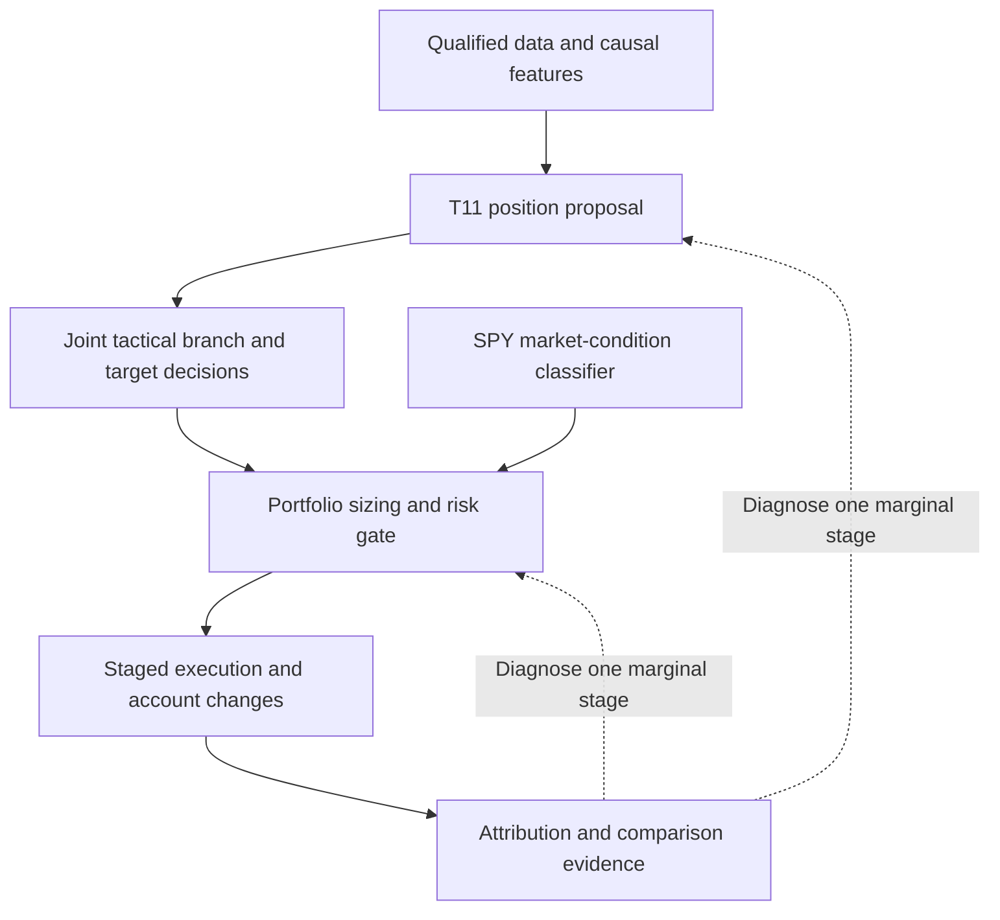

# T11 hierarchy: strengths, weaknesses and unknown headroom

Descriptive synthesis of saved development results; zero new financial runs.
This extends the [plateau diagnosis](2026-10-30-t11-plateau-diagnosis.md).
The [research standard](../research-standard.md) owns the actual minimal pipeline;
the following hierarchy is an analysis view, not a claim that each optional stage
is implemented independently. The [leaderboard](../leaderboard.md) owns rankings.

## Hierarchical assessment

| Layer | What performs well in saved evidence | What performs worse or remains unknown | Evidence strength |
| --- | --- | --- | --- |
| Data/features | Matched reference calendar and compatible aggregate results; selector common-calendar checks | Daily original features, gate states and complete provider snapshot are absent; compatibility cannot exclude all timing/data defects | Aggregate compatibility verified; full reproduction incomplete |
| Broad-market condition | Gate reduces full-path T11 DD51.26%→36.90%; worst historical2020loss is no longer the full-window maximum | Gated2025-01-27still loses14.78%; SPY-wide condition may not represent specific leveraged holdings | Observed account tradeoff; target-risk mismatch is a hypothesis |
| Tactical branch selection | Full T11 beats SOXL/cash at both tested costs;2022gated full+60.62% vs gated SOXL/cash−28.99% | Per-branch profit, costs and marginal value are not identified;2025full gated−0.64% | Policy-level contrasts, no causal branch attribution |
| Target choice within a branch | Keeping full policy beats SOXL concentration; broadening names alone did not help | Latest monthly selector Calmar0.350 vs2.494 replaced several mechanisms at once; it does not isolate bullish-target selection | Negative fixed-policy result; marginal target opportunity unknown |
| Risk and sizing | Gate improves Calmar2.335→2.494 and reduces depth | CAGR119.67%→92.03%; ending wealth−55.38%; longest recovery215→293days; blanket cap includes inverse/defensive positions | Strong descriptive tradeoff, not exposure-matched timing alpha |
| Execution and accounting | Original controls show zero rejected/non-MOO fills and matching aggregates; staged execution is repeatable at aggregate level | Full T11 native Calmar2.492→1.713 under25→50bp; full independent ledger/daily reproduction and gap attribution missing | Cost sensitivity observed; execution alpha and operational readiness unverified |
| Research feedback | Negative findings and immutable failures retained; offline checks improve | Last ten slots yield four unique policy/cost summaries; result capture consumes substantial budget; viewed history reused | Engineering evidence is stronger than improvement/generalization evidence |

Branch and target choice are coupled in T11. The table does not pretend that
existing tests changed them independently. Numeric confidence scores would imply
calibration we do not possess, so evidence categories remain explicit.

## What is the upper bound?

**Unknown achievable performance.**2.494is a best-observed development score,
not a ceiling or a forward expectation. There is no useful universal finite
Calmar bound without fixing admissible policies, universe, exposure/leverage,
information timing, execution/costs and period. For fixed positive CAGR, a
sequence of strategies with positive drawdown tending to zero has arbitrarily
large Calmar mathematically; exact zero drawdown makes the ratio undefined.
This is not evidence that such a strategy is realizable.

**Conditional arithmetic headroom.** Holding saved CAGR92.0276% fixed gives:

| Full-window drawdown magnitude | Implied Calmar | Status |
| --- | ---: | --- |
| 36.8978% | 2.4941 | Observed development reference |
| 35% | 2.6294 | Sensitivity only |
| 32% | 2.8759 | Sensitivity only |
| 30% | 3.0676 | Sensitivity only |
| 25% | 3.6811 | Sensitivity only |

Reducing exposure generally changes CAGR and DD together; these are not forecasts,
upper bounds or achieved candidates. Calmar3requires about30.676%DD if current
CAGR is preserved. Combining ungated CAGR with gated DD would join incompatible
paths and is not a valid attainable ceiling.

**Stage-specific headroom can be investigated, not assumed.** A future oracle
study could quantify opportunities under tightly fixed interventions: choose
among eligible branch targets, alter only a risk cap, or compare fill conventions.
Perfect foresight is untradable. Switching daily between two independently
backtested account return streams does not reconcile positions, costs, cash or
execution. A hindsight wealth-maximizing path does not necessarily bound Calmar,
which is a path-dependent ratio. No such oracle or financial replay was run here.

## Highest-value analysis order

1. Recover/bind daily branch, proposed target, gate, orders/fills and realized
   holdings for the existing policy. Avoid another policy replacement first.
2. Attribute the2024-09–2025-06loss/recovery episode,2025-01-27loss and selected
   counterexamples to target exposure, timing, trading costs and cap decisions.
3. Separate risk reduction on leveraged long branches from suppression of defensive
   or inverse branches. Determine whether each intervention actually had an
   actionable decision, instead of counting warnings while already cash.
4. Only then freeze one candidate stage change, with a matched incumbent and
   exposure/control context. Use cost and recovery guards alongside Calmar.

The above is prioritized diagnosis, not authority to reopen exhausted financial
budgets. Stage-level benefits remain unknown until proper attribution or a new
separately bounded experiment supplies the missing evidence. Positive2024growth
and six viewed years do not establish robustness or an untouched holdout.

## Verification

Reviewed the original gate-transfer, official export-validation, SOXL/cash,
six-ETF selector and sector epoch3records. Read the saved hashed path diagnosis;
checked its input/output hashes and recomputed fixed-CAGR sensitivity directly.
No new data, financial simulations, broker actions or leaderboard scores.
