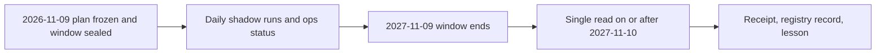

# FWD-SPY-EMA-1: sealed 12-month forward test of the SPY EMA50/200 rule

Opened 2026-11-09 under [GRS](../research-standard.md). This cycle exists to test the
new foundations end to end on real forward data and to start the
[learning curve](../learning-curve.md). It makes no claim of edge. Orders: none.

## Frozen contract

- **Plan:** [FWD-SPY-EMA-1.json](../../research/registry/forward-plans/FWD-SPY-EMA-1.json),
  SHA-256 `b17c6e70b5af12644b43a401305eedd8fc192dab6b3e84d0674e517b848fc994`.
  It fixes the candidate, control, window, data source, costs, criteria and code hashes.
- **Ledger:** [trial ledger](../../research/registry/trial-ledger/ledger.jsonl), holdout
  `SPY-FWD-1`, window 2026-11-10 to 2027-11-09. Seal hash
  `909d6cdbb430d44cf7b1850a076e266f62adce7945b805ca2434e7d56fb39558`; chain head after
  freeze begins `cb6b49e713e0` (verify with `scripts/check_trial_ledger.py`).
- **Candidate:** long SPY while EMA50 exceeds EMA200 of completed daily closes, else flat.
  It has no volatility gate; this mirrors what `paper_trading/spy_signal.py` and
  `BoundedSPY` actually run. **Control:** SPY buy and hold.
- **Rule for one read:** open the holdout once, on or after 2027-11-10. The ledger records
  the read but cannot enforce the date, so the date is a procedural commitment.
- **Decision rule:** keep only if the candidate is not dominated on net CAGR versus max
  drawdown at both 5bp and 10bp, max drawdown is at most 30%, and shadow integrity holds;
  retire if dominated at both costs; otherwise inconclusive. Differences under 1.0
  percentage point are ties.

## Limits to keep in view

- One year with a handful of position changes cannot show an edge. Treat the result as
  descriptive and as a test of the pipeline.
- The glue that extends the backtest engine with forward bars is not written or
  hash-frozen. It may not change the signal, costs or criteria; any change is recorded.
- Shadow records are hypothetical positions, so this cycle measures no fill quality.
- The 2005-2025 SPY history is already viewed; nothing here makes it independent.
- No receipt exists yet. At closure, write an `experiment-receipt/v1` with
  `holdout_seal_hash`, log it with `scripts/experiments.py log --receipt`, and record the
  evidence class `sealed_forward`.

## Next actions

1. Schedule the daily shadow run and `scripts/ops_status.py` (needs your approval).
2. Write and test the forward evaluation glue before the window ends.
3. Close the cycle after 2027-11-10 with one read.
