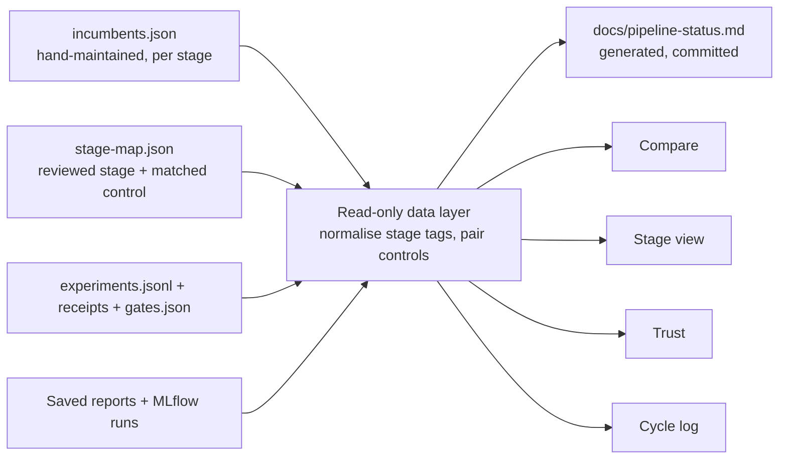

# Research dashboard redesign: design

Design only. Nothing here is implemented; no code, report or service has changed.
The owner approved this design on 2026-11-17, including the reviewed `stage-map.json`
sidecar and the `unassessed` trust badge for version 1.
[GRS-1.1](../research-standard.md) owns the pipeline and evidence rules,
[scoring](../research-scoring.md) owns metric meaning and eligibility, and the
[performance SOP](../operations/performance.md) owns starting and stopping the
current browser. This record owns only the redesign of what the dashboard shows.

## Intent

Today the home page at `127.0.0.1:8765` is a link list to two SPY runs. The
evidence it should summarize is spread over about 30 report folders and 110
experiment records. The owner wants one place to (1) compare algorithms,
(2) judge whether each number can be trusted, and (3) see **which pipeline stage a
gain or loss comes from**, so the next research cycle targets the weakest stage.

Current status must not depend on launching the dashboard. A committed, generated
**status document** states which algorithm is in use at each stage and what the
evidence says; the dashboard is the drill-down view over the same data.

**Stated by the owner:** evaluate and develop algorithms, compare them, and find
which part of the pipeline to improve; know the current status without launching
the dashboard; and know which algorithm is used at each stage.
**Assumed by the author (not yet confirmed):** the first decision made at the
dashboard is "which stage should the next cycle target", so the stage view leads.

## Goals, non-goals, anti-goals

Goals
- Compare an incumbent with challengers in one context (same period, cost, capital).
- Show per-stage evidence: effect versus its matched control, or an explicit gap.
- Show an eligibility badge beside every number.
- Show each cycle's lesson and the open uncertainties.
- Record the algorithm currently in use at each stage in one declared file and one
  generated, committed status document, readable without running anything.

Non-goals
- The dashboard is not a status store; it never holds the only copy of a fact.
- No new authoritative result store; no strategy reruns; no broker access.
- No automatic "best algorithm" or adoption verdict; no automated next-cycle pick
  in the first version.
- No replacement of our metric definitions by a library.

Anti-goals (a failure even if it renders)
- A headline number without its eligibility or evidence class.
- A stage effect computed without a matched control.
- A leaderboard that hides retired, blocked or unfavorable results.
- Development evidence presented as confirmation.

## Constraints

- Views, not stores: the dashboard is derived from `research/registry/experiments.jsonl`,
  `research/registry/incumbents.json`, `docs/tasks/evidence/` receipts,
  `research/registry/gates.json`, saved reports and MLflow
  ([documentation conventions](../README.md)). It writes none of them.
- `incumbents.json` is the one new hand-maintained declaration. It changes only when
  a closed research cycle's disposition changes the incumbent, and each change cites
  that cycle's record. `docs/pipeline-status.md` is generated and never edited by hand.
- Offline and loopback only (127.0.0.1); ordinary verification sends no orders.
- Metric units as stored (`net_cagr`, `max_drawdown` are fractions); missing,
  undefined and incomparable values stay visibly distinct from zero.
- Native-first ([decision 0002](../decisions/0002-native-capabilities-first.md)):
  Nautilus tearsheets and MLflow stay; new code only where nothing native fits.
- All 110 current records are `development` evidence; 0 are confirmation.

## What the data supports today

Measured from the registry on 2026-11-17.

| Fact | Value | Consequence for the design |
| --- | --- | --- |
| Records / contexts (`code` + `period`) | 110 / 36 | Compare view groups by context |
| Contexts holding a `challenger`-tagged record and a control (tag or disposition) | 20 of 36; each has exactly one challenger record, and all 20 are `retire` | First version shows no "improved" cell; that is the evidence, not a defect |
| Controls per context | 0: 5, 1: 7, 2: 21, 3: 2, 4: 1 | A challenger often has several candidate controls; see pairing below |
| Records with neither `control` nor `challenger` tag | 48 (28 `inconclusive`, 17 `control`, 2 `retire`, 1 `blocked`) | Not pairable without a sidecar label |
| Metrics per record | 6: `net_cagr`, `max_drawdown`, `calmar`, `sharpe`, `longest_underwater_days/sessions` | Fixed column set for Compare |
| Stage-tagged records | 66, of which 62 carry one stage after normalisation and 4 carry two | Counts per stage: features 6, market conditions 6, proposal 12, target selection 15, risk gate 5, sizing 12, execution 6 |
| Records with no stage tag | 44 | Show as "unclassified", never guess a stage |
| Tag spellings | `selection` = `target selection`; `traffic gate` = `risk gate` | Normalise through one mapping table |
| Eligibility data | None per run; `evidence_status` is 14 free-text values | Trust badge cannot be derived; see Trust |
| Run links | Records carry `receipt` and `study` refs only; no MLflow run id, no capital | Compare is a registry view in v1 |

Gap found: no file records the algorithm currently in use per stage. "Incumbent"
appears only in prose across cycle write-ups ([cycle register](../research-cycles.md)).
The generated [leaderboard](../leaderboard.md), [dead ends](../dead-ends.md) and
[learning curve](../learning-curve.md) already exist and are freshness-checked by
`make experiments-check`; they describe history, not the current choice.

Known defect, **out of scope**: untracked `.local/performance/leverage-latest.json` stores absolute
paths from an old checkout, so `make performance` fails at its last step. The code that reads it
(`scripts/performance.py`, `reporting/leverage.py`, `reporting/strategy_suite.py`) is byte-pinned in
`research/compatibility.json`, so the fix is repointing that data file, not editing code.

## Approaches considered

| | A. Static HTML + MLflow + custom stage view | B. Streamlit/Dash app | C. Adopt a public dashboard |
| --- | --- | --- | --- |
| Fit with current setup | Same loopback `http.server`, same MLflow | New long-running server and dependency | Foreign data model |
| Effort | Medium | Medium, plus a new service to operate | Low to start, high to bend |
| Risk | Less interactivity | Second process to supervise and test | Unvetted repos (best match has 0 stars) |

**Chosen: A** (owner approved on 2026-11-17). B can sit on the same data layer
later. C rejected: no public repo covers stage attribution or our eligibility rules.
Reused: MLflow (run store, compare), Nautilus tearsheets (per-run report).
Optional later: `quantstats`/`empyrical-reloaded` as metric cross-checks,
`alphalens-reloaded` for rank-based selector studies.

## Design



Data layer (one module, pure functions, unit-tested on fixtures):
1. Load records; normalise tag spellings (table above).
2. Read the **classification sidecar** `research/registry/stage-map.json` (schema
   `stage-map/v1`, hand-reviewed): per record, the single `stage_under_test` and, for a
   challenger, the `control` it is matched to (a `record_id`). The registry itself is
   hash-chained and is not edited. *(Author's call.)*
3. A record's tags describe its configuration, not the stage it tests (a control can
   carry two stage tags). Only the sidecar's `stage_under_test` places a record in a
   stage cell. A record with no sidecar entry is `unclassified`; a record changing two
   stages is `unattributable`.
4. Matched pair = a challenger (tag `challenger`, or any record whose reviewed entry names a
   control, since the registry is immutable and some challengers carry no tag) and the control
   the sidecar names,
   in the same `code` and `period`. With no named control the pair is `ambiguous
   control`, and no delta is computed. Capital is not in the data, so it is not
   part of the match. *(Author's call.)*
5. Stage delta = challenger minus matched control, same units, matched pairs only.
6. Attach disposition, evidence class, verbatim `evidence_status` and `lesson`.

Cell state (author's call): each pair reports (a) its **disposition** (`retire`,
`blocked`, `inconclusive`, ...) and (b) its **effect** from Pareto dominance on the two
policy objectives, `net_cagr` (higher) and `max_drawdown` (lower), as in
`research/control/scoring.py`: `improved` (dominates), `worse` (dominated), `tradeoff`
(neither), `tie` (exactly equal; no tolerance in v1). Sharpe, Calmar and underwater
length are shown as diagnostics and never decide the effect. A cell with several
pairs lists counts per state; there is no roll-up label. Disposition and effect are
both shown, so a retired challenger that beat its control on CAGR reads "retired,
tradeoff", not one or the other.

### Incumbents file and status document

`research/registry/incumbents.json`, schema `incumbents/v1`, one entry per stage
(features, market conditions, position proposal, target selection, risk gate,
sizing, execution):

| Field | Meaning |
| --- | --- |
| `stage` | One of the normalised stage names |
| `algorithm` | Human-readable name, for example "EMA 50/200 trend" |
| `identity` | Frozen parameters or code version, enough to reproduce the choice |
| `justified_by` | `record_id` in `experiments.jsonl` (and cycle id) that selected it |
| `availability` | `implemented`, `unverified`, `blocked` or `planned` ([README](../README.md) vocabulary) |
| `last_changed` | Cycle id and date of the last change; `null` if never challenged |
| `scope` | Context where it holds (for example "SPY, 2020–2025, 25bp"); no universal winner |

A stage may be declared `none` (baseline protection only). A stage with no entry
renders as "undeclared", never as a guessed algorithm.

`docs/pipeline-status.md` is rendered from that file plus the registry, in the same
way `scripts/experiments.py render` produces the leaderboard. One row per stage
(illustrative; the deltas are the gated-T11 figures from the
[gate transfer record](2026-10-26-qc504-t11-gate.md), not a declared incumbent):

```
| Stage | Algorithm in use | Avail. | Latest vs control | Cycles | Open uncertainty |
| Risk gate | EMA/vol traffic light | implemented | maxDD −14.4pt, CAGR −27.6pt (tradeoff) | 5 | exposure-matched control missing |
```

Freshness is enforced the same way as today's generated views (`make check` fails when
the document differs from a fresh render). The dashboard Stage view reads the same
data, so the two cannot disagree.

Views

```
┌ Stage view (landing page) ───────────────────────────────────────────┐
│ (counts are records; illustrative layout, final counts come from the │
│  sidecar)                                                             │
│ Features  Market   Proposal  Target   Risk gate  Sizing  Execution    │
│ 6 rec     6 rec    12 rec    15 rec   5 rec      12 rec  6 rec        │
│ pairs: n  pairs: n pairs: n  pairs: n pairs: n   pairs: n pairs: n    │
│ effect and disposition counts per cell, e.g. tradeoff×1 · retire×1    │
│ 4 unattributable · 44 unclassified · click a cell → records, lessons  │
├ Compare ─────────────────────────────────────────────────────────────┤
│ context: [U1-25bp · 2020–2025 ▾]   incumbent: [control ▾]            │
│ name        CAGR  maxDD  Calmar Sharpe underwater  trust       evidence│
│ T11         ...                                    unassessed  dev    │
│ T11 + gate  ...                                    unassessed  dev    │
├ Trust ───────────────────────────────────────────────────────────────┤
│ verbatim evidence_status + receipt link; eligibility: unassessed      │
├ Cycle log ───────────────────────────────────────────────────────────┤
│ date · record · stage · disposition · outcome · lesson                │
└──────────────────────────────────────────────────────────────────────┘
```

Rules
- A cell shows the delta per policy metric, the effect and disposition counts, and
  the record count; click shows the lessons. The counting unit is the **record**;
  a "cycle" is a [cycle register](../research-cycles.md) entry and is not a unit here.
- Tradeoffs stay visible: gated T11 cut max drawdown 51.26% to 36.90% but CAGR
  119.67% to 92.03%, and the cell shows both.
- **Trust (author's call):** no per-run eligibility record exists, and free-text
  `evidence_status` is not mapped to pass/fail. Version 1 shows `evidence_status`
  verbatim, the evidence class and the receipt link, with eligibility labelled
  `unassessed`. Rows are not greyed for being unassessed. Greying on failed or
  unknown eligibility starts only when real eligibility records exist (a separate
  task owned by the [scoring contract](../research-scoring.md)).
- Cell states used: improved, worse, tradeoff, tie (effect); retired, blocked,
  inconclusive, control (disposition); plus `ambiguous control`, `unattributable`,
  `unclassified`, `no evidence`.
- **Compare (author's call):** a registry view in v1; no join to MLflow runs or saved
  reports. The incumbent defaults to the context's control and can be switched among
  that context's controls. *Revised during planning:* the repo already has an entry
  page, `scripts/dashboard.py` (`.local/progress/index.html`, a tab bar over the
  progress, holdings, profile and target pages, see
  [daily schedule](../operations/daily-schedule.md#single-entry-page)). The new
  pipeline page is added there as one more tab, and the performance home on `127.0.0.1:8765`
  is left unchanged and stays reachable. No existing page is replaced.
- **Open uncertainty (author's call):** no source field exists, so the Cycle log shows
  `outcome` and `lesson` only. An optional `open_uncertainty` field on future records
  is a registry schema change, out of scope here.

## Phasing

1. `stage-map.json` schema, loader and a drafted first version (stage under test and
   matched control per record, derived from each record's study document and marked
   `reviewed: false`; unreviewed entries render as `unclassified`).
   `incumbents.json` schema and loader, data layer, generated `docs/pipeline-status.md`
   with its freshness check, then the Stage view from the same data. Initial entries
   are drafted from the cycle register's prose and each is marked `unverified` until the
   owner confirms it; the builder does not infer an incumbent the prose does not state.
   Add the new owner to the [documentation map](../README.md#find-the-canonical-owner).
2. Compare view and Trust badges.
3. Cycle log and open-uncertainty panel.
4. Optional cross-checks (`quantstats`, `alphalens-reloaded`), only if a cycle needs them.

## Verification (planned, not yet performed)

Offline unit tests on fixture registries (pairing, tag normalisation, missing-control
cells, unit handling); regenerate pages from the real registry and diff row counts
against `experiments.jsonl`; check that every `justified_by` resolves to a real record;
check the status document is stale-detected after editing `incumbents.json`;
run `make check`. No broker or network calls.

## Left to the builder

Page technology within static HTML, chart library (Plotly is already present),
file layout under `reporting/`, exact colours and wording, how stage cells are
sorted, and whether the data layer is exposed as JSON for later reuse.

## Limitations

Stage attribution is only as good as the controls that exist: 20 of 36 contexts
hold a challenger and a control, all 20 challengers were retired, and risk-gate
evidence is thin. Records without a sidecar entry (at least the 44 with no stage
tag) appear as `unclassified` until reviewed. Eligibility is `unassessed` for every
run until eligibility records exist. All evidence is development-class.
