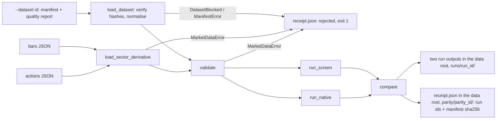

# Engine parity: synthetic CI fixture and local sector-ETF run

- Work status: complete for the synthetic CI fixture. Local sector-ETF parity
  **passed** on 2026-11-18 on the frozen dataset `sector-etfs-2016-2025-n1`: 0 mismatches
  (attempt 3 below). The two earlier attempts, rejected at load on 2026-11-18, are kept
  as history. [JSON receipt of the earlier blocked run](evidence/2026-11-17-engine-parity.json).
- Quality status of the dataset: `pass-with-exceptions` (not yet accepted by the owner);
  see the [data library](../data-library.md).
- Roadmap and owners: P0 and P1b of the
  [offline research infrastructure design](2026-11-17-offline-research-infra-design.md),
  sequenced in the [roadmap](../roadmap.md) under M1/M2;
  [implementation plan](2026-11-17-offline-infra-p0-p1b-plan.md) Task 6. The input is the
  derivative from the [sector issuer qualification](2026-10-28-sector-issuer-qualification.md).
- Evidence class: synthetic and local engineering evidence. Not for financial use.
  Offline, no network, no broker request, no order.

## Inputs and contracts

The derivative lives in the main checkout's ignored `data/` folder, not in worktrees.
Both hashes match `data/qualified/alpaca-sector-etfs-2016-2025-v1-issuer-v2/inputs.json`.

| Input | Path (main checkout) | Recorded columns |
| --- | --- | --- |
| Bars | `data/normalized/alpaca-sector-etfs-2016-2025-v1.json` (sha256 `81aa4f61…c919`) | List of rows: `symbol`, `session`, `source_timestamp`, `ts_event`, `ts_init`, `o`, `h`, `l`, `c`, `v` (decimal strings) |
| Actions | `data/normalized/alpaca-sector-etfs-2016-2025-v1-issuer-actions-v2.json` (sha256 `e4717aec…967d`) | `cash_and_in_kind[]`: `id`, `symbol`, `kind` (`cash` or `in_kind`), `ex_date`, `pay_date`, `amount`, …; `splits[]`: `id`, `symbol`, `ex_date`, `ratio`; `excluded_issuer_rows[]` (explicit nonpayments, not loaded) |

- `research/evaluation/sector_derivative.py`: `load_sector_derivative(bars_path,
  actions_path, instruments) -> MarketData`. It converts values and never rounds or drops
  them. It rejects a missing instrument, duplicate rows, differing session lists,
  non-integer split ratios and any non-cash distribution. Dropping an in-kind
  distribution would misstate a holder's equity.
- `scripts/current/engine_parity.py run --bars --actions --instruments --out --runs`.
  It runs `sma_trend_targets()` with the default `MarketConfig` (5 bps, $1 commission,
  $100,000) through both engines. Both run outputs go to `<runs>/<run_id>/`; the
  native run's `parent_run` is the screening run. Each manifest's `engine` is `screen`
  or `nautilus`, and its `config` holds only strategy, market, instruments and engine,
  so `config_hash` identifies the configuration. The `parity-receipt/v1` receipt is
  written to `<out>/<parity_id>/receipt.json`. It records `calendar`, `timing`,
  `cash_interest: "not modelled"`, input hashes, `runs_root`, each run's id and
  `manifest.json` sha256, and the `ParityReport`. Rejection or mismatch exits 1.
  `code_commit` gains `+dirty` when the tree has uncommitted changes.
- `--dataset <id>` (mutually exclusive with `--bars`/`--actions`) loads a dataset
  through `research/evaluation/datasets.py`: it verifies the manifest's input hashes,
  refuses a dataset with no quality report or a `fail` report, and re-applies
  `etf-normalise/v1`. The receipt's `inputs` then holds `dataset_id`, `manifest_sha256`,
  the quality report path (relative to the data root) and status, plus the bars and
  actions hashes from the manifest. `calendar.half_days` is the report's half-day
  list. A missing manifest exits 2 with `blocked: data absent: <path>`.
- `make parity-local` runs `--dataset $(PARITY_DATASET)` (default
  `sector-etfs-2016-2025-n1`) on SPY, XLB, XLE and XLF. Receipts and runs go to the
  data root's `parity/` and `runs/` (`QTL_DATA_ROOT`, default the main checkout's
  `data/`). The target is not part of `make check`. The earlier `--bars`/`--actions`
  mode remains.
- Tolerances: share quantities and fill dates are identical; cash and equity match within
  $0.01 per session. This task changed neither the tolerances nor the engines. The later
  whole-branch review changed the engines: splits move no cash, `TargetFn` receives the
  shared `history_view`, and targets and `MarketConfig` are checked by shared code.
  The recorded attempts below predate those changes. They were rejected at load, so no
  engine ran.

## What parity proves

Parity shows that NautilusTrader's order, commission, position and cash accounting of
harness-scripted quotes matches the pandas engine. It cannot catch defects in code both
engines share: `execution_price`, the dividend entitlement rule, the split rule,
`validate`, `history_view`, and lookahead inside a `TargetFn`. Those need their own
tests.

## Actual results

| Attempt (UTC) | Code | Receipt | Exit | Outcome |
| --- | --- | --- | --- | --- |
| 1, 2026-11-18T03:19:45Z | `35465c6` working tree with the uncommitted loader | `.local/parity/20261118T031945Z-30d7c8ba/receipt.json` | make 2 | Rejected at load: `XLF-2016-09-19 (in_kind)` |
| 2, 2026-11-18T03:22:04Z | `1b47a82` (clean) | `.local/parity/20261118T032204Z-2e0b1c4e/receipt.json` | make 2 | Rejected at load: `XLF-2016-09-19 (in_kind)` |
| 3, 2026-11-18T20:02:29Z | `9beafe7` plus the uncommitted dataset loader (receipt `code_commit` ends `+dirty`) | `parity/20261118T200229Z-e4c79908/receipt.json` under the data root | make 0 | **Passed**: status `passed`, 0 mismatches |

Attempt 3 is the current result. Attempts 1 and 2 were rejected at load. The XLF 2016-09-19 distribution paid 0.139146 XLRE
shares per XLF share, not cash. `MarketData` cannot represent it. No run IDs, parity
report or timing exist because no engine ran. The receipt's `calendar` is null because
loading failed.

Attempt 3 details (`make parity-local`, dataset `sector-etfs-2016-2025-n1`, instruments
SPY, XLB, XLE, XLF, default `MarketConfig`, `sma_trend_targets` window 20, gross 0.95):

- Inputs: manifest sha256 `ddfa944c…efced`; quality report
  `quality/sector-etfs-2016-2025-n1/20261118T195816Z/report.json` (status
  `pass-with-exceptions`; 21 half-day sessions listed in the receipt).
- Calendar: 2,514 sessions, 2016-01-04 to 2025-12-31, identical across the four instruments.
- Timing: screening 1.01 s, native engine 3.15 s; projected 394 s for 500 names.
- Runs: screen `20261118T200229Z-5a4e7475`, nautilus `20261118T200229Z-6a40d447`, both
  under the data root's `runs/`.
- Not shown: the code both engines share (`execution_price`, dividend and split rules,
  `validate`, `history_view`) is outside what parity can catch. One run on four
  instruments; cash interest is not modelled.
- Receipts moved: the two earlier receipts were copied (not moved) to
  `parity/legacy-worktree/` under the data root.

The Plan 3 data layer resolved the three blockers below: `etf-normalise/v1` rounds
sub-cent prices half-even to the cent (10,280 values changed, counted per instrument and
field), converts the XLF 2016-09-19 in-kind distribution to 4.486067 per share, and
excludes the SPY dividend paid 2026-01-30.

A read-only probe after the first attempts, kept as history, is not a parity result. It shows that removing the
in-kind blocker would not be enough:

- Calendar: 2,514 sessions, 2016-01-04 to 2025-12-31, identical across all four
  instruments. Half-days are not marked by the source.
- Every instrument has prices off the cent grid. Counts of open/high/low/close fields:
  SPY 37/271/305/88, XLB 4/452/408/7, XLE 19/467/461/36, XLF 31/505/497/14. For example,
  the SPY close on 2016-01-04 is `201.0192`. `validate` on SPY, XLB and XLE rejects
  with `SPY: price not on the cent grid`.
- SPY's 2025-12-19 distribution pays on 2026-01-30, after the last session. `validate`
  would reject it.
- No split falls inside a dividend window. The XLB and XLE 2:1 splits are effective
  2025-12-05.

Synthetic CI parity passes: `tests/current/test_engine_parity.py` and the new CLI test
running on the synthetic fixture. `make check` passed: 1,130 tests, 6 skipped.

## Limitations and next action

- Attempts 1 and 2 left parity blocked: the data was not rounded or altered then, and
  `validate` was not relaxed. Attempt 3 unblocked it through the data layer's recorded
  normalisation recipe, not by changing tolerances or engines.
- The dataset's quality status is `pass-with-exceptions` and the owner has not accepted
  the report. Cross-source Alpaca-Yahoo breaches (799 of 27,654 closes) are listed in
  the [data library](../data-library.md), not resolved.
- Receipts and runs now live in the shared data root, so removing a worktree no longer
  deletes them. The data root itself has no backup rule yet.
- Lesson: before writing the comparison, check a real input against the model's own
  validator. Here the issuer-qualified data violated two model assumptions, the cent
  grid and cash-only actions, and the synthetic fixture never exercised either.
