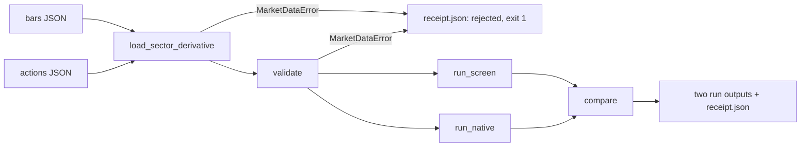

# Engine parity: synthetic CI fixture and local sector-ETF run

- Work status: complete for the synthetic CI fixture. **Blocked** for local
  sector-ETF parity: the real-data run was rejected at load and no engine ran.
  [JSON receipt](evidence/2026-11-17-engine-parity.json).
- Roadmap and owners: P0 and P1b of the
  [offline research infrastructure design](2026-11-17-offline-research-infra-design.md),
  sequenced in the [roadmap](../roadmap.md) under M1/M2;
  [implementation plan](2026-11-17-offline-infra-p0-p1b-plan.md) Task 6. The input is the
  derivative from the [sector issuer qualification](2026-10-28-sector-issuer-qualification.md).
- Evidence class: synthetic and local engineering evidence. Not for financial use.
  Offline, no network, no broker request, no order.

## Inputs and contracts

The derivative lives in the main checkout's ignored `data/` folder, not in worktrees.
Both hashes match `data/qualified/alpaca-sector-etfs-2016-2025-v1-issuer-v2/inputs.json`.

| Input | Path (main checkout) | Recorded columns |
| --- | --- | --- |
| Bars | `data/normalized/alpaca-sector-etfs-2016-2025-v1.json` (sha256 `81aa4f61…c919`) | List of rows: `symbol`, `session`, `source_timestamp`, `ts_event`, `ts_init`, `o`, `h`, `l`, `c`, `v` (decimal strings) |
| Actions | `data/normalized/alpaca-sector-etfs-2016-2025-v1-issuer-actions-v2.json` (sha256 `e4717aec…967d`) | `cash_and_in_kind[]`: `id`, `symbol`, `kind` (`cash` or `in_kind`), `ex_date`, `pay_date`, `amount`, …; `splits[]`: `id`, `symbol`, `ex_date`, `ratio`; `excluded_issuer_rows[]` (explicit nonpayments, not loaded) |

- `research/evaluation/sector_derivative.py`: `load_sector_derivative(bars_path,
  actions_path, instruments) -> MarketData`. It converts values and never rounds or drops
  them. It rejects a missing instrument, duplicate rows, differing session lists,
  non-integer split ratios and any non-cash distribution. Dropping an in-kind
  distribution would misstate a holder's equity.
- `scripts/current/engine_parity.py run --bars --actions --instruments --out`. It runs
  `sma_trend_targets()` with the default `MarketConfig` (5 bps, $1 commission,
  $100,000) through both engines and writes `<out>/<parity_id>/` with both run outputs.
  The native run's `parent_run` is the screening run. The `parity-receipt/v1`
  `receipt.json` records `calendar`, `timing`, `cash_interest: "not modelled"`, input
  hashes and the `ParityReport`. Rejection or mismatch exits 1. `code_commit` gains
  `+dirty` when the tree has uncommitted changes.
- `make parity-local` passes the recorded paths and `--out .local/parity`. It is not
  part of `make check`.
- Tolerances: share quantities and fill dates are identical; cash and equity match within
  $0.01 per session. This task changed neither the tolerances nor the engines.

## Actual results

| Attempt (UTC) | Code | Receipt | Exit | Outcome |
| --- | --- | --- | --- | --- |
| 1, 2026-11-18T03:19:45Z | `35465c6` working tree with the uncommitted loader | `.local/parity/20261118T031945Z-30d7c8ba/receipt.json` | make 2 | Rejected at load: `XLF-2016-09-19 (in_kind)` |
| 2, 2026-11-18T03:22:04Z | `1b47a82` (clean) | `.local/parity/20261118T032204Z-2e0b1c4e/receipt.json` | make 2 | Rejected at load: `XLF-2016-09-19 (in_kind)` |

Attempt 2 is the recorded result. The XLF 2016-09-19 distribution paid 0.139146 XLRE
shares per XLF share, not cash. `MarketData` cannot represent it. No run IDs, parity
report or timing exist because no engine ran. The receipt's `calendar` is null because
loading failed.

A read-only probe after the run is not a parity result. It shows that removing the
in-kind blocker would not be enough:

- Calendar: 2,514 sessions, 2016-01-04 to 2025-12-31, identical across all four
  instruments. Half-days are not marked by the source.
- Every instrument has prices off the cent grid. Counts of open/high/low/close fields:
  SPY 37/271/305/88, XLB 4/452/408/7, XLE 19/467/461/36, XLF 31/505/497/14. For example,
  the SPY close on 2016-01-04 is `201.0192`. `validate` on SPY, XLB and XLE rejects
  with `SPY: price not on the cent grid`.
- SPY's 2025-12-19 distribution pays on 2026-01-30, after the last session. `validate`
  would reject it.
- No split falls inside a dividend window. The XLB and XLE 2:1 splits are effective
  2025-12-05.

Synthetic CI parity passes: `tests/current/test_engine_parity.py` and the new CLI test
running on the synthetic fixture. `make check` passed: 1,130 tests, 6 skipped.

## Limitations and next action

- Local sector-ETF parity is **blocked** and undemonstrated. The data was not rounded or
  altered, and `validate` was not relaxed.
- Unblocking it needs an owner decision on three points. First, how to treat sub-cent
  source prices: an explicit, recorded quantisation step in the data layer or a
  sub-cent engine contract. Second, in-kind distributions: model them or exclude XLF or
  the 2016 window. Third, payment dates beyond the data window.
- The receipts are in this worktree's ignored `.local/parity/`. Removing the worktree
  deletes them unless they are copied to durable local storage first.
- Lesson: before writing the comparison, check a real input against the model's own
  validator. Here the issuer-qualified data violated two model assumptions, the cent
  grid and cash-only actions, and the synthetic fixture never exercised either.
