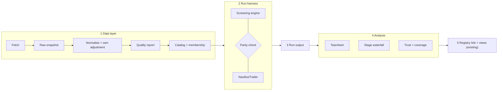
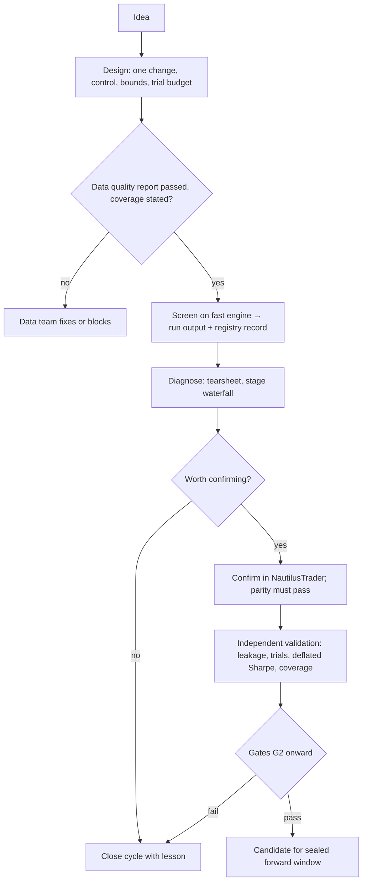

# Offline research infrastructure design

Proposed design for the infrastructure that daily offline research needs before more
views are worth building: a qualified free-data layer, one run harness with two engines,
a standard per-run output and analysis computed from that output. It also maps the
existing teams, skills and SOPs onto that infrastructure and names the gaps. P0, P1a
(the ETF data layer), P1b, P2, P3 and P4 are **implemented**; only P5 (portfolio
construction) is **planned**. Real-data sector-ETF parity
**passed** with 0 mismatches on the frozen dataset `sector-etfs-2016-2025-n1`
([task record](2026-11-17-engine-parity.md)). Known open gaps are under
[Not yet](#not-yet), for example no `keep` has yet been logged for real.
See the status column under [Phasing](#phasing). The [roadmap](../roadmap.md)
keeps sequencing authority. The owner approved this design on 2026-11-17 and folded it
into M1 (data layer, harness, parity) and M2 (run output, analysis, enforced rules).

## Intent

The [Pipeline tab](2026-11-17-dashboard-redesign-design.md) and the registry can show
only six scalar metrics per run, because no run keeps its returns, positions, signals
or fills. Views cannot answer *why* a run won or lost, *which stage* lost value, or
*whether a result is noise*. The fix is upstream: trustworthy data, comparable runs and
a standard output that every analysis and view reads.

## Goals, non-goals and anti-goals

- **Goals.** Daily US ETFs first, then S&P 500 stocks; free data only; every financial
  run reproducible from frozen data and code; every result carries its own trust and
  coverage facts; screening fast enough for 500-name sweeps; confirmation on the same
  engine paper trading will use.
- **Non-goals (this design).** Intraday data; fundamentals pipeline (SEC XBRL comes
  after price/volume research works); paid data; paper or live orders; replacing
  MLflow or NautilusTrader; a database server.
- **Anti-goals.** A result that silently uses survivor-only stocks; a screening engine
  whose numbers drift from NautilusTrader unnoticed; a run that exists only as scalar
  metrics; any new path that edits frozen files or the hash-chained registry.

## Constraints

- Free sources only: Alpaca free data (already used), Yahoo/yfinance, Wikipedia S&P 500
  change history and community constituent repositories, SEC EDGAR later. No billing-
  enabled trials. Source-use rights are recorded per source before named financial use.
- NautilusTrader 1.231.0 stays pinned; native catalog first, as in
  [decision 0002](../decisions/0002-native-capabilities-first.md).
- Dataset layout, manifest and eligibility rules already belong to the
  [data library](../data-library.md); this design extends them and does not fork them.
- Files pinned in `research/compatibility.json` and the existing registry stay
  untouched. Ordinary verification stays offline and order-free.

## Facts this design rests on

| Fact | Evidence |
| --- | --- |
| Sector ETFs: 27,654 daily bars, 10 ETFs plus SPY, 2016–2025, native catalog round-trip | [data library](../data-library.md) |
| ETF corporate actions incomplete: 160 missing payment dates, two SPY dividend omissions | same |
| S&P 500: 1,212,539 bars for 500 *current* members (survivor-selected) | same |
| Registry: 110 records, all development class; 105 carry six scalar metrics; 95 link a receipt and study; none link a series | `research/registry/experiments.jsonl`, profiled 2026-11-17 |
| Native tearsheets exist for two saved SPY runs only | `reporting/saved_runs.py`, [performance SOP](../operations/performance.md) |
| No deflated Sharpe, PBO or purged cross-validation code | repository search 2026-11-17 |
| Free point-in-time S&P 500 membership is available as community reconstructions | e.g. `hanshof/sp500_constituents` (snapshots from 1996), `index-constitution` (MIT); Wikipedia change table |
| Free sources mostly lack delisted-stock prices | external review, 2026-11-17 web scan |

## Approaches considered

| | A. NautilusTrader for every run | **B. Fast screening engine plus NautilusTrader confirmation (chosen)** | C. Adopt vectorbt or Qlib for stock research |
| --- | --- | --- | --- |
| Speed on 500 names | Slowest | Fast screening; full engine only for shortlisted candidates | Fast |
| Trust | Highest single-engine parity with paper | Needs a parity check between engines | Second data format and assumptions |
| Repo fit | Pinned already | Existing studies already use pandas ledgers | New dependency and storage |

B was recommended and accepted on 2026-11-17 for daily research across many names. A is
too slow for sweeps; C duplicates the data layer and breaks parity with the paper engine.

## Design

### 1. Data layer

Extends the data-library layout (`raw/`, `catalog/`, `manifests/`).

- **Raw snapshots.** Every fetch writes the provider response unedited with a request
  receipt and SHA-256. Re-fetching creates a new snapshot; nothing is overwritten.
  Yahoo is a second ETF source next to Alpaca, for cross-checks.
- **Own adjustment.** Store raw unadjusted OHLCV and actions separately; derive
  adjusted series with a versioned recipe. Provider-adjusted columns are kept only
  as a cross-check, because providers revise them retroactively.
- **Quality report per dataset version.** Expected versus observed sessions (exchange
  calendar), duplicates, non-positive or non-finite prices, OHLC consistency, large
  unexplained gaps, cross-source close disagreement above a stated tolerance, and
  actions checked against issuer records where they exist. Output: pass, fail or
  pass-with-exceptions, each exception listed. A failed report blocks financial use.
- **Point-in-time membership.** A dated table `(date, symbol, in_index)` built from a
  pinned community reconstruction, cross-checked against the Wikipedia change table
  and spot-checked on known index changes. Ticker changes are resolved to one
  instrument identity. Coverage per date: members with full price data versus
  members in the index.

### 2. Run harness

One entry point that takes a frozen run configuration (strategy and stage parameters,
universe, period, costs, dataset manifest IDs, engine) and writes a run output.

- **Screening engine.** Vectorised daily engine in pandas/numpy. Timing convention:
  signals use data up to the close of day *t*; orders fill at the open of *t*+1; costs
  in basis points per traded notional; whole-share rounding optional and recorded.
- **NautilusTrader confirmation.** The same configuration drives a native backtest on
  the catalog with the same timing and cost model.
- **Price convention (design call).** Both engines trade raw unadjusted prices, credit
  cash dividends on the payment date and apply splits to held quantities on the
  effective date, matching the existing native runner (`research/spy_backtest.py`
  trades raw prices and credits cash dividends) and the incumbent gate's raw-close
  definition. Split handling is new work in both engines. Whole-share rounding is
  always on, so NautilusTrader instrument precision stays as paper trading needs it.
  Adjusted series from the data layer are for analysis and cross-checks only.
- **Parity check (design call).** Two levels:
  - *In `make check` (CI has no market data):* a committed synthetic fixture of a few
    instruments and about 250 sessions, including one split and several dividends.
    Both engines must produce identical share quantities and fill dates, and cash and
    equity within $0.01 per session.
  - *Locally, as a separate make target with a receipt:* SPY plus three sector ETFs,
    2016–2025, on the issuer-qualified ETF derivative, with the same tolerances.
  A mismatch fails. Parity re-runs whenever either engine's fill, cost or action code
  changes. A parity run is engineering evidence, not financial use.

### 3. Run output

One folder per run under `.local/runs/<run_id>/`, never edited after write:

| File | Content |
| --- | --- |
| `manifest.json` | run_id, created UTC, code commit, config and its hash, engine and version, dataset manifest IDs and hashes, universe coverage, parent run (for ablations), file hashes |
| `returns.parquet` | date, gross return, cost, net return, equity |
| `positions.parquet` | date, instrument, quantity, weight |
| `signals.parquet` | date, instrument, stage, value (the output of each pipeline stage) |
| `fills.parquet` | date, instrument, side, quantity, price, cost |

The existing receipt flow stays (`experiment-receipt/v1` →
`scripts/check_experiment_receipt.py` → `experiments.py log --receipt`). The receipt
gains the run's `run_id` and manifest hash, and the registry record reaches the run
through its receipt. MLflow import stays an optional view. Past records stay
unchanged and keep reading as "no series". *(Design call.)*

### 4. Analysis

All computed from run outputs, never from typed-in numbers:

- **Tearsheet.** Reuse the native NautilusTrader tearsheet already used in
  `reporting/saved_runs.py`; add top drawdowns, rolling Sharpe and calendar returns
  where the native one lacks them.
- **Stage waterfall.** The harness runs an ablation ladder from one configuration:
  signal only (no gate, equal sizing, zero cost) → with risk gate → with sizing →
  with costs. Each rung is a child run; the waterfall shows the change at each rung.
  This replaces per-cell badges as the answer to "which stage loses value".
- **Trust panel.** Number of trials per context and period (from the registry), Sharpe
  variance across them, deflated Sharpe ratio (needs skew and kurtosis from the
  return series), and the automated lookahead check: re-run with data truncated at
  several dates and confirm signals before each cut are unchanged.
- **Coverage.** For stock runs, the share of historical members with price data, with
  the missing names listed. Every stock result shows "survivor-biased: X of Y members".

### 5. Views

The existing dashboard and generated status documents read section 4 outputs. No new
chart framework is introduced.

## Reuse candidates

From a 2026-11-17 scan of GitHub and PyPI (licence, last release and maintenance
checked on each project page). Each adoption still goes through
`trade-capability-review` or `trade-research-intake` and the locked requirements.

| Component | Adopt | Learn from only | Avoid, and why |
| --- | --- | --- | --- |
| Membership | `fja05680/sp500` (MIT) as the base | `index-constitution` (MIT), `hanshof/sp500_constituents` (MIT) as cross-checks | — |
| Prices and actions | `yfinance` (Apache-2.0) behind frozen snapshots; `alpaca-py` (Apache-2.0) for cross-checks | — | — |
| Fundamentals (later) | `edgartools` (MIT) | — | `sec-edgar-api` (stale since 2023) |
| Quality checks and output schema | `pandera` (MIT) | — | `great_expectations` (heavy for this scale) |
| Screening engine | Own pandas engine, so the fill and cost model stays identical to the NautilusTrader path | `vectorbt` (Apache-2.0 with Commons Clause), `bt` (MIT) | `backtesting.py` (AGPL-3.0, single asset) |
| Metrics and tearsheet | `empyrical-reloaded`, `quantstats` (Apache-2.0); NautilusTrader native tearsheet | `pyfolio-reloaded` input layout as a template for the run output | — |
| Signal analysis | `alphalens-reloaded` (Apache-2.0) | — | — |
| Overfitting checks | `skfolio` (BSD-3) for combinatorial purged cross-validation; own deflated Sharpe, probabilistic Sharpe and PBO written from the Bailey and López de Prado papers | `pypbo` (AGPL-3.0) as a reference only, no copying | `mlfinlab` (commercial, removed from PyPI) |
| Lookahead check | Own implementation | Freqtrade's truncate-and-compare method (GPL-3.0); method only, no code | — |
| Agent skills | — | `tradermonty/claude-trading-skills` (MIT) `backtest-expert` against our robust-evaluation skill; `anthropics/financial-services` for plugin structure | Directory-style skill lists with no licence or quality review |

The fja05680 author advises starting membership history in 2001; our price data starts
in 2016, so the advice holds. Yahoo usage terms are still unverified (see limitations).

## Teams, skills and SOP

Teams and skills already exist in the [catalog](../skills.md); the catalog stays their
owner. This design only names the gaps it creates.

| Team | Existing skills | Gap introduced by this design |
| --- | --- | --- |
| Data | `trade-data-acquisition`, `trade-data-audit` | Ownership of point-in-time membership and its coverage figure |
| Platform | `trade-infra-change`, `trade-capability-review`, `trade-local-ops` | Harness and parity procedure |
| Research | `trade-research-design`, `trade-feature-engineering`, `trade-experiment`, `trade-performance-diagnosis`, `trade-candidate-evolution` | None; they run through the harness |
| Validation (independent of Research) | `trade-leakage-audit`, `trade-robust-evaluation`, `trade-promotion-review` | Automated lookahead check alongside the manual audit |
| Management | `trade-research-management`, `/ask-pm`, `/ask-director` | None |

SOP for one idea, with GRS keeping authority over cycle rules:

### Three rules

**Status: implemented (Plan 6, 2026-11-18)**, with the limits below. Three rules are
tool-enforced rather than documented only:

1. No financial run on a dataset version without a passed quality report. A
   pass-with-exceptions report allows financial use only when the data owner has
   accepted each exception in the report.
2. No registry record of a *completed* financial run without a run output. Blocked,
   failed and abandoned attempts keep the current GRS rules and need no run output.
3. A record whose disposition promotes a candidate (the GRS adoption dispositions)
   must reference a NautilusTrader run output, a passing parity receipt for the engine
   code it used, and a validation receipt produced by a Validation skill rather than
   the Research skill that ran it. The exact field names are fixed in the plan.

*(The precise wording of all three rules is this design's call.)*

How they are enforced: `use: financial` marks a financial run, and `scripts/analysis.py run`
refuses one without a covering acceptance (`scripts/data.py accept`, owner only).
`scripts/experiments.py log` reads and hashes the run, parity and validation files,
re-verifies the quality gate from the report on disk, requires the nautilus run to be a
financial run bound to the candidate (same dataset hash, strategy, market, instruments) and
compares engine files between full-SHA commits; `make check` re-verifies only tracked
material (record shape and the tracked validation receipt). The promoting disposition is
`keep`, never `imported`, `failed` or `abandoned`. Details:
[workflow](../workflow.md#enforced-research-rules) and the [task record](2026-11-18-enforced-rules.md).

Design call (revised by the Plan 8 final review): the parity receipt for a `keep` must be the
`candidate-confirmation` receipt (`scripts/confirm.py`) for exactly the two cited runs. It
vouches for the **engine code** (engine-file identity between the receipt's commit and the
run's commit) and for **these two runs agreeing**; `log` checks the receipt's `runs.screen` and
`runs.nautilus` run ids and manifest hashes against the cited refs. It does not validate the
strategy's merit. This replaces the earlier Plan 6 call that the receipt's nautilus run need not
be the candidate's run.

Limits:

- Acceptance is bound to one report by SHA-256; it does not prove the owner understood the exceptions.
- Roles in a validation receipt are self-reported. The tool enforces separation of
  recorded roles, not independence of the model or session.
- The 110 earlier records are `imported` and exempt.

### Not yet

- **No `keep` has been logged.** `scripts/confirm.py` now produces a candidate's
  NautilusTrader run and a passing receipt, and the whole path is tested in temporary roots,
  but a real `keep` still needs an owner-accepted quality report, a validation receipt from a
  Validation skill, a clean tree and the owner's decision
  ([record](2026-11-19-candidate-confirmation.md)).
- The registry is an append-only local file; a self-consistent hand-forged chain is outside
  what it can prevent.
- No acceptance has been recorded for any real dataset; the owner has not accepted
  the `sector-etfs-2016-2025-n1` exceptions.

## Phasing

| Phase | Deliverable | Acceptance | Status |
| --- | --- | --- | --- |
| P0 | Run output schema and writer | Schema test; a fixture run writes and re-reads every file with matching hashes | Implemented: `research/evaluation/run_output.py`, `tests/current/test_run_output.py` ([plan](2026-11-17-offline-infra-p0-p1b-plan.md) Task 1) |
| P1a | ETF data layer: Yahoo snapshot, own adjustment, quality report; shared data root `QTL_DATA_ROOT` and relocation of receipts; resolves the real-data parity blockers (sub-cent source prices, the XLF in-kind distribution on 2016-09-19, the SPY dividend paid 2026-01-30 after the window) | ETF quality report passes or lists every exception; Alpaca–Yahoo close disagreement measured; the local sector-ETF parity run loads and its receipt is regenerated | Implemented (2026-11-18, Plan 3): `research/data/`, `research/evaluation/etf_normalise.py`, `data_quality.py`, `datasets.py`. The quality report for `sector-etfs-2016-2025-n1` is `pass-with-exceptions`, not yet owner-accepted; Alpaca-Yahoo close disagreement measured (623 of 27,654 closes breach tolerance, with Yahoo's own splits); the local sector-ETF parity run loaded and passed with 0 mismatches ([task record](2026-11-17-engine-parity.md)) |
| P1b | Screening engine and NautilusTrader confirmation on the fixture | Parity check passes in `make check` | Implemented: synthetic CI parity passes in `make check` ([plan](2026-11-17-offline-infra-p0-p1b-plan.md) Tasks 2–5). Real-data sector-ETF parity passed on a clean tree with 0 mismatches after the data layer resolved the earlier load rejection (XLF 2016 in-kind event, sub-cent prices) ([task record](2026-11-17-engine-parity.md); the [receipt of the earlier blocked run](evidence/2026-11-17-engine-parity.json) is history) |
| P2 | Analysis: tearsheet, stage waterfall, trust panel | The incumbent SPY EMA/volatility traffic-light strategy is rebuilt through the harness; its waterfall and trust panel are computed; a reconciliation report compares it with the existing registry numbers and explains every difference (a difference is reported, not a gate) | Implemented 2026-11-18 (Plan 4): see the [incumbent rebuild record](2026-11-18-incumbent-rebuild.md); nested ladder hold, trend, trend capped by the gate (the legacy-030 structure), costs; lookahead passed; the rebuild runs on 2016-2025 ETF data, not 2005-2025 |
| P3 | S&P 500 membership and coverage; instrument identity across ticker changes; liquidity-scaled stock costs; timing of a 500-name screening run | Membership table from `fja05680/sp500` (MIT), cross-checked against `index-constitution` and `hanshof/sp500_constituents`, spot-checked on known changes; coverage measured against the existing 500-name archive; one instrument identity per issuer across ticker changes; a stock cost model that scales with liquidity (average daily dollar volume) in place of a flat basis-point cost; a measured 500-name screening time. Acquiring former members' prices is out of scope | Implemented (Plan 5), with limits: current-holdings proxy of 409 names (62 symbols excluded: split events, failed fetches and post-window adjustments), coverage 57.1% to 79.3% of members, nine ticker changes applied and none verified, all stock results survivor-biased and discovery-only; screening all names about 83 s (measured on the earlier 416-name dataset) ([record](2026-11-18-stock-layer.md)) |
| P4 | SOP and catalog updates; registry `refs` link | The three enforced rules each have a failing-then-passing test | Implemented (2026-11-18, Plan 6): see [Three rules](#three-rules) and the [task record](2026-11-18-enforced-rules.md). Limits: acceptance is bound to a report hash; roles are self-reported; the candidate confirmation command (roadmap step 10) now produces the nautilus run; no `keep` has been logged ([Not yet](#not-yet)) |
| P5 | Portfolio construction: a combiner that reads run outputs and writes a new run output. Equal-weight and inverse-volatility weighting, one cash account, no leverage | A combined run reproduces from its component run ids; weights, cash and costs reconcile to the component outputs; every combination counts as a trial in the trial count under [goals](../goals.md) | Implemented (2026-11-18, Plan 7), with limits: `research/evaluation/portfolio.py` and `scripts/portfolio.py`; sleeve-level model (sleeve `net_return`, not shares), long-only, no leverage, cash earns zero; a combination reproduces byte for byte from its component run ids and reconciles to them; `--cycle-id` records one trial, `--exploratory` records none. One real demonstration (three sleeves, equal weight; inverse volatility on two because of warm-up), engineering use, survivor-bias labels inherited, not a research finding ([record](2026-11-18-portfolio.md)) |

P1a and P1b run in parallel after P0: P1b uses the synthetic fixture and the existing
issuer-qualified ETF derivative, so it does not wait for P1a's adjustment recipe.
Stock research starts after P3. P5 starts after P2 and reads only run outputs, so it
needs no change to the engines. Plan numbers follow the master plan sequence; the
[roadmap](../roadmap.md) keeps the order.

## Outcome of Plan 1 (P0 and P1b), 2026-11-18

Implemented: the run-output schema `run-output/v1` and writer, a pandas screening
engine and a NautilusTrader confirmation engine behind one shared contract
(`research/evaluation/engine_contract.py`), and a parity check on the committed
synthetic fixture that runs in `make check`.

At the end of Plan 1, parity on real data was blocked: the local sector-ETF run was
rejected at load for three reasons, all routed to the data layer. Plan 3 (P1a)
resolved them in data, with no engine change, and real-data parity now passes; see
the [engine parity task record](2026-11-17-engine-parity.md).

| Former blocker | Detail | Resolution in P1a |
| --- | --- | --- |
| In-kind distribution | XLF on 2016-09-19 | Cash equivalent, ratio × XLRE close on the ex-date |
| Sub-cent prices | Source prices below one cent | Half-even rounding to the cent, counted in the quality report |
| Dividend after the window | SPY dividend paid 2026-01-30, after the data window | Excluded and listed; total return understated by the dividend |

Plan 2 added the readiness checklist, the artifact catalog and the
[conventions](../conventions.md) that the later phases read.

## Left to the builder

File and module names; the exchange-calendar library; exact quality tolerances beyond
those stated; Parquet engine; how the ablation ladder is expressed in configuration.

## Limitations and open questions

- Delisted-stock prices remain missing with free data; coverage makes the bias visible
  but does not remove it. Paid data is reconsidered only if coverage shows it matters.
- **Owner ruling, 2026-11-17:** the owner accepts Yahoo's unverified usage terms for
  *private, offline research only*. Yahoo-derived data and results are not published
  or redistributed; publishing anything derived from them needs a new ruling. The
  ruling is recorded in the data library's rights state when P1a starts.
- **Owner ruling, 2026-11-17:** folded into roadmap M1 and M2 rather than a separate
  packet.
- Community membership reconstructions can contain errors; spot-checks reduce but do
  not eliminate them.
- The fill and cost model is deliberately simple; it is a research model, not
  execution evidence.
