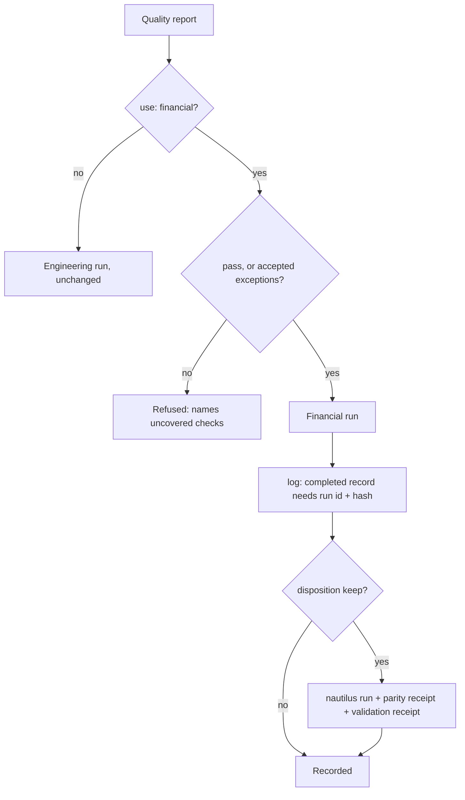

# Enforced research rules (P4)

- Work status: complete (Plan 6, Tasks 1 to 5). Offline; no broker request, no order, no
  data fetch.
- Roadmap and owners: P4 of the
  [offline research infrastructure design](2026-11-17-offline-research-infra-design.md),
  [roadmap](../roadmap.md) step 6, [Plan 6](2026-11-18-offline-infra-plan6-enforced-rules-plan.md).
  Rules and limits for readers: [workflow](../workflow.md#enforced-research-rules),
  [conventions](../conventions.md#use).
- Evidence class: offline engineering evidence (tests on temporary roots).
- Receipt: [evidence JSON](evidence/2026-11-18-enforced-rules.json).

## What was built

| Rule | Mechanism | Owner file |
| --- | --- | --- |
| 1 | `use: financial` gate and owner-only `data.py accept` | `research/evaluation/acceptance.py`, `scripts/analysis.py`, `scripts/data.py` |
| 2 | `refs.run_id` and manifest hash on new completed records; optional `attempt` | `research/control/experiment_registry.py`, `research/control/run_refs.py`, `scripts/experiments.py` |
| 3 | `keep` needs nautilus run, parity receipt, validation receipt; engine files unchanged | `scripts/experiments.py`, `research/evaluation/engine_identity.py`, `research/control/validation_receipts.py`, `scripts/validation.py` |

Enforced where: file reads at `scripts/experiments.py log` and in `scripts/analysis.py run`;
`make check` verifies only tracked material (record shape and the tracked validation
receipts), so it needs no local data.

| Check | At `log` | In `make check` |
| --- | --- | --- |
| Quality gate of the run (and the nautilus run) | re-verified from the report and acceptance on disk inside the data root; unreadable report rejected | not checked |
| Nautilus run financial and bound to the candidate (dataset hash, strategy, market, instruments) | yes | not checked |
| `keep` never `imported`, `failed` or `abandoned` | yes | yes (record shape) |
| Engine identity between full-SHA commits (engine modules, `run_output.py`, `requirements.lock.txt`) | yes (git diff) | not checked |
| Validation receipt: Validation-role skill, `pass`, a passing check, run ids, same parity receipt id | yes, and the file must be tracked in the tracked directory | yes (hash and content) |

Final review fixes (after the adversarial review): `keep` with a failed or abandoned
attempt and any imported `keep` are rejected; the nautilus run must meet the financial
requirement and be bound to the candidate; waived-only receipts and receipts naming another
parity receipt are rejected; engine identity takes full SHAs only and passes
`--end-of-options` to git; log-time gate re-verification; `--receipts-dir` outside the
tracked directory needs `--allow-untracked-receipts` (tests only); `write_acceptance`
validates its path segments.

## Validation performed

- `tests/current/test_enforced_rules.py::test_end_to_end_rules`: one scenario on temporary
  roots with a `pass-with-exceptions` fixture report and a fake git. It asserts each
  rejection before its success: the financial run blocked, then unlocked by an acceptance;
  a completed record without a run rejected; a `keep` record rejected for each missing
  ref in turn and for a Research-skill validator; then logged; then `check` passes with the
  runs and parity roots removed. The test passed on first run because Tasks 1 to 4 had
  already implemented every rule it walks.
- Unit tests for each rule are listed in the evidence JSON. The 110 existing registry
  records still validate unchanged.
- Real-data observation (Task 1): a financial run on `sector-etfs-2016-2025-n1` is
  refused, naming six uncovered checks (`zero_volume`, `cent_rounding`, `actions_converted`,
  `actions_excluded`, `cross_source`, `split_events`). Nothing was written.

## Not done and limits

- No acceptance, no registry record and no validation receipt were created in this plan.
  The owner has not accepted the real dataset's exceptions.
- **A `keep` still cannot be logged in practice**: no CLI produces a candidate's nautilus
  run (analyses are screening runs; parity runs the fixed parity strategy, and a parity run
  is an engineering run, now rejected as the nautilus run). A candidate confirmation command
  is the next gap.
- The registry is append-only and local: a self-consistent hand-forged chain is outside
  what it can prevent.
- Parity receipts vouch for engine code, not the candidate. Validator roles are
  self-reported; independence is not proven.
- Acceptance is hash-bound to a report, not a proof of understanding.
