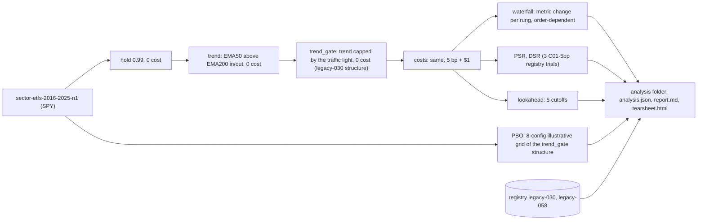

# Incumbent SPY EMA/volatility gate rebuilt through the harness

- Work status: complete (Plan 4 Task 7, with the final-review fix wave). The rebuild ran
  as a nested ladder on the screening engine from a clean commit; lookahead **passed**.
  Offline, no network, no broker request, no order.
- Roadmap and owners: P2 of the
  [offline research infrastructure design](2026-11-17-offline-research-infra-design.md),
  [roadmap](../roadmap.md) step 4, [Plan 4](2026-11-18-offline-infra-plan4-analysis-plan.md)
  Task 7. Conventions: [research conventions](../conventions.md).
- Evidence class: local engineering evidence on a `pass-with-exceptions` dataset that the
  owner has not accepted ([data library](../data-library.md)). Not for financial use, not a
  strategy claim. Differences from the registry are reported, not gated.
- Receipt: [evidence JSON](evidence/2026-11-18-incumbent-rebuild.json) (run ids,
  summaries, waterfall, trust inputs, lookahead, comparison; no prices). Spec:
  `research/registry/analysis-specs/incumbent-spy-gate.json`.

## Run

- Command: `scripts/analysis.py run --spec research/registry/analysis-specs/incumbent-spy-gate.json
  --root <main checkout>/data`, 2026-11-18 21:33 UTC, exit 0, 8.0 s wall.
- Code commit recorded: `c05e9a020083ebcad598bc04120f3c79e54979bd` (clean tree, no `+dirty`).
- Analysis folder (relative to the data root): `analysis/20261118T213357Z-incumbent-spy-gate/`
  (`analysis.json`, `report.md`, `tearsheet.html`; tearsheet status `written`).
  `scripts/analysis.py build` copies the tearsheet under `.local/progress/analysis/`.
  It supersedes `analysis/20261118T210433Z-incumbent-spy-gate/` (gate-only third rung, no
  rebalance band, dirty commit), which stays on disk and is not cited for results.
- Dataset: `sector-etfs-2016-2025-n1`, SPY only, 2,514 sessions (2016-01-04 to 2025-12-31).
  Rules and caps are `INCUMBENT_SPEC` (`proposal: "ema"`). Warm-up follows the legacy
  implementation: no position until EMA200 and volatility exist; the first assessed session
  classifies directly. First costs-rung fill is 2016-10-18, so 200 sessions are flat.
- Sizing: whole shares, 0.99 gross, and a 2% rebalance band (no trade while the gate state
  and proposal are unchanged and the target is within 2% of the holding). Fills per rung:
  hold 7, trend 16, trend_gate 27, costs 29.

## Ladder and waterfall

The ladder is nested: each rung adds one element to the previous one. The waterfall
therefore depends on the rung order; another order would attribute the same end result
differently. Deltas are "to minus from"; max drawdown is a positive magnitude, so a negative
drawdown delta is an improvement.

| Rung | Run id | CAGR | Max DD | Sharpe | Calmar | Turnover / yr | UW sessions / days |
| --- | --- | --- | --- | --- | --- | --- | --- |
| hold | `20261118T213357Z-fef5dc7f` | 0.1452 | 0.3384 | 0.8634 | 0.4292 | 0.0609 | 487 / 708 |
| trend | `20261118T213357Z-d1389ece` | 0.0960 | 0.2986 | 0.7281 | 0.3215 | 1.0646 | 489 / 710 |
| trend_gate | `20261118T213357Z-3a33fdf7` | 0.1080 | 0.1642 | 0.9359 | 0.6578 | 1.2610 | 512 / 746 |
| costs | `20261118T213357Z-ea1330dc` | 0.1075 | 0.1642 | 0.9312 | 0.6544 | 1.2638 | 512 / 746 |

| Step | CAGR | Max DD | Sharpe | Calmar |
| --- | --- | --- | --- | --- |
| hold to trend | -0.0492 | -0.0398 | -0.1353 | -0.1076 |
| trend to trend_gate | +0.0120 | -0.1344 | +0.2078 | +0.3363 |
| trend_gate to costs | -0.0006 | +0.0000 | -0.0047 | -0.0034 |

Headline: in this order, capping the EMA trend with the gate carries the benefit (drawdown
down 13.4 points, Calmar up 0.34, Sharpe up 0.21); the EMA trend alone is worse than holding
on this window; 5 bp plus $1 costs little (Calmar -0.003) at about 1.26 turnover a year. The
gate step lengthens the longest underwater spell (+23 sessions).

## Trust

| Statistic | Value | Inputs |
| --- | --- | --- |
| PSR (costs rung, benchmark 0) | 0.9980 | n = 2,514 (includes 200 warm-up sessions), per-period Sharpe 0.05866, skew -0.711, kurtosis 8.965 |
| DSR | 0.9964 | `n_trials` = 3, set by `comparison.trial_code` `C01-5bp`: legacy-030-discrete-ema-volatility-gate, legacy-073-continuous20-volatility-cap, legacy-092-half-ema-control with registry Sharpes 0.7689, 0.7162, 0.6319; per-period Sharpe variance 1.895e-05 (registry Sharpes divided by sqrt 252); benchmark Sharpe 0.003712 |
| PBO | 0.4244 | illustrative grid of 8 configurations of the trend_gate structure (EMA fast {20, 50}, slow {100, 200}, red volatility {0.35, 0.40}); not registry trials; CSCV, 16 partitions, 12,870 combinations, 2,512 rows |

Caveats, recorded in the analysis document as well:

- **High PSR/DSR here is not an adoption signal.** The PSR benchmark Sharpe is 0, not SPY
  buy-and-hold, so it only says the series is unlikely to have a non-positive Sharpe. Use it
  as a screening signal only.
- **Period mismatch:** the trial Sharpes are 2005-2025 registry results applied to a
  2016-01-04 to 2025-12-31 series.
- **Trial count:** 3 only because the registry holds three C01-5bp records; the broader
  historical trial count is unknown (the C04 study notes this), so DSR is optimistic if more
  configurations were tried.
- **Warm-up:** n includes the 200 leading flat sessions (zero return, no position), which
  inflates n and so PSR and DSR.
- **PBO:** the grid shares one price history with the ladder; a screening signal, not proof.

## Lookahead

Status **pass**, no differences. The full-data run is computed once and compared with a
truncated re-run at each of five cutoffs:

| Cutoff | Compared signals |
| --- | --- |
| 2017-01-03 | 541 |
| 2019-01-02 | 2,047 |
| 2020-12-30 | 3,556 |
| 2022-12-28 | 5,062 |
| 2024-12-27 | 6,568 |

At each cutoff every session before it is compared (signals and positions), plus the
decision at the cutoff itself. The earliest cutoff (2017-01-03) lies after the warm-up, so a
truncation inside the warm-up (before 2016-10-18) is not tested.

## Reconciliation with the registry

Structure, **VERIFIED** from `research/policies/risk_gate.py` `frames`: `gate_ema` is
`min(EMA50 > EMA200 proposal, cap)` and `gate_hold` is `min(1, cap)`. The legacy-030
incumbent is the EMA proposal passed through the cap (as described in the
[C04 study](2026-10-28-no-veto-c04.md)), so this ladder's `trend_gate` and `costs` rungs are
its counterpart; legacy-058 is the always-long, gate-only control (`gate_hold`) and is shown
for context, not as a counterpart.

| Metric | Rebuild costs rung (trend x gate, 2016-2025) | legacy-030 (C01-5bp, 2005-2025) | legacy-058 gate-only (C04-5bp, 2005-2025) |
| --- | --- | --- | --- |
| net CAGR | 0.1075 | 0.0873 | 0.0969 |
| max drawdown | 0.1642 | 0.1777 | 0.2183 |
| Sharpe | 0.9312 | 0.7689 | 0.7961 |
| Calmar | 0.6544 | 0.4915 | 0.4441 |
| longest underwater sessions | 512 | 513 | 567 |
| longest underwater days | 746 | 746 | 822 |

Labelled supplement, rebuild only: over the post-warm-up window 2016-10-18 to 2025-12-31
(first fill to the end) the costs rung has CAGR 0.1173, max drawdown 0.1642, Sharpe 0.9707,
Calmar 0.7142, underwater 512 / 746; the hold rung over the same window has CAGR 0.1508,
max drawdown 0.3384, Sharpe 0.8800, Calmar 0.4457. The legacy rows cannot be sliced to this
window (no legacy return series), so this is context, not a like-for-like comparison. The
near-identical longest underwater spell (512 / 746 against 513 / 746) is reported, not
explained; it may be coincidental across different windows.

Why the numbers differ (reported, not gated; no difference is quantified individually):

1. **Period:** 2016-2025 against 2005-2025. The legacy window includes 2008-09, where a
   200-day trend gate and the drawdown and underwater metrics behave very differently; the
   rebuild never sees it. The hold rung's 2016-2025 CAGR (0.145) is probably higher than
   the 2005-2025 average, which would lift every rung; this is not measured here.
2. **Data:** Alpaca SIP raw bars with issuer actions (the quality-checked dataset) against the
   legacy saved SPY source (5,535 daily rows, 89 dividends, 0 splits, SHA recorded in the C04
   study; its provider is not asserted here).
3. **Warm-up:** EMA200 and volatility start in 2016, so the rebuild is flat for the first 200
   sessions; the legacy run had a 2004 warm-up and 5,283 evaluation sessions.
4. **CAGR convention:** the rebuild annualises over 252 sessions a year
   ([conventions](../conventions.md)); the legacy studies use calendar days over 365.25
   (for example `research/spy_backtest.py`).
5. **Price-peak component disabled** in both (legacy states it explicitly); the rebuild does
   not implement it. `research/policies/risk_gate.py` carries it.
6. **Sizing:** whole shares and 0.99 gross in both; the rebuild starts with $100,000 and the
   legacy run with $300,000, so share rounding differs; the rebuild also applies a 2%
   rebalance band.
7. **Costs and cash:** both 5 bp per side and $1 commission with zero cash interest. The
   legacy run adds 6% debit financing and credits dividends at the ex-date; the screening
   engine credits dividends on the pay date and has no financing.
8. **Registry values are rounded** at the stored precision; the rebuild is not.

## Validation performed

- `tests/current/test_incumbent_spec.py` checks the spec against `INCUMBENT_SPEC`
  (`proposal: "ema"`), the nested rung order and `comparison.trial_code`; it was updated
  first and seen failing, then passing. The fix-wave tests are listed in the commit
  "Plan 4 final review fixes: nested ladder, DSR inputs, performance".
- `make check`: exit 0 after the fix wave (1,335 tests, 6 skipped) and again with these
  records.
- Page builds from the main data root: `scripts/analysis.py build` (analysis.html from 1
  analysis), `scripts/stages.py build` (stages.html from 110 records) and
  `scripts/dashboard.py` (Pipeline, Readiness, Analysis); the DSR inputs appear on the
  Analysis page and in the Pipeline trust row.
- Not performed: native-engine run of the rebuild, replication of the legacy 2005-2025
  window (no checked SPY dataset back to 2005), tearsheet inspection beyond a written status.

## Documentation impact

[Readiness](../readiness-checklist.md) R5, R6 and R8 keep their earlier raises (the new
evidence does not change them); their critiques now name the warm-up, period and benchmark
caveats and the order-dependent waterfall. R7 unchanged (no signal diagnostics). The design
P2 row and the roadmap step 4 record the nested ladder and its legacy-030 counterpart.

## Remaining limitations and next action

- Dataset acceptance by the owner is open; the result inherits `pass-with-exceptions`.
- A pre-2016 checked SPY dataset would make the period comparable with legacy-030; a SPY
  buy-and-hold benchmark for PSR would make the trust statistics decision-relevant. Both are
  separate, explicitly requested work.
