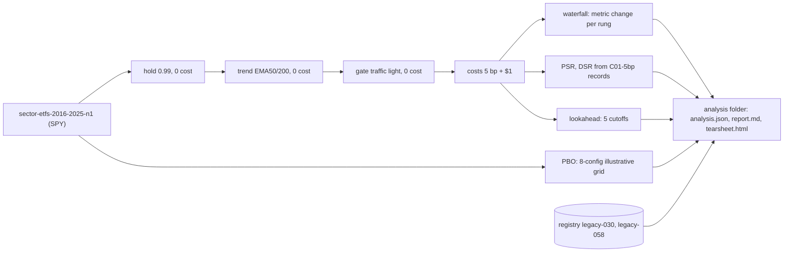

# Incumbent SPY EMA/volatility gate rebuilt through the harness

- Work status: complete (Plan 4 Task 7). The rebuild ran once on the screening engine;
  lookahead **passed**. Offline, no network, no broker request, no order.
- Roadmap and owners: P2 of the
  [offline research infrastructure design](2026-11-17-offline-research-infra-design.md),
  [roadmap](../roadmap.md) step 4, [Plan 4](2026-11-18-offline-infra-plan4-analysis-plan.md)
  Task 7. Conventions: [research conventions](../conventions.md).
- Evidence class: local engineering evidence on a `pass-with-exceptions` dataset that the
  owner has not accepted ([data library](../data-library.md)). Not for financial use, not a
  strategy claim. Differences from the registry are reported, not gated.
- Receipt: [evidence JSON](evidence/2026-11-18-incumbent-rebuild.json) (run ids,
  summaries, waterfall, trust inputs, lookahead, comparison; no prices). Spec:
  `research/registry/analysis-specs/incumbent-spy-gate.json`.

## Run

- Command: `scripts/analysis.py run --spec research/registry/analysis-specs/incumbent-spy-gate.json
  --root <main checkout>/data`, 2026-11-18 21:04 UTC, exit 0, 52.6 s wall.
- Code commit recorded: `781ccd2fb7c99a46882891c979180c68cc6531cc+dirty`. The only
  uncommitted files at the time were this task's new spec and test; the run is not
  repeated for a clean marker.
- Analysis folder (relative to the data root): `analysis/20261118T210433Z-incumbent-spy-gate/`
  (`analysis.json`, `report.md`, `tearsheet.html`; tearsheet status `written`).
  `scripts/analysis.py build` copies the tearsheet under `.local/progress/analysis/`.
- Dataset: `sector-etfs-2016-2025-n1`, SPY only, 2,514 sessions (2016-01-04 to 2025-12-31).
  Rules and caps are `INCUMBENT_SPEC`. Warm-up follows the legacy implementation: no position
  until EMA200 and volatility exist; the first assessed session classifies directly.
  First fill is 2016-10-18, so 200 sessions are flat.

## Ladder and waterfall

| Rung | Run id | CAGR | Max DD | Sharpe | Calmar | Turnover | UW sessions / days |
| --- | --- | --- | --- | --- | --- | --- | --- |
| hold | `20261118T210433Z-6bfb985e` | 0.1466 | 0.3386 | 0.8657 | 0.4329 | 0.0873 | 487 / 708 |
| trend | `20261118T210433Z-74f7652e` | 0.0959 | 0.3004 | 0.7232 | 0.3194 | 1.0791 | 492 / 715 |
| gate | `20261118T210433Z-b750801b` | 0.1143 | 0.1982 | 0.9333 | 0.5767 | 1.1056 | 492 / 715 |
| costs | `20261118T210433Z-de51a9d9` | 0.1134 | 0.1994 | 0.9269 | 0.5688 | 1.1099 | 496 / 722 |

| Step | CAGR | Max DD | Sharpe | Calmar |
| --- | --- | --- | --- | --- |
| hold to trend | -0.0507 | -0.0383 | -0.1425 | -0.1135 |
| trend to gate | +0.0184 | -0.1022 | +0.2100 | +0.2573 |
| gate to costs | -0.0009 | +0.0012 | -0.0064 | -0.0079 |

Headline: on this window the gate step carries the benefit (drawdown down by 10.2 points,
Calmar up 0.26); EMA trend alone is worse than holding; 5 bp plus $1 costs little
(Calmar -0.008) at this turnover. Max drawdown is a positive magnitude.

## Trust

| Statistic | Value | Inputs |
| --- | --- | --- |
| PSR (costs rung, benchmark 0) | 0.9979 | n = 2,514, per-period Sharpe 0.05839, skew -0.646, kurtosis 7.678 |
| DSR | 0.9964 | `n_trials` = 3 (registry records with context code `C01-5bp`), per-period Sharpe variance 1.895e-05 (from registry Sharpe 0.7689, 0.7162, 0.6319 divided by sqrt 252), benchmark Sharpe 0.003712 |
| PBO | 0.3923 | illustrative grid of 8 configurations (EMA fast {20, 50}, slow {100, 200}, red volatility {0.35, 0.40}); not registry trials; CSCV, 16 partitions, 12,870 combinations, 2,512 rows |

The DSR trial count is 3 only because the registry holds three C01-5bp records; the broader
historical trial count is unknown (the C04 study notes this), so DSR is optimistic if more
configurations were tried. The PBO grid shares one price history with the ladder and is
a screening signal, not proof.

## Lookahead

Status **pass**, no differences. Five cutoffs, each compared against a truncated re-run:

| Cutoff | Compared signals |
| --- | --- |
| 2017-01-03 | 541 |
| 2019-01-02 | 2,047 |
| 2020-12-30 | 3,556 |
| 2022-12-28 | 5,062 |
| 2024-12-27 | 6,568 |

The first cutoff (2017-01-03) falls just after EMA200 warm-up ends (first fill 2016-10-18),
so it compares fewer signals but is not vacuous; the earliest sessions, where no signal
exists, are not tested by any cutoff.

## Reconciliation with the registry

| Metric | Rebuild (costs rung, 2016-2025) | legacy-030 (C01-5bp, 2005-2025) | legacy-058 (C04-5bp, 2005-2025) |
| --- | --- | --- | --- |
| net CAGR | 0.1134 | 0.0873 | 0.0969 |
| max drawdown | 0.1994 | 0.1777 | 0.2183 |
| Sharpe | 0.9269 | 0.7689 | 0.7961 |
| Calmar | 0.5688 | 0.4915 | 0.4441 |
| longest underwater sessions | 496 | 513 | 567 |
| longest underwater days | 722 | 746 | 822 |

Labelled supplement, rebuild only: over the post-warm-up window 2016-10-18 to 2025-12-31
(first fill to the end) the costs rung has CAGR 0.1238, max drawdown 0.1994, Sharpe 0.9663,
Calmar 0.6209, underwater 496 / 722; buy-and-hold over the same window has CAGR 0.1523,
max drawdown 0.3386, Sharpe 0.8825, Calmar 0.4499. The legacy rows cannot be sliced to this
window (no legacy return series), so this is context, not a like-for-like comparison.

Why the numbers differ (reported, not gated; no difference is quantified individually):

1. **Period:** 2016-2025 against 2005-2025. The legacy window includes 2008-09, where a
   200-day trend gate and the drawdown and underwater metrics behave very differently; the
   rebuild never sees it. The 2016-2025 buy-and-hold CAGR (0.147) is also well above SPY's
   longer-run average, which lifts every rung.
2. **Data:** Alpaca SIP raw bars with issuer actions (the quality-checked dataset) against the
   legacy saved SPY source (5,535 daily rows, 89 dividends, 0 splits, SHA recorded in the C04
   study; its provider is not asserted here).
3. **Warm-up:** EMA200 and volatility start in 2016, so the rebuild is flat for the first 200
   sessions; the legacy run had a 2004 warm-up and 5,283 evaluation sessions.
4. **Price-peak component disabled** in both (legacy states it explicitly); the rebuild does
   not implement it. `research/policies/risk_gate.py` carries it.
5. **Structure:** the rebuild's `gate` rung is the traffic light alone (trend non-positive
   gives yellow, a 0.5 cap). The legacy incumbent is an EMA50 greater than EMA200 proposal
   passed through the same cap; legacy-058 is an always-long proposal through the cap. The
   ladder has no rung for the proposal-times-cap combination, so legacy-030 has no exact
   counterpart here. This is an unverified reading of the legacy study text, not a
   re-implementation check.
6. **Sizing:** whole shares and 0.99 gross in both; the rebuild starts with $100,000 and the
   legacy run with $300,000, so share rounding differs.
7. **Costs and cash:** both 5 bp per side and $1 commission with zero cash interest. The
   legacy run adds 6% debit financing and credits dividends at the ex-date; the screening
   engine credits dividends on the pay date and has no financing.
8. **Registry values are rounded** at the stored precision; the rebuild is not.

## Validation performed

- `tests/current/test_incumbent_spec.py`: written first and seen failing (spec file
  absent), then passing; checks the spec against `INCUMBENT_SPEC` and the Decisions values.
- Analysis run, build of pages and `make check`: see the closing section.
- Not performed: native-engine run of the rebuild, replication of the legacy 2005-2025
  window (no checked SPY dataset back to 2005), tearsheet inspection beyond a written status.

## Documentation impact

[Readiness](../readiness-checklist.md) R5, R6, R8 raised by one step at most; R7 unchanged
(no signal diagnostics). The design P2 row and the roadmap step 4 record the completion.

## Remaining limitations and next action

- Dataset acceptance by the owner is open; the result inherits `pass-with-exceptions`.
- A proposal-times-cap rung would give legacy-030 a counterpart; a pre-2016 checked SPY
  dataset would make the period comparable. Both are separate, explicitly requested work.
