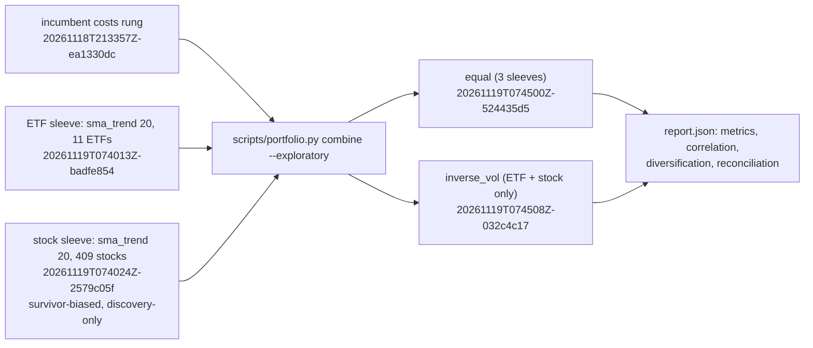

# Portfolio construction demonstration (Plan 7, phase P5)

- Work status: complete (Plan 7 Task 3). A combiner of run outputs was exercised on three
  real sleeves. Offline, no network, no broker request, no order.
- Roadmap and owners: P5 of the
  [offline research infrastructure design](2026-11-17-offline-research-infra-design.md),
  [roadmap](../roadmap.md) step 9, [Plan 7](2026-11-18-offline-infra-plan7-portfolio-plan.md).
  Conventions: [combinations](../conventions.md#combinations). Goals row:
  [research baseline and selection](../goals.md).
- Evidence class: `use: engineering`, `exploratory: true`. **These numbers demonstrate the
  mechanism. They are not a research finding and support no strategy claim.** No trial was
  recorded in the tracked ledger (`research/registry/trial-ledger/` is untouched).
- Receipt: [evidence JSON](evidence/2026-11-18-portfolio.json) (run ids, metrics, hashes;
  no prices). Code: `research/evaluation/portfolio.py`, `scripts/portfolio.py`.

## Sleeves

All use `sector-etfs-2016-2025-n1` or `spy-equities-2016-2025-n2` in the real data root,
2,514 sessions from 2016-01-04 to 2025-12-31. **The date sets are identical**, so the
alignment rule (no silent intersection) was satisfied for all three.

| Sleeve | Run id | Source | Net CAGR | Max drawdown | Sharpe (0 rf) | Calmar |
| --- | --- | --- | --- | --- | --- | --- |
| incumbent | `20261118T213357Z-ea1330dc` | costs rung of the clean incumbent analysis (SPY, EMA50/200 with the traffic-light gate, 5 bp + $1) | 10.75% | 16.42% | 0.931 | 0.654 |
| ETF trend | `20261119T074013Z-badfe854` | spec `portfolio-sleeve-etf-trend` (`sma_trend` window 20, gross 0.95, SPY and ten sector ETFs, 5 bp + $1, one rung) | 4.66% | 22.25% | 0.408 | 0.209 |
| stock trend | `20261119T074024Z-2579c05f` | spec `portfolio-sleeve-stock-trend` (same strategy, all 409 names, 5 bp + $1, one rung) | -29.02% | 96.79% | -3.628 | -0.300 |

The two new sleeves ran from a clean tree (code commit `d34954b`). The stock sleeve carries
`survivor-biased` and `discovery-only` from its dataset (`universe_kind:
current-holdings-proxy`). Screening time was not measured for this task.

The stock sleeve loses 29% a year. The likely cause is its cost model, not the signal: the
spec charges the ladder's usual flat 5 bp plus **$1 per trade** to a 409-name book of
about $230 per position, so each trade costs about 40 bp. That is an unverified reading
(no ablation was run) and is not tuned away here, because strategy tuning is outside this
task. It does make the stock sleeve a useful stress case for the arithmetic below.

## Combinations

Defaults except as noted: monthly rebalance, 5 bp rebalance cost, gross 1.0, 100,000 initial
cash, 60-session volatility window.

| Combination | Run id | Components | Net CAGR | Max drawdown | Sharpe (0 rf) | Calmar |
| --- | --- | --- | --- | --- | --- | --- |
| equal | `20261119T074500Z-524435d5` | incumbent, ETF, stock (1/3 each) | -5.98% | 52.78% | -0.637 | -0.113 |
| inverse_vol | `20261119T074508Z-032c4c17` | ETF, stock (first rebalance 50/50) | -18.16% | 86.98% | -2.322 | -0.209 |

**inverse_vol over all three sleeves was refused**, correctly: the incumbent holds no
position for its first 200 sessions (EMA200 warm-up), so its return series has zero
volatility over the first 60 sessions and the combiner raises `component
20261118T213357Z-ea1330dc has zero or non-finite volatility over the 60 sessions before 61`.
The rule was not loosened; the inverse-volatility combination uses the two sleeves that have
returns from the start. This is a limit of the method on warm-up sleeves, and the first
`inverse_vol` demonstration is therefore not a like-for-like comparison with `equal`.

### Diversification and correlation

| Figure | equal (3 sleeves) | inverse_vol (2 sleeves) |
| --- | --- | --- |
| Diversification ratio | 1.269 | 1.338 |
| Risk shares (incumbent, ETF, stock) | 35.1%, 42.1%, 22.8% (sum 1.0003) | ETF 57.5%, stock 46.6% (sum 1.0414) |
| Portfolio daily sigma | 0.569% | 0.534% |

Sleeve `net_return` correlations: incumbent with ETF 0.542, incumbent with stock 0.329,
ETF with stock 0.368. The risk-share sum departs from 1 when weights drift or re-target
away from the first rebalance's weights and when costs are charged (the report states this).
The inverse-volatility combination still ends deeply negative because the stock sleeve
keeps a weight near half (50% at the first rebalance, equal because fewer than 60 sessions exist;
later re-targeted by inverse volatility, which favours the stock sleeve, the lower-volatility
one), and its return is far worse than its volatility suggests.

### Reconciliation and bounds

| Check | equal | inverse_vol |
| --- | --- | --- |
| Reconciliation status | PASS | PASS |
| Max absolute return error vs sleeve returns and positions | 0 | 8.7e-19 |
| Maximum sum of weights | 1.0000000000000009 | 1.0000000000000004 |
| Minimum cash | -8.9e-16 | -4.4e-16 |
| Total rebalance cost (fraction of equity, summed) | 0.00166 | 0.00488 |

The weights sum to 1 and cash is zero to within float rounding (the tiny negatives are
rounding, not leverage). Rebalancing is a cost on returns, so the combined metrics show
`turnover` 0 (the fills table is empty by design).

## Labels, use and trials

Both combinations inherit `survivor-biased` and `discovery-only` and `universe_kind:
current-holdings-proxy` from the stock sleeve, in the run manifest and in the report.
`use` is `engineering`: the incumbent run itself carries no `use`, so no component is
`financial`. Both manifests say `exploratory: true` and carry no `trial`. **No trial was
recorded in the tracked ledger.** A real research combination would need a frozen plan, a
cycle id (`--cycle-id`, one ledger trial) and its own forward window; none exists here.

## Reproducibility

The equal combination was recomputed from the same three component run ids and parameters
with the same code, written to a temporary runs root and compared with the first run
(a short script in the session scratchpad, since the CLI reads and writes one runs root):

- `config_hash` identical: `524435d5410828c2e1266ae6ac2627ae7e7acd00ac74a4101db99e2d8d802712`.
- All four tables read back equal, and the four parquet files are **byte-identical** (SHA-256
  of `returns`, `positions`, `signals` and `fills` equal); the run ids differ only by the
  timestamp prefix (`20261119T074500Z-524435d5` against `...T074537Z-524435d5`).
- The temporary root was deleted; nothing was copied into the data root.

## Validation actually performed

- Run for real: two new sleeve analyses (engineering, clean tree), two combinations, one
  refused combination, two reports, one reproducibility comparison. Unit tests for the
  combiner and the command ran offline in `make check` (see the Plan 7 task reports).
- Not run: `--cycle-id` (no ledger trial), any financial-use sleeve (it would be refused: the
  datasets are not owner-accepted), membership masking, any forward window.

## Limitations

- One demonstration; three sleeves, one data period, one rebalance setting. No sensitivity.
- Sleeve-level model: sleeve returns, not shares; positions are sleeves and `quantity` is 0.
  No lot sizes, no per-name limits, no netting inside or across sleeves.
- Cash earns zero. Costs are rebalance turnover only; sleeve returns already include their own
  costs and none is charged twice.
- The stock sleeve is survivor-biased and its costs are probably dominated by the flat $1
  commission on small positions; the ETF and incumbent sleeves are on a
  `pass-with-exceptions` dataset the owner has not accepted.
- The inverse-volatility combination excludes the incumbent because of warm-up (see above).
- Equal and inverse-volatility weighting are the only methods; no covariance or optimiser.
- The combined numbers are dominated by one bad sleeve and say nothing about whether
  combining better strategies helps.
