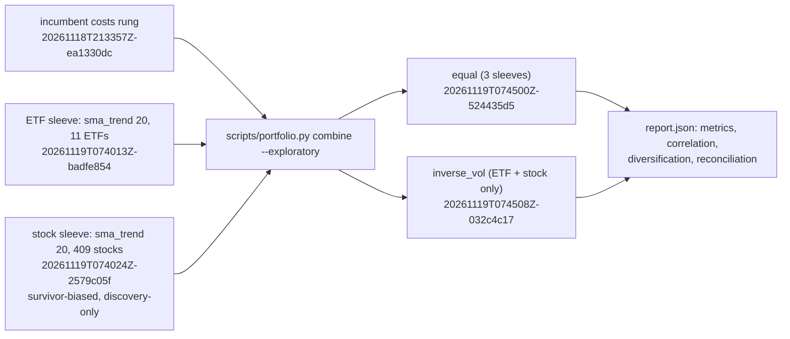

# Portfolio construction demonstration (Plan 7, phase P5)

- Work status: complete (Plan 7 Task 3). A combiner of run outputs was exercised on three
  real sleeves. Offline, no network, no broker request, no order.
- Roadmap and owners: P5 of the
  [offline research infrastructure design](2026-11-17-offline-research-infra-design.md),
  [roadmap](../roadmap.md) step 9, [Plan 7](2026-11-18-offline-infra-plan7-portfolio-plan.md).
  Conventions: [combinations](../conventions.md#combinations). Goals row:
  [research baseline and selection](../goals.md).
- Evidence class: `use: engineering`, `exploratory: true`. **These numbers demonstrate the
  mechanism. They are not a research finding and support no strategy claim.** No trial was
  recorded in the tracked ledger (`research/registry/trial-ledger/` is untouched).
- Receipt: [evidence JSON](evidence/2026-11-18-portfolio.json) (run ids, metrics, hashes;
  no prices). Code: `research/evaluation/portfolio.py`, `scripts/portfolio.py`,
  `scripts/portfolio_repro.py`.
- Reports (relative to the data root): `portfolio/20261119T074500Z-524435d5/20261119T080117Z/report.json`
  and `portfolio/20261119T074508Z-032c4c17/20261119T080123Z/report.json`. The first reports,
  `portfolio/<run id>/report.json`, stay as superseded history: they were written before the
  final-review fixes (sleeve and combined turnover 0, risk shares from the first rebalance's weights).



## Sleeves

All use `sector-etfs-2016-2025-n1` or `spy-equities-2016-2025-n2` in the real data root,
2,514 sessions from 2016-01-04 to 2025-12-31. **The date sets are identical**, so the
alignment rule (no silent intersection) was satisfied for all three.

| Sleeve | Run id | Source | Net CAGR | Max drawdown | Sharpe (0 rf) | Calmar |
| --- | --- | --- | --- | --- | --- | --- |
| incumbent | `20261118T213357Z-ea1330dc` | costs rung of the clean incumbent analysis (SPY, EMA50/200 with the traffic-light gate, 5 bp + $1) | 10.75% | 16.42% | 0.931 | 0.654 |
| ETF trend | `20261119T074013Z-badfe854` | spec `portfolio-sleeve-etf-trend` (`sma_trend` window 20, gross 0.95, SPY and ten sector ETFs, 5 bp + $1, one rung) | 4.66% | 22.25% | 0.408 | 0.209 |
| stock trend | `20261119T074024Z-2579c05f` | spec `portfolio-sleeve-stock-trend` (same strategy, all 409 names, 5 bp + $1, one rung) | -29.02% | 96.79% | -3.628 | -0.300 |

The two new sleeves ran from a clean tree (code commit `d34954b`). The stock sleeve carries
`survivor-biased` and `discovery-only` from its dataset (`universe_kind:
current-holdings-proxy`). Screening time was not measured for this task.

The stock sleeve loses 29% a year, and the cause is verified by ablation (the 409 names, the
same strategy and data, only the cost model changed; the engine reproduces the recorded run
exactly):

| Cost model | Net CAGR | Max drawdown |
| --- | --- | --- |
| 0 bp + $0 | 10.9% | 26.6% |
| 5 bp + $0 | 6.3% | 27.6% |
| 5 bp + $1 (recorded) | -29.0% | 96.8% |

In the recorded run the book makes about 48 fills per session with a median fill of 1 share
(about $94), so the $1 commission is about 1% of each fill. The strategy re-equalises ~409
tiny positions every day (1-2 share top-ups), so the commission bleeds the account; the
invested weight collapses from 0.83 (2016) to 0.42 (2019), 0.07 (2021) and 0.007 (2025), and the
account ends mostly in cash. This is a property of the strategy and its cost model (daily
re-equalisation of many tiny positions), **not of the combiner and not an engine bug**. It is
not tuned away here, because strategy tuning is outside this task. It makes the stock sleeve a
useful stress case for the arithmetic below.

## Combinations

Defaults except as noted: monthly rebalance, 5 bp rebalance cost, gross 1.0, 100,000 initial
cash, 60-session volatility window.

| Combination | Run id | Components | Net CAGR | Max drawdown | Sharpe (0 rf) | Calmar |
| --- | --- | --- | --- | --- | --- | --- |
| equal | `20261119T074500Z-524435d5` | incumbent, ETF, stock (1/3 each) | -5.98% | 52.78% | -0.637 | -0.113 |
| inverse_vol | `20261119T074508Z-032c4c17` | ETF, stock (first rebalance 50/50) | -18.16% | 86.98% | -2.322 | -0.209 |

**inverse_vol over all three sleeves was refused**, correctly: the incumbent holds no
position for its first 200 sessions (EMA200 warm-up), so its return series has zero
volatility over the first 60 sessions and the combiner raises `component
20261118T213357Z-ea1330dc has zero or non-finite volatility over the 60 sessions before 61`.
The rule was not loosened; the inverse-volatility combination uses the two sleeves that have
returns from the start. This is a limit of the method on warm-up sleeves, and the first
`inverse_vol` demonstration is therefore not a like-for-like comparison with `equal`.

### Diversification and correlation

| Figure | equal (3 sleeves) | inverse_vol (2 sleeves) |
| --- | --- | --- |
| Diversification ratio | 1.270 | 1.250 |
| Risk shares (incumbent, ETF, stock) | 35.2%, 42.3%, 22.4% (sum 1.0) | ETF 49.9%, stock 50.1% (sum 1.0) |
| Time-averaged start weights | 0.336, 0.335, 0.330 | ETF 0.315, stock 0.685 |
| Portfolio daily sigma (gross return) | 0.569% | 0.534% |

Sleeve `net_return` correlations: incumbent with ETF 0.542, incumbent with stock 0.329,
ETF with stock 0.368. Both figures describe the weights actually held: the per-session start
weights (targets on rebalance sessions, drifted weights otherwise) give contributions
`c = w * r`, risk share is `Cov(c_i, gross return) / Var(gross return)` (sums to 1 exactly), and
the diversification ratio uses the time-averaged start weights over the gross-return volatility.
The first report used the first rebalance's weights and the post-cost return; for the equal
combination the ratio moved from 1.269 to 1.270, and for inverse volatility from 1.338 to 1.250
(the first rebalance is 50/50 but the mean target weights are ETF 0.31 / stock 0.69).

The stock sleeve's low volatility (0.587% a day against the ETF sleeve's 0.841%) is not a
sign of safety: it comes from the sleeve sitting in cash after the invested-weight collapse
above. Inverse volatility therefore rewards it with the larger weight (mean target 0.69), and the
combination still ends deeply negative because that sleeve's return is far worse than its
volatility suggests.

### Reconciliation and bounds

| Check | equal | inverse_vol |
| --- | --- | --- |
| Reconciliation status | PASS | PASS |
| Max absolute return error vs sleeve returns and positions | 0 | 8.7e-19 |
| Maximum sum of weights | 1.0000000000000009 | 1.0000000000000004 |
| Minimum cash | -8.9e-16 | -4.4e-16 |
| Total rebalance cost (fraction of equity, summed) | 0.00166 | 0.00488 |
| Combined rebalance turnover per year (sum of absolute weight changes / years) | 0.332 | 0.979 |

The weights sum to 1 and cash is zero to within float rounding (the report clips rounding noise
below 1e-12 to 0.0; it is not leverage). Rebalancing is a cost on returns, so the combined
fills table is empty by design: the combined `turnover` is `null` with a note, and
`rebalance_turnover_per_year` is the figure to read. Sleeve turnover now comes from each
component's real fills and the sleeve's own initial cash (`config.market.initial_cash`): per
year, incumbent 1.26, ETF trend 88.1, stock trend 59.5 (the first report showed 0 for all
three because the empty combined fills table was used).

## Labels, use and trials

Both combinations inherit `survivor-biased` and `discovery-only` and `universe_kind:
current-holdings-proxy` from the stock sleeve, in the run manifest and in the report.
`use` is `engineering`: the incumbent run itself carries no `use`, so no component is
`financial`. Both manifests say `exploratory: true` and carry no `trial`. **No trial was
recorded in the tracked ledger.** A real research combination would need a frozen plan, a
cycle id (`--cycle-id`, one ledger trial) and its own forward window; none exists here.

## Reproducibility

The equal combination was recomputed from the same component run ids and parameters with the
same code (the reproduction script `scripts/portfolio_repro.py`, since the CLI reads and writes
one runs root):

```text
scripts/portfolio_repro.py --run-id 20261119T074500Z-524435d5 --runs-root <data root>/runs
```

- `config_hash` identical: `524435d5410828c2e1266ae6ac2627ae7e7acd00ac74a4101db99e2d8d802712`.
- The SHA-256 of the `returns`, `positions`, `signals` and `fills` parquet files is **identical**
  to the values in the original manifest; the temporary run id
  (`20261119T080150Z-524435d5`) differs from the original only by its timestamp prefix.
- The comparison is of parquet hashes; the evidence JSON records them. The temporary run
  lived in a temporary directory that was deleted; nothing was copied into the data root.

## Validation actually performed

- Run for real: two new sleeve analyses (engineering, clean tree), two combinations, one
  refused combination, two reports (regenerated after the final review, in the timestamped
  layout), one reproducibility comparison, and the stock-sleeve cost ablation above. Unit tests for the
  combiner and the command ran offline in `make check` (see the Plan 7 task reports).
- Not run: `--cycle-id` (no ledger trial), any financial-use sleeve (it would be refused: the
  datasets are not owner-accepted), membership masking, any forward window.

## Limitations

- One demonstration; three sleeves, one data period, one rebalance setting. No sensitivity.
- Sleeve-level model: sleeve returns, not shares; positions are sleeves and `quantity` is 0.
  No lot sizes, no per-name limits, no netting inside or across sleeves.
- Cash earns zero. Costs are rebalance turnover only; sleeve returns already include their own
  costs and none is charged twice.
- The stock sleeve is survivor-biased and its result is dominated by the flat $1 commission on
  very small fills (ablation above); the ETF and incumbent sleeves are on a
  `pass-with-exceptions` dataset the owner has not accepted.
- The inverse-volatility combination excludes the incumbent because of warm-up (see above).
- Equal and inverse-volatility weighting are the only methods; no covariance or optimiser.
- The combined numbers are dominated by one bad sleeve and say nothing about whether
  combining better strategies helps.

## Deferred follow-ups

Not implemented here:

- An opt-in warm-up-aware `inverse_vol` so a sleeve with a leading warm-up (the incumbent) can
  join an inverse-volatility combination.
- Nested combinations (a combination as a component).
- Validation of `--cycle-id` against a registered research cycle.
