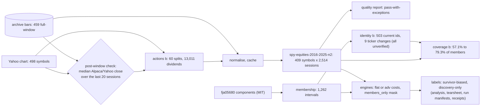

# S&P 500 stock layer (P3): data, membership, identity, costs and timing

- Work status: complete (Plan 5, Tasks 1 to 6, plus the final-review fix wave that produced
  dataset `n2`). Offline except the authorised fetches (Yahoo chart endpoint under the owner
  ruling of 2026-11-18, GitHub for the membership sources); no broker request and no order.
- Roadmap and owners: P3 of the
  [offline research infrastructure design](2026-11-17-offline-research-infra-design.md),
  [roadmap](../roadmap.md) step 5, [Plan 5](2026-11-18-offline-infra-plan5-stocks-plan.md),
  [data library](../data-library.md). Survivor-bias rule: [goals](../goals.md).
- Evidence class: local engineering evidence on a `pass-with-exceptions` dataset that the
  owner has not accepted. **Every stock analysis is labelled survivor-biased and
  discovery-only and cannot clear G2.** Not for financial use.
- Receipt: [evidence JSON](evidence/2026-11-18-stock-layer.json) (counts, hashes, timings,
  parity; no prices).
- Superseded history: dataset `spy-equities-2016-2025-n1` (416 names), its quality report,
  `sp500-identity-20261118`, `sp500-coverage-spy-equities-n1-20261118` and the parity receipt
  on `n1` stay in the data root as history. `n2` replaces them; the differences are in the
  next section.

## What the fix wave changed (n1 to n2)

| Finding in the final review | Fix | Effect |
| --- | --- | --- |
| Yahoo dividends and closes for seven names are also adjusted for events after the window (a 25:1 BKNG split in 2026, and so on), so un-adjusting them for in-window splits is not enough | `stock-actions --bars-dir` excludes a symbol whose median Alpaca/Yahoo close ratio over the last 20 window sessions, after applying Yahoo's own in-window splits, differs from 1 by more than 0.5%. No factor is inferred: a spin-off adjustment need not be a pure ratio | 10 symbols excluded (the seven known and AMCR, CRWD, CVNA); universe 416 to 409; quality check `actions_post_window_adjustment` lists the measured ratios; cross-source breaches 21,504 to 3,906 |
| Ticker renames mask real members | `derive-renames` writes unverified records from adjacent membership intervals | 8 renames applied (below); 450 candidates stay unresolved |
| Run outputs carry no labels, tearsheet unlabelled | `labels` and `universe_kind` in every stock-class or masked run manifest (analysis and parity), labels in the tearsheet title | ETF run manifests keep exactly their old keys (golden and hashes unchanged) |
| Minor | `split_consistency` quality check; sha256 of the membership and identity documents in the analysis `universe` block and the membership verified against its manifest; datasets cache keyed on a code version; GitHub redirect host check, expand errors in the manifest notes and licence-derived rights wording; non-HTTP failures count to the Yahoo stop; dashboard derives labels from `universe_kind`; report Universe line states names, exclusions and the ex-date dividend credit | See the report in the fix-wave folder and the tests |

**Correction to the first record.** The first version of this record said every stock
analysis and receipt carried the two labels. That was true of `analysis.json`, the report,
the Analysis page and the parity receipt, but not of the run manifests or the tearsheet. Both
carry them from the fix wave on. Runs written before it (including the `n1` runs) have no
labels in their manifests; their `datasets` block shows the `universe_kind`.

## Scope and limits

- **Universe:** the issuer's current SPY equity holdings (current-holdings proxy). The
  archive has 459 full-window names; **409** are in `n2`. The other 50 full-window names are
  excluded, and so are 41 partial-window and 3 unavailable names. In all 62 symbols are
  excluded by the actions step (50 of the full-window list, 12 not in it): 43 for a
  non-integer or unit split ratio, 4 for a reverse split, 5 failed fetches and 10 for a
  post-window adjustment.
- **Large caps are missing.** The split rule excludes any symbol with a reverse or
  non-integer split event (47). It protects raw-price backtests from a corrupted share count,
  but most of the 47 are spin-off or merger adjustments that Yahoo encodes as ratios near 1
  (IBM 1.046:1, GE 1.04:1, MMM 1.196:1), not real splits. They include GE, IBM, MMM, PFE,
  MRK, T, HON, RTX, DD, DHR, EXC, MET, OXY, YUM, DELL and HPE, and six true fractional
  splits (BF.B 5:4; ODFL, PCAR, RJF, ROL, WRB 3:2). Five more failed to fetch (FDXF, HONA,
  HUBB, KVUE, VYLR; HTTP 400 or an invalid-OHLC response, not retried). Treating spin-off
  pseudo-splits properly is a follow-up, not done here.
- **Post-window adjustment.** Ten symbols have a median Alpaca/Yahoo close ratio away from 1
  over the last 20 sessions: BKNG 25.0, KLAC 10.0, CVNA 5.0, CRWD 4.0, APH 2.0, MNST 2.0,
  FDX 1.241, CMCSA 1.067, SPGI 1.057 and AMCR 0.2 (a reverse split). Seven of them (APH, BKNG,
  CMCSA, FDX, KLAC, MNST, SPGI) are on the full-window list and were the known cases; CVNA,
  CRWD and AMCR are not, so `n2` loses exactly those seven (416 to 409). Yahoo's dividends for
  these names are adjusted for the later event as well, so they cannot be un-adjusted from
  in-window splits alone; they are excluded, not corrected.
- **Survivor bias:** former members' prices are out of scope, so no run can include a name
  that left the index. Membership masking (`members_only`) removes names that were not
  members on the decision date, but it cannot add the missing ones. The share of members
  with data per date is 0.571 at the minimum (2016-01-04, 288 of 504), 0.699 at the median
  and 0.793 on 2025-12-31 (399 of 503). Results are discovery-only.

## Corporate actions (Yahoo)

| Item | Result |
| --- | --- |
| Fetch | 503 requested, 498 received, 5 failed, no 403 or 429 |
| Actions file | `normalized/spy-equities-2016-2025-actions-yahoo-yahoo-spy-equities-2016-2025-20261118b.json` (the first file, without the post-window check, stays as history) |
| Splits | 60 records, integer forward ratio of at least 2 only |
| Dividends | 13,011, un-adjusted by the product of the ratios of later in-window splits |
| Post-window check | 451 symbols checked (498 minus the 47 split exclusions), 0 unchecked, 10 excluded |
| Pay date | Not provided: `pay_date = ex_date`, credited on the ex-date, listed as the `pay_date_assumed` exception (12,583 events in `n2`) |
| Split-date check | `split_consistency` passes: each split's raw close times its ratio is within 15% of the previous close; no big move next to a split date |

## Quality report

`quality/spy-equities-2016-2025-n2/20261119T020229Z/report.json`, built on the clean commit
`d593cd85c220a989a39131abe601791d592fa9ad`: **pass-with-exceptions**, not accepted by the
owner.

| Check | Result |
| --- | --- |
| sessions, duplicates, non_finite, non_positive, ohlc, actions_converted, split_events, split_consistency | pass (0) |
| half_days | 21 listed |
| zero_volume | 904 exceptions |
| gaps | 165 (real moves above 25% on non-split days) |
| cent_rounding | 311,424 values rounded to the cent grid |
| actions_excluded | 2 (dividends before the window: A and ERIE on 2015-12-31) |
| cross_source (Alpaca vs Yahoo) | 3,906 breaches of 1,024,531 compared (was 21,504 on `n1`); 368 symbols have at least one; SW 2,137, CBOE 379, SMCI 353, IBKR 122 account for 2,991 of them. Not resolved, listed |
| universe | 62 excluded symbols with reasons |
| actions_post_window_adjustment | 10 names with their measured ratios |
| pay_date_assumed | 12,583 |

## Membership, identity and coverage

- **Membership** `sp500-membership-20261118`: `fja05680/sp500` (MIT, licence text hashed with
  the snapshot), 1,262 intervals for 1,209 symbols; 504 members on 2016-01-04 and 503 on
  2025-12-31. Spot checks all passed: TSLA from 2020-12-21, AAPL throughout, and FB until
  2022-06-08 with META from 2022-06-09. The first source picked by the fetch was a stale
  file ending in 2019; it was corrected after the live run and kept as evidence.
- **Cross-checks** on the first trading day of each year 2016 to 2025:
  `hanshof/sp500_constituents` is a current list, so it is one-sided; names only there
  went from 138 to 82 with the eight renames resolved; `index-constitution` is symmetric
  (198 primary-only and 177 other-only before resolution, 142 and 121 after). Differences
  are listed in the membership and identity documents and were not tuned away.
- **Identity** `sp500-identity-20261118b` (built from the same membership and archive;
  `sp500-identity-20261118` is the history): 1,214 symbols, 503 current issuer ids, 702
  historical-only `sym:` ids, 9 aliases, **9 ticker changes applied, all `verified: false`
  with no `source_url`**.
  - FB to META (2022-06-09) is the original record, from `research/registry/ticker-changes.json`
    with a note that no source could be checked offline.
  - Eight records were derived from adjacent membership intervals and carry the note
    "derived from adjacent membership intervals in sp500-membership-20261118 (fja05680 file);
    not independently verified": TMK to GL (2019-08-08), BLL to BALL (2022-05-10), ANTM to
    ELV (2022-06-28), NLOK to GEN (2022-11-08), PKI to RVTY (2023-05-16), RE to EG
    (2023-07-10), ABC to COR (2023-08-30), FLT to CPAY (2024-03-25).
  - **Why only eight.** The ruling allows records derived from adjacent intervals. The
    membership table cannot tell a rename from an ordinary one-for-one replacement: 159
    candidates have their new symbol in the dataset, and applying all of them would merge
    unrelated companies (for example GLD to ADBE, TWTR to ACGL, AIV to TSLA) and widen the
    mask for names such as TSLA. The command therefore keeps a candidate only if the old
    symbol is historical-only, both symbols occur in one candidate each, the old symbol was
    a member in the window, and the second source (`hanshof` current list) dates the new
    symbol's addition to the index more than 7 days before its first membership here (the
    company was already in the index under the old ticker). Each record keeps the
    corroborating date in a `corroboration` field.
  - **Missed renames.** BK to BNY and MMC to MRSH are renames the current-list source cannot
    corroborate (it predates them), so they are not applied. 450 candidates stay unresolved.
    All nine records need owner review before any G2 claim.
- **Coverage** `sp500-coverage-spy-equities-n2-20261118b`: minimum 0.5714 on 2016-01-04
  (288 of 504), median 0.6990, 0.7932 on 2025-12-31 (399 of 503). The document lists
  `late_or_never_member_dataset_symbols`: 153 dataset names whose first membership starts on
  the day of an unresolved rename candidate (mostly ordinary late additions; shown as a
  count in the analysis report's Universe line).

## Cost model

`MarketConfig(cost_model="adv")` (default `flat`, unchanged). Slippage in bp comes from the
median of close times volume over the 20 sessions strictly before the decision session:
at least 1e9 USD 2 bp, at least 1e8 5 bp, at least 2e7 10 bp, otherwise 25 bp; fewer than
20 sessions use 25 bp. The fill is at the open of the next session. Both engines call the
shared `cost_bps` and `cost_table`. Raw close and volume are used. **The earlier note that a
split inside the window can distort ADV was wrong for this data:** the Alpaca volume is raw
too (AAPL's 4:1 split of 2020-08-31: volume 244 million against 53 million the session
before, close down from 499 to 129), so close times volume is split-invariant and only a real
volume change moves ADV. The lookahead check passes with `adv`. The tiers are modelled, not
calibrated to quotes.

## Performance and bit-identity

Measured before the fix wave on `n1` (all 416 names, 2,514 sessions),
`sma_trend_targets(window=20, gross=0.95)`; `n2` has 409 names, so the times scale by about
2% less. The machine was shared (load average 10 to 18), so single-run timings are noisy.

| Run | Before | After |
| --- | --- | --- |
| Screening, flat costs | 178.8 s | 83.3 s |
| Screening, `adv` costs | 122.4 s | 83.6 s |
| Screening, flat costs with `members_only` | 150.7 s | 86.6 s |
| Screening, 50 names, flat | 18.7 s | 11.4 s |
| Native engine, 20 names, `adv` | 36.0 s | 19.8 s |
| Native engine, 416 names, `adv` (**extrapolated** linearly from 20 names) | about 750 s | about 413 s |

The target (screening under 5 minutes) was met before and after. Changes: `history_view`
slices precomputed frames instead of copying every frame each session (the frames are shared,
so strategies and callers must not modify them; `MarketData` is documented as immutable after
construction); both engines look splits and dividends up by date and use index maps instead of
per-session scans and `list.index`; the native engine reads bar columns from arrays. What
remains is mostly pandas work inside the strategy callback and NautilusTrader itself. The
native speed-up is less certain than the screening one because of the shared machine.

Results are **bit-identical**: pandas row hashes of the returns, positions, signals and
fills tables and the cash series match before and after for screening on all 416 names
(flat, `adv`, masked) and the native engine on 20 names; the 50-name hash also matches; the
incumbent spec rebuilt in two temp roots (before and after) gives identical run tables and
an identical `analysis.json` after normalising ids and timestamps; `make golden-check`
passes unchanged (also after the fix wave); `test_history_view_matches_reference` compares
the new view with a copy of the old construction at every fixture session.

## Parity on real data

`scripts/current/engine_parity.py run --dataset spy-equities-2016-2025-n2 --max-instruments 20
--cost-model adv` (the first 20 symbols alphabetically, A through ALB; includes the AFL 2:1,
ACGL 3:1 and AAPL 4:1 splits and 632 dividends): **passed, 0 mismatches**. Receipt
`parity/20261119T020306Z-af17c2e9/receipt.json` on the clean code commit
`d593cd85c220a989a39131abe601791d592fa9ad`, with the `n2` manifest hash, quality status
`pass-with-exceptions` and the survivor-bias labels; both run manifests also carry
`labels` and `universe_kind`. The earlier receipt on `n1`
(`parity/20261119T013649Z-a9e75a25`, code `016d9f6`) stays as history. This is engineering
evidence on 20 of 409 names, not a financial claim. The script also has `--timing-only`,
which records timing without a parity or financial claim; it is covered by a unit test, not
run on real data.

## Validation

- Offline tests: plain `make check` exit 0 after the code commits (1,432 tests in about
  60 s, golden, docs, boundaries, readiness and artifacts checks passed, 2026-11-19 UTC).
  Every behaviour change in the fix wave has a test written before the change.
- Real-data runs: the commands above on code commit `d593cd8`, 2026-11-19 UTC: actions,
  `n2` normalise, quality, identity, coverage and parity. The derived renames were chosen
  from real data and each was inspected; no rename is independently verified.
- Not run: an analysis spec on `n2` (no spec names it yet).

## Remaining limitations

- Large caps excluded by the split rule (above); spin-off pseudo-splits are not modelled.
- Former members' prices are missing; coverage 57.1% to 79.3% of members.
- Nine ticker changes are applied and none is verified; 450 rename candidates are unresolved.
- Dividends are credited on the ex-date; Yahoo gives no pay date.
- The quality report is not accepted by the owner; 3,906 cross-source breaches are listed,
  not resolved (four names account for most of them).
- Native timing for all names is extrapolated, not measured.

## Next action

Stock research is allowed to start as discovery-only work. Before any G2 claim, qualify
point-in-time membership with former members' prices, source the ticker changes (replace
the unverified records with cited ones) and decide how to treat spin-off adjustments.
