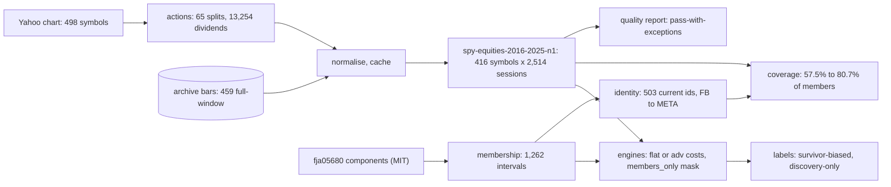

# S&P 500 stock layer (P3): data, membership, identity, costs and 416-name timing

- Work status: complete (Plan 5, Tasks 1 to 6). Offline except the authorised fetches
  (Yahoo chart endpoint under the owner ruling of 2026-11-18, GitHub for the membership
  sources); no broker request and no order.
- Roadmap and owners: P3 of the
  [offline research infrastructure design](2026-11-17-offline-research-infra-design.md),
  [roadmap](../roadmap.md) step 5, [Plan 5](2026-11-18-offline-infra-plan5-stocks-plan.md),
  [data library](../data-library.md). Survivor-bias rule: [goals](../goals.md).
- Evidence class: local engineering evidence on a `pass-with-exceptions` dataset that the
  owner has not accepted. **Every stock analysis is labelled survivor-biased and
  discovery-only and cannot clear G2.** Not for financial use.
- Receipt: [evidence JSON](evidence/2026-11-18-stock-layer.json) (counts, hashes, timings,
  parity; no prices).

## Scope and limits

- **Universe:** the issuer's current SPY equity holdings (current-holdings proxy). The
  archive has 459 full-window names; 416 are in the dataset. The other 43 full-window names
  and the 41 partial-window and 3 unavailable names are excluded.
- **Large caps are missing.** 47 symbols are excluded because Yahoo reports a split that is
  not an integer forward ratio, and 5 more failed to fetch (FDXF, HONA, HUBB, KVUE, VYLR;
  HTTP 400 or an invalid-OHLC response, not retried). The exclusion rule protects raw-price
  backtests from a corrupted share count, but most of the 47 are spin-off or merger
  adjustments that Yahoo encodes as ratios near 1 (IBM 1.046:1, GE 1.04:1, MMM 1.196:1),
  not real splits. They include GE, IBM, MMM, PFE, MRK, T, HON, RTX, DD, DHR, EXC, MET, OXY,
  YUM, DELL and HPE, and six true fractional splits (BF.B 5:4; ODFL, PCAR, RJF, ROL, WRB
  3:2). Treating spin-off pseudo-splits properly is a follow-up, not done here.
- **Survivor bias:** former members' prices are out of scope, so no run can include a name
  that left the index. Membership masking (`members_only`) removes names that were not
  members on the decision date, but it cannot add the missing ones. The share of members
  with data per date is 0.575 at the minimum (2016-01-04, 290 of 504), 0.699 at the median
  and 0.807 on 2025-12-31 (406 of 503). Results are discovery-only.

## Corporate actions (Yahoo)

| Item | Result |
| --- | --- |
| Fetch | 503 requested, 498 received, 5 failed, no 403 or 429 |
| Splits | 65 records, integer forward ratio of at least 2 only |
| Dividends | 13,254, un-adjusted by the product of the ratios of later splits |
| Pay date | Not provided: `pay_date = ex_date`, credited on the ex-date, listed as the `pay_date_assumed` exception (12,791 events) |
| Split-date check | Each split's raw close ratio matches its ratio; no big move next to a split date |

## Quality report

`quality/spy-equities-2016-2025-n1/20261119T004900Z/report.json`: **pass-with-exceptions**,
not accepted by the owner.

| Check | Result |
| --- | --- |
| sessions, duplicates, non_finite, non_positive, ohlc, actions_converted, split_events | pass (0) |
| half_days | 21 listed |
| zero_volume | 904 exceptions |
| gaps | 165 (real moves above 25% on non-split days, for example a +52% day) |
| cent_rounding | 317,041 values rounded to the cent grid |
| actions_excluded | 2 (outside the window) |
| cross_source (Alpaca vs Yahoo) | 21,504 breaches of 1,042,129 compared; mostly seven names (APH, BKNG, CMCSA, FDX, KLAC, MNST, SPGI) on every session, because the Yahoo snapshot is adjusted for splits after the window end that our actions list lacks |
| universe | 52 excluded symbols with reasons |
| pay_date_assumed | 12,791 |

## Membership, identity and coverage

- **Membership** `sp500-membership-20261118`: `fja05680/sp500` (MIT, licence text hashed with
  the snapshot), 1,262 intervals for 1,209 symbols; 504 members on 2016-01-04 and 503 on
  2025-12-31. Spot checks all passed: TSLA from 2020-12-21, AAPL throughout, and FB until
  2022-06-08 with META from 2022-06-09. The first source picked by the fetch was a stale
  file ending in 2019; it was corrected after the live run and kept as evidence.
- **Cross-checks** on the first trading day of each year 2016 to 2025:
  `hanshof/sp500_constituents` is a current list, so it is one-sided (131 names only there
  after identity resolution, 0 differences on 2025-08-23); `index-constitution` is
  symmetric (191 primary-only and 170 other-only after resolution, mostly unresolved
  ticker renames and its opt-out date convention). Differences are listed in the
  membership document and were not tuned away.
- **Identity** `sp500-identity-20261118`: 1,214 symbols, 503 current issuer ids, 710
  historical-only `sym:` ids, 1 alias. Only FB to META (2022-06-09) is applied, from
  `research/registry/ticker-changes.json`. **That entry is unverified:** it has no
  `source_url` and `verified: false`, because no source could be checked offline. 458
  one-day exit and entry pairs are unresolved candidates (121 with the exit in 2016 or
  later); real renames among them (ABC to COR, ANTM to ELV, BLL to BALL, BK to BNY) are not
  applied until a source is cited.
- **Coverage** `sp500-coverage-spy-equities-n1-20261118`: minimum 0.5754 on 2016-01-04
  (290 of 504), median 0.6990.

## Cost model

`MarketConfig(cost_model="adv")` (default `flat`, unchanged). Slippage in bp comes from the
median of close times volume over the 20 sessions strictly before the decision session:
at least 1e9 USD 2 bp, at least 1e8 5 bp, at least 2e7 10 bp, otherwise 25 bp; fewer than
20 sessions use 25 bp. The fill is at the open of the next session. Both engines call the
shared `cost_bps` and `cost_table`. Raw close and volume are used, so a split inside the
window can distort ADV for up to 20 sessions. The lookahead check passes with `adv`. The
tiers are modelled, not calibrated to quotes.

## Performance and bit-identity

All 416 names, 2,514 sessions, `sma_trend_targets(window=20, gross=0.95)`. The machine was
shared (load average 10 to 18), so single-run timings are noisy.

| Run | Before | After |
| --- | --- | --- |
| Screening, flat costs | 178.8 s | 83.3 s |
| Screening, `adv` costs | 122.4 s | 83.6 s |
| Screening, flat costs with `members_only` | 150.7 s | 86.6 s |
| Screening, 50 names, flat | 18.7 s | 11.4 s |
| Native engine, 20 names, `adv` | 36.0 s | 19.8 s |
| Native engine, 416 names, `adv` (**extrapolated** linearly from 20 names) | about 750 s | about 413 s |

The target (screening under 5 minutes) was met before and after. Changes: `history_view`
slices precomputed frames instead of copying every frame each session; both engines look
splits and dividends up by date and use index maps instead of per-session scans and
`list.index`; the native engine reads bar columns from arrays. What remains is mostly
pandas work inside the strategy callback and NautilusTrader itself. The native speed-up is
less certain than the screening one because of the shared machine.

Results are **bit-identical**: pandas row hashes of the returns, positions, signals and
fills tables and the cash series match before and after for screening on all 416 names
(flat, `adv`, masked) and the native engine on 20 names; the 50-name hash also matches; the
incumbent spec rebuilt in two temp roots (before and after) gives identical run tables and
an identical `analysis.json` after normalising ids and timestamps; `make golden-check`
passes unchanged; `test_history_view_matches_reference` compares the new view with a copy
of the old construction at every fixture session.

## Parity on real data

`scripts/current/engine_parity.py run --dataset spy-equities-2016-2025-n1 --max-instruments 20
--cost-model adv` (the first 20 symbols alphabetically, A through ALB; includes the AFL, ACGL
and AAPL splits and 631 dividends): **passed, 0 mismatches**. Receipt
`parity/20261119T013649Z-a9e75a25/receipt.json` records the manifest hash, quality status
`pass-with-exceptions` and the survivor-bias labels. This is engineering evidence on 20 of
416 names, not a financial claim. The script also gained `--timing-only`, which records
timing without a parity or financial claim; it is covered by a unit test, not run on real
data.

## Validation

- Offline tests: plain `make check` exit 0, 1,408 tests in 56 s, golden passed, docs,
  boundaries, readiness and artifacts checks passed (2026-11-19 UTC, after the code commit).
- Real-data runs: the commands above, on code commit `016d9f6`, 2026-11-19 UTC.

## Remaining limitations

- Large caps excluded by the split rule (above); spin-off pseudo-splits are not modelled.
- Former members' prices are missing; coverage 57.5% to 80.7% of members.
- FB to META is unverified; 458 rename candidates are unresolved.
- Dividends are credited on the ex-date; Yahoo gives no pay date.
- The quality report is not accepted by the owner; cross-source breaches are listed, not
  resolved.
- Native timing for all names is extrapolated, not measured.

## Next action

Stock research is allowed to start as discovery-only work. Before any G2 claim, qualify
point-in-time membership with former members' prices, source the ticker changes and decide
how to treat spin-off adjustments.
