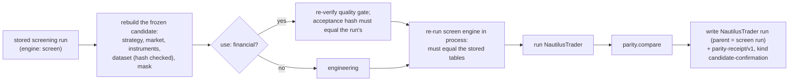

# Candidate confirmation (Plan 8, roadmap step 10)

- Work status: complete (Plan 8, Tasks 1 to 3). Offline; no network, broker request or order.
- Roadmap and owners: [offline research infrastructure design](2026-11-17-offline-research-infra-design.md)
  ([three rules](2026-11-17-offline-research-infra-design.md#three-rules)),
  [roadmap](../roadmap.md) step 10, [Plan 8](2026-11-19-offline-infra-plan8-candidate-confirmation-plan.md),
  [workflow](../workflow.md) rule 3 and its refs recipe, [Plan 6 record](2026-11-18-enforced-rules.md).
- Evidence class: `use: engineering`. The datasets have **no owner-accepted quality report, so none
  of the receipts below can back a `keep`**. No record was logged to the registry, no trial was
  recorded and no acceptance was written (`scripts/data.py accept` was not run).
- Receipt: [evidence JSON](evidence/2026-11-19-candidate-confirmation.json) (run ids, receipt ids,
  statuses, timings; no prices). Code: `research/evaluation/confirm.py`, `scripts/confirm.py`.
  Tests: `tests/current/test_confirm.py`, `tests/current/test_confirm_cli.py`,
  `tests/current/test_keep_path.py`.

## What the command does

`scripts/confirm.py --run-id ID` exits 0 only for status `passed`. It refuses (exit 1, `error: ...`)
a non-`screen` run, a changed dataset hash, a stored run that no longer reproduces, a financial
run whose gate no longer verifies, a dirty tree (unless `--allow-dirty`, whose receipt carries
`+dirty` and is rejected for `keep`) and, since this task, a native engine failure. Absent data
exits 2. A mismatch writes a `mismatch` receipt and exits 1.

## Keep-path scenario (temporary roots)

`tests/current/test_keep_path.py` walks, in a temporary data root with a tiny dataset and an
accepted quality report: a financial screening run, `confirm`, a `keep` dry run rejected without
a validation receipt (the message names it), rejected for a receipt that does not cover both runs
and for a Research skill as validator, accepted with a valid receipt from a Validation skill (a
non-dry log into the temporary registry also works), and a `--allow-dirty` confirmation rejected
as dirty. A second scenario (added by the final review fix wave, red first) shows that a `keep` is
rejected for a mismatching native run cited with a foreign passing receipt, a receipt of another
screening run, a stale screening run, a masked run kept with an unmasked confirmation (universe
swap) and a plain engine-parity receipt, and accepted only for the matching confirmation. Each
rejection is asserted before its success, and the rejection messages are checked by text. It never
touches the real registry (its hash is asserted unchanged).

## Real-data confirmations (engineering use)

Data root and receipts live outside the repository; ids below.

| Candidate | Screening run | Result | Stored run reproduced | Screen s | Native s | Mismatches |
| --- | --- | --- | --- | --- | --- | --- |
| ETF sleeve: `sma_trend` window 20, gross 0.95, SPY and ten sector ETFs, 5 bp + $1 (`sector-etfs-2016-2025-n1`, 2,514 sessions) | `20261119T074013Z-badfe854` | passed; native run `20261120T065117Z-bc294994`, receipt `20261120T065117Z-604c9050` | yes | 2.16 | 13.60 | 0 |
| Incumbent costs rung: `traffic_light` (EMA 50/200 with the volatility gate), SPY, 5 bp + $1 | `20261118T213357Z-ea1330dc` | passed; native run `20261120T065125Z-1bf6cadf`, receipt `20261120T065125Z-07246157` | yes | 0.29 | 0.48 | 0 |
| Stock sleeve: `sma_trend` window 20, 409 names (`spy-equities-2016-2025-n2`) | `20261119T074024Z-2579c05f` | **refused**, exit 1, nothing written | not reached | n/a | n/a | n/a |

Both passing runs ran from a clean tree (commit `cf21a36`) and the dataset manifest hash matched the
stored run's. The second (a stateful strategy with a gate) shows the "stored run equals re-run"
claim holds for more than a stateless trend.
**Finding (stock sleeve).** The native engine stops at the first multi-name rebalance (2016-02-02)
with `Exceeded MAX_ORDER_SUBMIT_RATE`: NautilusTrader's risk engine rejects more orders per second than
`RiskEngineConfig.max_order_submit_rate`, whose default is `100/00:00:01` (100 orders per second;
verified in nautilus_trader 1.231.0), and the 409-name book submits several hundred orders in one
bar, so the first multi-name rebalance exceeds it. This is the native engine's limit on a
wide book, not a mismatch and not a tuned result; the engine and tolerances were left as they are.
Raising the rate limit is a native-engine change with its own parity evidence, so it is a
follow-up, not part of this task. Consequence: **the stock sleeve cannot yet be confirmed, so a
stock candidate cannot yet reach `keep`.** Before the small fix below, the same condition
escaped as a Python traceback.

**Bug fixed in this task.** `scripts/confirm.py` did not catch `EngineError`, so a native engine
failure printed a traceback; it now prints `error: ...`, exits 1 and writes nothing (test
`test_native_engine_failure_is_a_refusal_not_a_traceback`). This landed after the two passing
runs, and touches only the error path.

## Limits

- Confirmation proves the two engines agree on one frozen candidate and that the stored screening
  run reproduces. It does not validate the strategy's merit or the data. After the final review fix
  wave, `log` accepts a `keep` only when the parity receipt is the `candidate-confirmation` receipt
  naming exactly the cited screening and NautilusTrader runs (ids and manifest hashes); the
  receipt vouches for engine-file identity between commits and for these two runs agreeing.
- The receipt's `bindable` means dataset-hash-bound (a dataset manifest SHA-256 was recorded and
  re-checked). For a masked run, the membership and identity file hashes are compared only when the
  screening run recorded them (runs made after the fix wave); older masked runs record ids only,
  and only the membership manifest (when present) is verified for them.
- A confirmation that disagrees writes its native run without `use` and `acceptance_sha256`, so it
  fails the financial-run gate on its own.
- Roles in the validation receipt are self-reported (Plan 6).
- A real `keep` still needs an owner-accepted quality report, a validation receipt from a
  Validation skill, a clean tree and the owner's decision
  ([workflow](../workflow.md)). None exists for any real dataset.
- A book that submits more than 100 orders in one bar (the 409-name stock book) exceeds
  NautilusTrader's default `max_order_submit_rate` of 100 per second (above).
- Receipts and runs are local files under the data root; they are not tracked.
