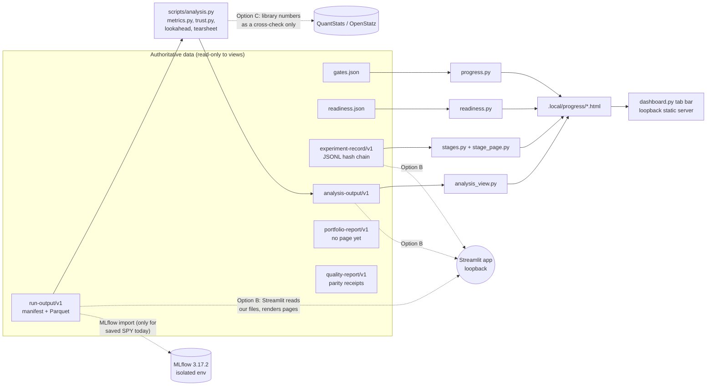

# Dashboard reuse capability review

Documentation-only review for the owner's decision. It adopts nothing, changes no
code, dependency, registry or pinned file, and recommends no purchase of work. It
asks whether an existing open-source dashboard or reporting tool should replace or
feed the hand-written static pages. Process owner: [workflow](../workflow.md);
dependency rule: a capability review plus a locked-dependency change in its own
commit ([architecture](../architecture.md#project-and-dependency-boundaries)).
Earlier reuse scan: [design reuse table](2026-11-17-offline-research-infra-design.md#reuse-candidates).

- Work status: complete (review delivered); adoption decision open, owner's.
- Facts gathered 2026-11-19 UTC with the GitHub CLI and PyPI JSON; commands below.

## Question and scope

**Question.** Should the platform reuse an existing dashboard/reporting tool instead
of its own pages, and if so which layer: rendering, data model, or only ideas?

**In scope.** Six candidates (Skippy-8/quantlab, MementoRC/quant-research-lab,
nittygritty-zzy/quantlab, Streamlit, OpenStatz and QuantStats, MLflow) against our
constraints: offline, read-only, loopback only, html-escaped values, licence permits
private use, no new dependency without review.

**Out of scope.** Strategy research, adoption, broker or paper state, installing any
candidate, or running any candidate's code. Nothing below was installed or executed;
every capability statement about a candidate is from its README, manifest or
configuration source and is **unverified by running it**.

## Current state (implemented) and where reuse could plug in

Implemented now: static pages built by scripts, written to `.local/progress/`, shown
by a tab-bar page in frames, served from loopback by a static server. All values are
html-escaped; the pages make no network calls and write nothing back
(`scripts/dashboard.py`, `scripts/progress.py`, `scripts/stages.py`,
`scripts/readiness.py`, `scripts/analysis.py`, `research/control/stage_page.py`,
`research/control/analysis_view.py`). The hand-written code behind the pages is about
1,500 lines including the metrics and trust modules (`wc -l` on the eight files plus
`research/evaluation/metrics.py` and `trust.py`: 1,481 lines).



Solid lines are implemented. Dotted lines are options, none implemented. MLflow
import exists only for saved SPY runs ([0003](../decisions/0003-local-performance-browser.md));
run-output/v1 is not imported.

## Candidate facts

Commands (run from `/tmp`; no candidate code was cloned or executed):

```text
gh api repos/OWNER/REPO --jq '[.license.spdx_id,.created_at,.pushed_at,.stargazers_count,.forks_count,.open_issues_count,.size,.language,.archived,.fork]|@tsv'
gh api repos/OWNER/REPO/readme --jq .content | base64 -d
gh api repos/OWNER/REPO/contents/pyproject.toml --jq .content | base64 -d
gh api repos/OWNER/REPO/releases --jq '.[0:6][]|[.tag_name,.published_at]|@tsv'
gh api repos/OWNER/REPO/commits --jq '.[0].commit.author.date, .[-1].commit.author.date'
gh api repos/OWNER/REPO/contributors --jq length
curl -s https://pypi.org/pypi/PACKAGE/json   # requires_dist, wheel sizes, licence
```

GitHub `size` is KB of the repository, not install size. `open_issues_count` includes
pull requests. Contributor and commit counts are the first API page (30 maximum).

| | Skippy-8/quantlab | MementoRC/quant-research-lab | nittygritty-zzy/quantlab | streamlit/streamlit | marketcalls/openstatz | ranaroussi/quantstats | mlflow/mlflow |
| --- | --- | --- | --- | --- | --- | --- | --- |
| Licence (SPDX) | MIT | none declared (API returns no licence; `/license` 404). No right to reuse code: ideas only | MIT | Apache-2.0 | Apache-2.0 | Apache-2.0 | Apache-2.0 (PyPI shows the full text, not an SPDX field) |
| Created | 2026-10-14 | 2026-09-16 | 2025-10-16 | 2019-08-24 | 2026-06-29 | 2019-05-01 | 2018-06-05 |
| Last push | 2026-10-15 | 2026-11-17 | 2025-10-17 | 2026-11-20 (UTC) | 2026-09-24 | 2026-11-02 | 2026-11-20 (UTC) |
| Stars / forks / open issues | 0 / 0 / 0 | 0 / 0 / 0 | 15 / 4 / 0 | 46,450 / 4,455 / 1,193 | 22 / 6 / 2 | 7,896 / 1,302 / 34 | 28,904 / 6,640 / 2,251 |
| Repo size (KB) | 4,425 | 3,865 | 1,214 | 1,288,321 | 1,875 | 5,992 | 1,520,801 |
| Language | Python | Python | Python | Python | Python | Python | Python |
| Releases | none (0.1.0 in manifest, 0 GitHub releases) | none | 3 (v0.2.0, v0.2.1, v0.3.0) | 1.67.0 on 2026-11-05, 1.66.1 on 2026-10-21, 1.66.0 on 2026-10-14, 1.65.0 on 2026-10-02: about 2 to 3 weeks | none on GitHub; PyPI 0.5.0 | v0.0.86 on 2026-09-27; five 0.0.8x tags on 2026-09-26/27 after v0.0.81 on 2026-01-13 | v3.18.0 on 2026-11-04, v3.17.2 on 2026-10-21, v3.17.1 on 2026-10-13: about 1 to 2 weeks |
| Contributors (first page) | 1 | 2 | 1 | not checked | 2 | 30 (page cap) | not checked |
| Activity span | 13 commits, 2026-10-14 to 2026-10-15 | 30 commits, 2026-11-06 to 2026-11-13 (first page) | 15 commits, ended 2025-10-17 | continuous | single recent push | continuous | continuous |
| Main dependencies | numpy, pandas, pyarrow, duckdb, requests, pytz, plotly, pyyaml; dashboard extra streamlit>=1.45 | pandas, numpy, pyyaml, yfinance, pyarrow; pixi lock | click, duckdb, pyyaml, tabulate, pandas, numpy, scipy, plotly, polygon-api-client, yfinance, requests, openpyxl, python-dotenv; also Qlib and MLflow per README | altair, click, numpy, packaging, pandas, pillow, pydeck, protobuf, pyarrow, requests, typing-extensions, starlette, uvicorn, anyio, python-multipart, websockets, itsdangerous (watchdog off macOS) | matplotlib, numpy, **pandas<3**, python-dateutil, scipy, seaborn, tabulate, yfinance | matplotlib, numpy, pandas>=2, python-dateutil, scipy, seaborn, tabulate, yfinance | mlflow-skinny, mlflow-tracing, Flask, Flask-CORS, aiohttp, alembic, cryptography, docker, graphene, gunicorn, huey, matplotlib, numpy, pandas, pyarrow, scikit-learn, scipy, skops, sqlalchemy |
| Wheel size | not published | not published | PyPI `quantlabs` 0.3.0 (size not verified) | 11.2 MB | 0.76 MB | 0.10 MB | 12.6 MB |
| Renders | 13 Streamlit view modules (backtest, builder, compare, data, events, home, insiders, monitor, optimize, options, registry, robustness, walkforward); HTML tearsheet; Node console | One static `site/index.html` (39 KB) reading `data/results.json`; GitHub Pages | Plotly charts and PNG from Qlib runs; MLflow runs under `results/mlruns` | Interactive Python-defined web apps | Single offline HTML tearsheet (plus optional `openstatz serve`); light/dark, PDF export | HTML tearsheet, plots, metrics, Monte Carlo | Run, experiment and artifact browser with metric comparison |
| Data model assumed | Own Parquet lake in DuckDB; own engine results and trial registry | Own `results.json`; locked `criteria.yaml` with hash; sealed holdout | Qlib `.bin` data and workflow YAML | Any pandas/Arrow data in Python | Returns series (pandas) | Returns series (pandas) | Runs with params, metrics, tags and file artifacts |
| Adoption signal | Personal project, 2 days of history, 0 stars | Personal project, 0 stars, no licence | Personal project, 15 stars, dormant a year | Widely used, large team | Small, 22 stars, 5 months old | Widely used, 7.9k stars | Widely used, 28.9k stars |
| Security notes | Not reviewed; calls external data APIs | Not reviewed; Actions and yfinance | Not reviewed | See below | Optional `serve` mode not reviewed; yfinance pulled in | yfinance pulled in | 13 published advisories listed on the GitHub API, including critical GHSA-26p8-2jq9-3vq9 (2026-10-09) and high GHSA-mr9f-g8qf-4w4j (2026-11-13); fixes not mapped to versions (not verified) |

Notes behind the table.

- **Small personal projects.** Candidates 1 to 3 have 0, 0 and 15 stars, one or two
  contributors, and no release cadence worth the name. Candidate 1 has 13 commits over
  two days; candidate 3 has been idle since 2025-10-17. These are not dashboards other
  people use. They are useful only as examples of ideas, and the owner of candidate 2
  has not licensed it.
- **Streamlit security.** The configuration source (`lib/streamlit/config.py`) shows
  `server.address` default unset, XSRF protection and CORS protection on by default,
  and `browser.gatherUsageStats` default **true** (sends usage statistics to
  Streamlit). A local server would need `--server.address 127.0.0.1`, statistics off,
  and a check that no component fetches network assets. What an unset address binds to
  on this platform: not verified. Streamlit GitHub security advisories: not verified
  (the API call returned 404). WebSocket and a Starlette/Uvicorn stack replace our
  static file server: a new live server process and attack surface instead of files.
- **Install footprint against our lock.** Our `requirements.lock.txt` has 28 pins
  (`wc -l`) including pandas 3.1.0, numpy 2.5.4, pyarrow 26.0.0, pillow 13.0.0,
  protobuf 5.29.6 and plotly 6.9.0. Streamlit's constraints (pandas<4, numpy<3,
  pyarrow<27, pillow<14, protobuf>=5.26.1,<8, click<9) look compatible with those pins
  on paper; adds about 10 new packages (altair, pydeck, requests, typing-extensions,
  starlette, uvicorn, anyio, python-multipart, websockets, itsdangerous). Whether the
  resolver accepts it beside `nautilus_trader==1.231.0`: **not verified** (no install
  attempted). The MLflow lock is isolated for the same reason
  ([0003](../decisions/0003-local-performance-browser.md)); that environment has 87
  lines versus 28.
- **OpenStatz conflicts with our pandas pin.** It declares `pandas<3`; our lock pins
  pandas 3.1.0. It could not enter the main environment without a lock change or a
  separate environment. QuantStats declares `pandas>=2.0.0` (compatible on paper) but
  adds scipy, seaborn, tabulate and yfinance, none of which is in our lock;
  `yfinance` also means a network-capable package inside an offline environment.
  Both are metric/tearsheet libraries built on a returns series; OpenStatz describes
  itself as a rebuild of QuantStats with the same numbers.
- **MLflow already adopted.** 3.17.2 runs in `.local/venvs/mlflow` for the saved SPY
  runs; latest release is 3.18.0 (2026-11-04), so the pin is one release behind.
  Not verified: whether 3.17.2 carries the fixes for the advisories above.

## Fit with our data model

| Our artifact | What a reuse option would have to convert |
| --- | --- |
| run-output/v1 (manifest + returns, positions, signals, fills Parquet) | Streamlit: read Parquet directly (no conversion). QuantStats/OpenStatz: build a `net_return` series with a date index; positions, signals and fills are not used. MLflow: log scalars as metrics and files as artifacts; tables become opaque files unless converted. |
| analysis-output/v1 (ablation waterfall, PSR/DSR/PBO trust, lookahead status, labels) | None of the libraries has an ablation ladder, PBO, lookahead status or survivor labels. Streamlit would render them (new code). MLflow could hold them as JSON artifacts or tags; it would not render them. |
| experiment-record/v1 (JSONL, hash chain) | Authoritative and hash-chained. No candidate verifies a hash chain; Streamlit could display it; MLflow import would create a second copy that is not the record (docs/README: "browser pages and MLflow are views, not additional authoritative result stores"). |
| gates.json, readiness.json, quality-report, parity receipts | Plain JSON/Markdown; pages today are the whole value. Streamlit could render the same; no candidate offers an equivalent. |
| Own `metrics.py` and `trust.py` | Convention-specific: 252 sessions, zero risk-free Sharpe, drawdown from the initial-capital peak, `None` for noise-level std; deflated Sharpe and PBO written by us. QuantStats/OpenStatz numbers would be compared, not substituted; whether QuantStats matches these conventions exactly: **not verified**. |
| NautilusTrader tearsheet (`create_tearsheet_from_stats`) | Already in use, already native and already linked from the Analysis tab. QuantStats/OpenStatz would be a second tearsheet from the same returns. |

## Reusable versus not, per candidate

| Candidate | Reusable | Not reusable |
| --- | --- | --- |
| 1 Skippy-8/quantlab | Ideas: counting trials so the threshold scales with attempts, truncate-and-reorder lookahead replay, hash-sealed holdout, a data-quality grader. MIT would allow copying, but the repository is two days old and untested by others. | Its engine, DuckDB lake and Streamlit views assume its own data model; 13 pages for a different workflow. We already own trial, lookahead and DSR code. |
| 2 MementoRC/quant-research-lab | Ideas only: locked criteria with a hash, sealed holdout by default, rebuild-and-diff of committed reports (`docs-regen`), static dashboard published after each close. | No licence, so no code. GitHub Pages deployment is out of scope (offline, loopback). The static-page-from-JSON approach is what we already do. |
| 3 nittygritty-zzy/quantlab | Little: Qlib plus MLflow wiring as an example. | Qlib data format and workflows; dormant since 2025-10-17; unrelated to our data model. |
| 4 Streamlit | Rendering layer for our own files: tabs, tables, Plotly charts, filters and cross-run selection we do not have today. Apache-2.0. | Its server, session state and websocket model. Offline operation is plausible (not verified) but usage statistics default on. Static pages are viewable without any process; a Streamlit page is not. |
| 5 QuantStats / OpenStatz | Cross-check on Sharpe, drawdown, CAGR; extra distributions, rolling statistics and seasonality we lack; OpenStatz writes one offline HTML file. | The trust panel, ablation and lookahead have no counterpart. A second tearsheet duplicates the Nautilus one. OpenStatz conflicts with pandas 3.1.0 and is five months old with 22 stars. |
| 6 MLflow | Run comparison and a metric history UI across runs; already installed and operated for SPY. Apache-2.0. | Not authoritative; does not render waterfall, trust or lookahead; the import scripts and a second copy of the run data must be kept in step; heavier server with a longer advisory list. |

## Adoption and maintenance signals

- **Used by others:** Streamlit (46,450 stars, releases every two to three weeks),
  MLflow (28,904 stars, releases every one to two weeks) and QuantStats (7,896 stars,
  34 open issues, a release burst on 2026-09-26/27 after a gap since 2026-01-13).
- **Small personal projects, not dashboards other people use:** Skippy-8/quantlab (0
  stars), MementoRC/quant-research-lab (0 stars, no licence), nittygritty-zzy/quantlab
  (15 stars, dormant) and, at a smaller scale, OpenStatz (22 stars).
- Star counts measure attention, not fitness for this platform.

## Recommendation

**Keep our static pages as they are now; adopt no candidate; take ideas only where a
gap is demonstrated.** Reasons:

1. The pages show what no candidate has: the hash-chained registry, gates, readiness,
   ablation waterfall, PSR/DSR/PBO trust, lookahead status and survivor labels. A
   library supplies only the generic part (equity curve, drawdown), which the Nautilus
   tearsheet already covers.
2. The generic gain is small and the cost is real. Streamlit adds a live server, about
   10 new packages, an 11.2 MB wheel and a statistics default that must be turned off,
   in a platform whose rule is offline, read-only static files. The libraries add
   packages that are not in the lock and, for OpenStatz, a pandas conflict.
3. The roadmap already says custom charts wait for a demonstrated native gap, and
   DuckDB and QuantStats are deferred. Nothing observed in this review demonstrates a
   gap.
4. The three research-lab repositories are not a reusable base: tiny, new or dormant,
   one without a licence.

**What would change this.** Any of:

- The owner wants interactive filtering across many runs (for example a 500-name sweep
  browser) that static HTML cannot reasonably give; then Option B.
- A real metric disagreement or missing statistic that QuantStats covers and the
  Nautilus tearsheet and `metrics.py` do not; then Option C as a cross-check.
- The hand-written page code becomes the bottleneck, for example a new page type each
  week; then re-cost Option B.
- A resolver check shows Streamlit installs beside the pinned engine with no change to
  existing pins, and a loopback, statistics-off, offline run is demonstrated.

## Options and cost

| Option | What changes | Cost (estimates, not measured) | Risk | Implemented? |
| --- | --- | --- | --- | --- |
| A. Keep ours | Nothing | None now; continuing page code upkeep | Static pages lack interactivity | Implemented (current state) |
| B. Streamlit rendering layer, keep our data model | New `streamlit` app reading run-output, analysis-output, registry and gates directly; static pages could remain as fallback. Dependency in its own lock commit and a separate environment likely | Capability review follow-up, lock change, rewrite of 4 page builders (Progress, Pipeline, Readiness and Analysis) as Streamlit code, tests that keep html-escaping and read-only, a start/stop SOP, a server-security check | New process and port; resolver conflict with the engine unverified; usage statistics default on; our tests assume static pages | Planned only if the owner asks; **unverified** |
| C. Ideas only | Add selected ideas to our own modules: a rebuild-and-diff check for committed reports; a metrics cross-check (possibly run as a one-off in a scratch environment); sealed-holdout and locked-criteria patterns already partly covered by [research standard](../research-standard.md) | Small tasks, no new dependency | Low | Planned only if the owner asks |
| D. MLflow also hosts run-output and analysis summaries | Extend the import scripts to log run-output/v1 scalars and analysis JSON | Importer plus a sync check against the registry; second copy of results | MLflow becomes a view that can drift; advisory history; no custom panels | Not recommended by this review; **unverified** |

No option is recommended for adoption by this review; the default above is A.

## What is implemented, unverified and planned

| State | Item |
| --- | --- |
| Implemented | Static pages, tab bar and loopback server; Nautilus tearsheet link; MLflow 3.17.2 import for saved SPY runs; own metrics and trust modules. |
| Unverified | Whether Streamlit installs beside `nautilus_trader==1.231.0` and our pins; what Streamlit's unset server address binds to; Streamlit security advisories; whether QuantStats numbers match our conventions; whether MLflow 3.17.2 carries fixes for the listed advisories; whether any candidate runs fully offline; every candidate capability beyond its README and manifest. |
| Blocked | Nothing is blocked; MementoRC/quant-research-lab code is unusable without a licence. |
| Planned | Nothing planned by this review. Options B, C and D need an owner decision. |

## Open questions for the owner

1. Is interactive filtering across many runs a real need now, or is the static view
   enough until the first 500-name sweep?
2. If Option B is wanted, may a Streamlit install be tried in a throwaway environment
   first to test the resolver, loopback binding and statistics-off operation, before
   any lock change?
3. Is a one-off QuantStats cross-check of `metrics.py` wanted, given it brings scipy,
   seaborn, tabulate and yfinance into a scratch environment only?
4. Should MLflow stay limited to saved SPY runs, or be extended to run-output
   summaries? The review leans toward leaving it limited, but the decision is yours.
5. Should MLflow be moved from 3.17.2 to 3.18.0 (a separate maintenance task) given the
   advisory list?
6. Is a licence enquiry to the MementoRC repository worthwhile for the rebuild-and-diff
   idea, or should we implement the idea ourselves?

## Limitations

- Facts come from public GitHub and PyPI APIs on 2026-11-19; dates ending 2026-11-20
  are UTC pushes at the time of query. Star counts and issue counts move daily.
- No candidate was installed, cloned or run; behaviour claims are from documentation
  and source configuration only.
- Cost figures in the options table are estimates, not measurements.
- This is a review for the owner's decision, not an adoption or a readiness decision.
