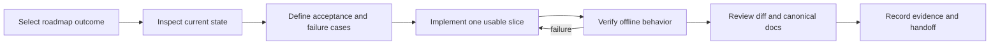

# Development workflow

This document owns how a project change moves from request to evidence.
The operator sets scope and external-action authorization. Codex implements,
verifies, and records evidence within that scope. A document or skill is not
authorization to submit orders or change broker/account settings.

For investment objectives or strategy selection, read [goals](goals.md).
For external repositories, papers, or reported results, follow
[research intake](research-intake.md) before adopting code or performance claims.

## Start a task

1. Read root README, the relevant roadmap milestone, and module owner document.
2. Inspect Git status and existing implementation. Preserve unrelated files. Until
   the first baseline commit, record file hashes for touched implementation inputs;
   never claim a clean Git revision identifies the code.
3. For a multi-step change, create `docs/tasks/<date>-<topic>.md` from the
   [task template](templates/task.md). Define observable acceptance criteria and
   failure cases before implementation. Small edits may record this in the handoff.
4. Choose the smallest useful slice. Database work includes migration and rollback
   or recovery behavior; event work includes duplicate/restart behavior.

Ready means scope, canonical owner, acceptance criteria, and verification are clear.
Seek missing user input only when it blocks a material decision.

## Implement and verify

- Test across the module's public interface. Use fixtures and fake adapters for
  broker behavior. Ordinary checks are offline and do not start Gateway.
- Run focused checks while developing, then `make check` before handoff.
- For migrations, verify against a disposable database and exercise recovery with
  representative records. Do not call a migration validated before this exists.
- For data changes, verify duplicates, invalid inputs, timestamps, provenance, and
  immutable source handling. For worker changes, exercise failure and restart.
- Inspect generated UI or reports when changed; include representative visual
  evidence. Label simulated state and unavailable data.
- Preserve raw failure evidence in ignored `.local/`; publish redacted outcomes.

## Finish a task

Done requires acceptance evidence, applicable checks and their results, canonical
documentation updates, and an honest account of remaining limitations. Record
changed paths, commands/results, timestamps, and code/data identity. A passing
offline suite proves only the behavior it exercised.

Update README when capability availability changes and roadmap only when milestone
acceptance is met. Update a decision record when changing an architectural choice.
Task closure does not establish paper or live readiness.

Commits and remote publication follow the requested task scope. Before the first
commit, review ignored paths and staged content for secrets, account identifiers,
and generated bulk data. This SOP does not automatically stage or publish files.

## Working rhythm

- Start each session: identify the current milestone and one concrete outcome.
- End each session: leave the task status, evidence, blocker, and next action.
- After an incident: preserve evidence and address its demonstrated cause before
  expanding operation.
- When capabilities change: review roadmap sequence and affected SOPs. Add a new
  skill only for a repeatable workflow that the existing skills do not cover.
