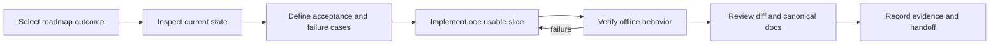
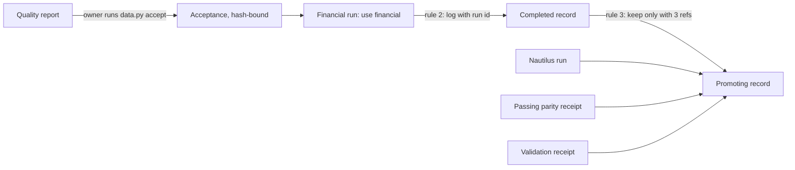

# Development workflow

This document owns how a project change moves from request to evidence.
The operator sets scope and external-action authorization. Codex implements,
verifies, and records evidence within that scope. A document or skill is not
authorization to submit orders or change broker/account settings.



For investment objectives or strategy selection, read [goals](goals.md).
For external repositories, papers, or reported results, follow
[research intake](research-intake.md) before adopting code or performance claims.

## Start a task

1. Read root README, the relevant roadmap milestone, and module owner document.
2. Inspect Git status and existing implementation. Preserve unrelated files. Until
   the first baseline commit, record file hashes for touched implementation inputs;
   never claim a clean Git revision identifies the code.
3. For a multi-step change, create `docs/tasks/<date>-<topic>.md` from the
   [task template](templates/task.md). Define observable acceptance criteria and
   failure cases before implementation. Small edits may record this in the handoff.
4. Choose the smallest useful slice. Database work includes migration and rollback
   or recovery behavior; event work includes duplicate/restart behavior.

Ready means scope, canonical owner, acceptance criteria, and verification are clear.
Seek missing user input only when it blocks a material decision.

## Implement and verify

For changes involving NautilusTrader or MLflow, first apply the
[dependency boundary decision](architecture.md#configure-extend-upgrade-or-patch).
Record whether the change configures a supported feature, extends a public
interface, upgrades a pinned dependency or requires a separately maintained
upstream patch. Follow that choice's evidence requirements before adoption.

- Test across the module's public interface. Use fixtures and fake adapters for
  broker behavior. Ordinary checks are offline and do not start Gateway.
- Run focused checks while developing, then `make check` before handoff.
- For migrations, verify against a disposable database and exercise recovery with
  representative records. Do not call a migration validated before this exists.
- For data changes, verify duplicates, invalid inputs, timestamps, provenance, and
  immutable source handling. For worker changes, exercise failure and restart.
- Inspect generated UI or reports when changed; include representative visual
  evidence. Label simulated state and unavailable data.
- Preserve raw failure evidence in ignored `.local/`; publish redacted outcomes.

## Finish a task

Done requires acceptance evidence, applicable checks and their results, canonical
documentation updates, and an honest account of remaining limitations. Record
changed paths, commands/results, timestamps, and code/data identity. A passing
offline suite proves only the behavior it exercised.

Update README when capability availability changes and roadmap only when milestone
acceptance is met. Update a decision record when changing an architectural choice.
Task closure does not establish paper or live readiness. New research cycles additionally
require the [GRS versioned receipt check](research-standard.md#experiment-receipt-contract)
and [management closure handoff](operations/recursive-research.md#research-management);
historical evidence is preserved rather than retroactively rewritten.

Commits and remote publication follow the requested task scope. Before the first
commit, review ignored paths and staged content for secrets, account identifiers,
and generated bulk data. This SOP does not automatically stage or publish files.

## Working rhythm

- Start each session: identify the current milestone and one concrete outcome.
- End each session: leave the task status, evidence, blocker, and next action.
- After an incident: preserve evidence and address its demonstrated cause before
  expanding operation.
- When capabilities change: review roadmap sequence and affected SOPs. Add a new
  skill only for a repeatable workflow that the existing skills do not cover.

## Plans, branches and review

- One PR per plan. Plans are stacked and a plan's PR is merged before the plan
  after next starts.
- One implementer at a time per branch.
- The owner may authorise a continuous multi-plan run; while it stands, the per-plan
  checkpoint is replaced by a per-plan report (PR link, rulings, deferred minors,
  score changes). Stops for destructive actions, credentials, new dependencies and
  refused external sources still apply.
- Plan edits during execution happen only through ledger rulings, committed
  between tasks.
- The user is a checkpoint at the start of each plan and at each PR.
- Generated-file conflicts: take either side, re-run the generator, never
  hand-merge. Each generated doc names its generator in its
  "Generated by scripts/<x>.py render" header; re-run that generator. The
  [artifact catalog](artifacts.md) and [readiness checklist](readiness-checklist.md)
  are two such docs.
- Shared identity, units, metric, cost, window and trial rules are owned by
  [research conventions](conventions.md); link them rather than restating.
- Definition of done per plan: every task's acceptance evidence is recorded, `make check`
  passes with no `PYTHON=` override, canonical docs and generated views are
  updated, readiness is re-scored (aspects whose next action the plan completed;
  other scores unchanged) and the checklist re-rendered, and remaining
  limitations are stated.
- Dependency adoption: capability review first, and the lock update in its own
  commit.
- `.local/scratch/` holds exploration. It counts as evidence only once it is
  reproduced through the harness (a committed test or script with a receipt).

## Enforced research rules

Three research rules are enforced by tools, not by habit. Each has a failing-then-passing
test; [the end-to-end scenario](../tests/current/test_enforced_rules.py) walks all three on
temporary roots.



1. **Financial use needs an accepted quality report.**
   - A run is financial when its spec or command says `use: financial`; everything else is
     `engineering` (the default, and what screening and parity runs are).
   - A `pass` report needs nothing. A `pass-with-exceptions` report needs an acceptance
     covering every check that is not `pass`. A `fail` report is never loadable.
   - **Only the owner accepts.** Agents never run `scripts/data.py accept`, and no other
     code path records an acceptance. The acceptance names one report by SHA-256, so a
     changed report or dataset invalidates it.
2. **A completed record needs a run output.** A new record (not `imported`) that is not
   `blocked` needs `refs.run_id` and the run manifest's SHA-256, and that run must be
   `use: financial` with a passing or accepted quality status. At log time the tool does
   not trust the gate fields written in the manifest: it re-runs the financial-use check on
   the quality report folder the manifest names (read inside the data root only) and
   compares the acceptance hash; a report it cannot read is a rejection. The optional
   `attempt` field (`completed` by default, `failed`, `abandoned`) lets an attempt that
   never produced a run be logged honestly; those need no run output, and are never `keep`.
3. **Promotion needs a NautilusTrader run, a passing parity receipt and a separate-role
   validation receipt.** The registry disposition that promotes is `keep`; retire, control
   and inconclusive do not. A `keep` record is never `imported` and never `failed` or
   `abandoned`. It needs:
   - a nautilus run that meets the same financial requirement as the candidate run
     (`use: financial`, quality pass or accepted, gate re-verified) and is bound to it: the
     same `datasets.manifest_sha256` and the same config `strategy`, `market` and
     `instruments` (the engine differs by design). A parity run is an engineering run, so it
     does not qualify;
   - a clean passing parity receipt, with no engine file changed between its commit and the
     run's commit. Both commits must be full 40-hex SHAs (not `HEAD`, a branch, a short SHA
     or `+dirty`); the engine files are the evaluation engine modules, `run_output.py` and
     `requirements.lock.txt`;
   - a tracked [validation receipt](skills.md): a Validation-role skill that is not a
     researcher skill, result `pass`, at least one check with status `pass` (waived checks
     alone are not evidence), covering both run ids and naming the same parity receipt as
     the record. At log time the receipt must live in the tracked
     `research/registry/validation-receipts/` directory and be tracked by git, so commit it
     first. `--receipts-dir` elsewhere is refused unless the test-only
     `--allow-untracked-receipts` flag is given (it prints a warning).

Where each is enforced:

| Rule | At `scripts/experiments.py log` (reads local files) | In `make check` (tracked material only) |
| --- | --- | --- |
| 1 financial gate | `scripts/analysis.py run` refuses before writing anything | not checked (local data is absent in CI) |
| 2 run output | manifest exists, SHA-256 matches, `use: financial`, quality gate re-verified from the report and acceptance on disk | record shape: `run_id` and hash present |
| 3 promotion | nautilus run financial and bound to the candidate (dataset hash, strategy, market, instruments), parity receipt clean and passing, engine files unchanged between full-SHA commits, validation receipt valid, tracked by git and naming the same parity receipt | record shape (never `imported`, `failed` or `abandoned`), plus the tracked validation receipt (hash, allowed validator, `pass`, a passing check, run ids, parity receipt id) |

The 110 records logged before these rules (`imported`) are exempt and validate unchanged;
none of them is a `keep`.

Limits, stated plainly:

- A parity receipt vouches for the **engine code** (engine-file identity between commits),
  not for the candidate strategy.
- Roles in a validation receipt are **self-reported**. The tool enforces separation of
  recorded roles, not the independence of the model or session that produced the work.
- Acceptance is bound to a report hash, not to what the owner understood when accepting.
- The registry is an append-only local file with a hash chain. A self-consistent
  hand-forged chain (runs, receipts and records all written by hand) is outside what such a
  file can prevent; the rules stop mistakes and shortcuts, not a determined forger.
- No `keep` can be logged in practice yet: no command produces a candidate's NautilusTrader
  run. Parity runs are engineering runs and are now rejected as the nautilus run (see the
  [design](tasks/2026-11-17-offline-research-infra-design.md#three-rules)).

## Combining run outputs

To combine runs, use `scripts/portfolio.py combine` then `report`: a real combination needs
`--cycle-id` (it counts as a trial), a demonstration uses `--exploratory`. Rules:
[combinations](conventions.md#combinations); example: [portfolio record](tasks/2026-11-18-portfolio.md).

## Test budget and interpreter

`make test` runs `scripts/run_tests.py`, which discovers `tests/`, times each
test and prints the slowest ten. It fails, naming the test, if any single test
exceeds 30 s. The CI budget is a whole suite of at most 5 minutes and any single
test at most 30 s. Real-data runs are local targets with receipts, not CI tests.

`PYTHON` defaults to `.venv/bin/python` when it exists (CI and the main checkout),
otherwise to the main checkout's `.venv/bin/python`, derived from the Git common
directory (`rev-parse --git-common-dir`), so a worktree needs no virtualenv of its
own. Override with `make PYTHON=<interpreter> ...`.

## Continuous integration

`make check` includes `make evidence-index-check`: published plans need one study
owner, references must resolve, and committed generated views must match their
sources. Update the curated registry when adding a study, then run `make research-index`.
The [index contract](architecture.md#research-evidence-index) owns availability
labels and scope; original evidence remains authoritative.

`make check` includes `make boundaries-check`, an offline static dependency and
frozen-source gate. The [architecture contract](architecture.md#enforced-python-dependency-boundaries)
owns its scope and exemptions; reverse imports, cycles and modified protected
files fail the PR/push checks.

[GitHub Actions CI](../.github/workflows/ci.yml) runs `make check` for every pull
request and branch/tag push. One Ubuntu 24.04 job uses Python 3.12, installs the
locked binary dependencies plus direct requirements into `.venv`, then checks
documentation, dependency consistency and offline tests. The dependency cache is
keyed by both requirements files; changes on the same event/ref cancel stale runs.
The job has a 15-minute timeout, read-only repository access and no persisted Git
credentials. Actions are pinned to full commit revisions; update pins deliberately.

```text
PR / push → pinned environment → make check → GitHub check result
```

Dependency installation requires package-network access. Tests use saved/synthetic
fixtures and do not start Gateway, submit orders, train models, launch MLflow or
run strategy-suite batches. CI validates the checked-out branch's tests; it does
not reproduce every historical report or establish broker readiness. The same
workflow automatically covers additional tests when research branches include it.

This reuses the pinned actions, explicit permissions and credential-free checkout
practices in [NautilusTrader's test workflow](https://github.com/nautechsystems/nautilus_trader/blob/b23139911fd9fed82aed2811c5a8a373202b9480/.github/workflows/test.yml).
Their Rust builds, self-hosted runners, release jobs and deployment credentials
are outside this project's CI requirements. No CD or branch-protection rule is
configured by this workflow. Requiring a successful check before merging is a
separate repository setting.
