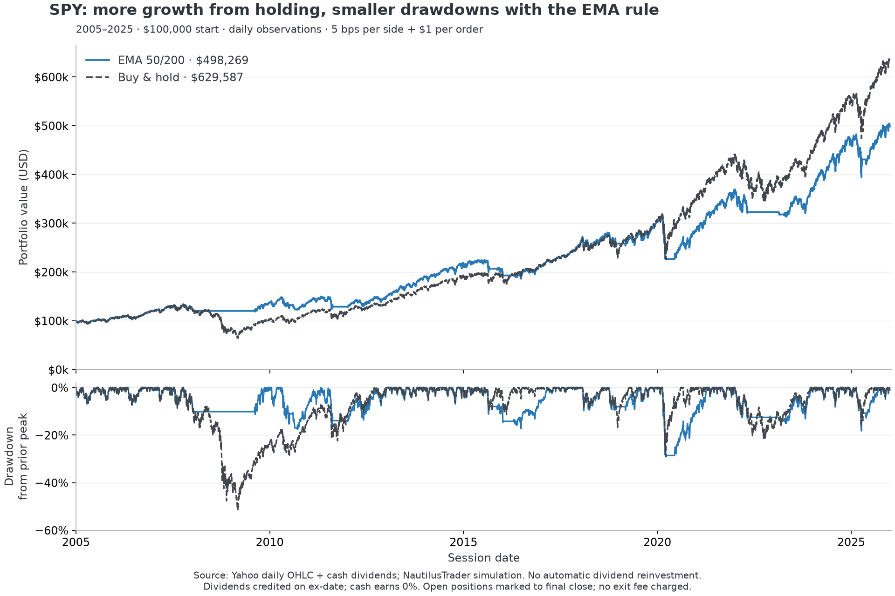

# SPY: EMA 50/200 versus buy-and-hold

Status: completed historical simulation, independently reconciled. Generated 2026-10-24T23:57:46.728801-07:00.
Methodology owner: [research/README.md](../../../research/README.md).

Buy-and-hold finished **$131,317 ahead**. The EMA rule reduced the largest daily-close decline from 51.7% to 28.6%. This one fixed-rule historical comparison does not establish a durable trading edge.



| Measure | EMA 50/200 | Buy & hold, cash dividends |
|---|---:|---:|
| Ending portfolio value | $498,269.20 | $629,586.54 |
| Total return | 398.27% | 529.59% |
| Annualized compound return | 7.95% | 9.16% |
| Maximum daily-close drawdown | -28.60% | -51.68% |
| Annualized daily volatility | 13.17% | 16.75% |
| Sharpe (0% risk-free assumption) | 0.65 | 0.61 |
| Sessions holding SPY | 80.71% | 100.00% |
| Filled orders | 25 | 1 |
| Cash dividends credited | $63,101.93 | $73,503.34 |
| Commission paid | $25.00 | $1.00 |
| Modeled spread/slippage cost | $2,657.21 | $48.84 |

## Experiment

- SPY daily data: 2005-01-03 through 2025-12-31, 5,283 sessions. Calendar 2004 is indicator warm-up only.
- Starting cash: $100,000 each; whole shares; cash account; no shorting or borrowing.
- EMA rule: after each daily close, hold SPY when EMA(50) > EMA(200), otherwise cash. Changes execute at the **next session open**. The first signal uses completed 2004 history.
- Each entry allocates approximately 99% of available cash. No continuous rebalancing. Buy-and-hold buys at the first tested open and retains the shares.
- $1 commission per filled order and 5 basis points of combined half-spread/slippage per side, rounded to the cent. These are illustrative assumptions, not an IBKR pricing quote. Cost is embedded in synthetic bid/ask quotes; the augmented fill CSV records it separately.
- Dividends are credited to cash on ex-date based on the prior session's holdings. They are **not automatically reinvested**. The EMA rule can redeploy accumulated cash on a later entry; buy-and-hold retains its dividends in cash.
- End values mark any open shares to the last close; neither portfolio is forced to sell. Exit costs for those final holdings are not charged. Cash interest and taxes are zero.

## Checks

All 5,283 daily balances in each portfolio and all 26 fills match a separate pandas/Decimal ledger within five cents. Audit details and the raw-data SHA-256 are in [manifest.json](manifest.json). Checks cover prior-close signals, next-open prices, sizing, dividend entitlement, fees, and cash borrowing. Behavior tests also verify that changing future data cannot alter earlier results.

## Interpretation limits

This is one historical period and one manually selected rule, with no parameter search and no independent holdout claim. The daily OHLC feed comes from Yahoo Finance and has not been independently reconciled against an exchange feed. Raw closes drive the signal; Yahoo adjusted close is not used. No splits occur in this snapshot; the loader rejects snapshots with splits.

The simulator uses synthetic open/close quotes, not observed bid/ask history. It assumes complete fills, ample liquidity, immediate settlement, and generic 09:30/16:00 New York event times; early-close sessions are not modeled intraday. Drawdowns use daily closes and can understate intraday losses. Dividends are made available before their actual payment dates. The buy-and-hold benchmark is not a dividend-reinvestment total-return index. None of these results verifies an IBKR connection or future execution quality.

## Reproduce and inspect

From the workspace root:

```sh
.venv/bin/python scripts/spy_backtest.py --data reports/spy/20261024-235746-728801/source-data.json
.venv/bin/python -m unittest discover -s tests -v
```

Each run writes a new folder. The frozen [source snapshot](source-data.json), normalized [daily inputs](input_daily.csv), per-portfolio equity/fill/dividend files, [annual returns](annual_returns.csv), and [chart source data](chart_data.csv) are retained together. Reproduction does not refresh or replace the snapshot.
